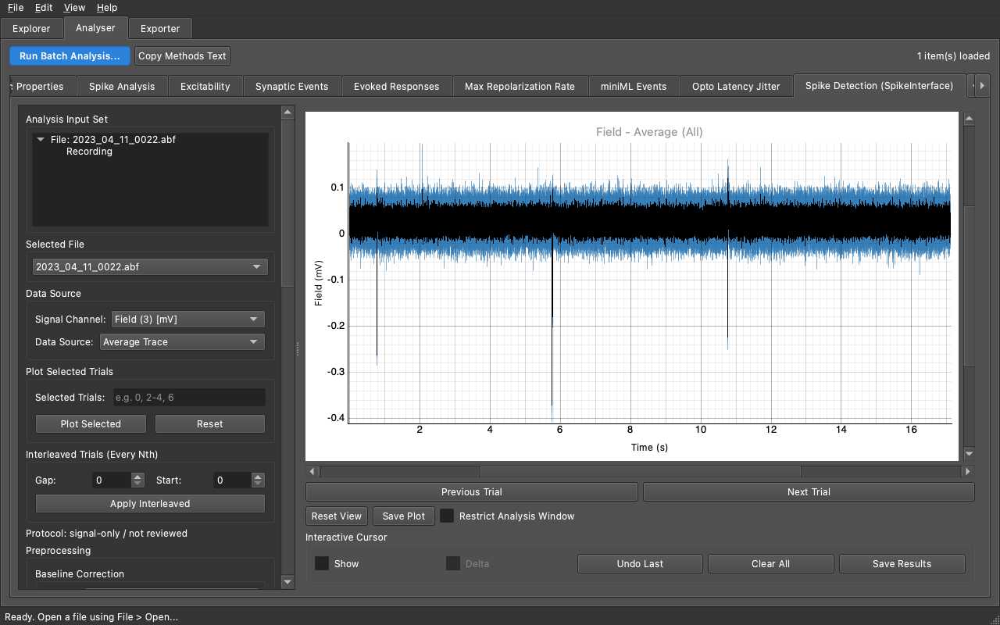
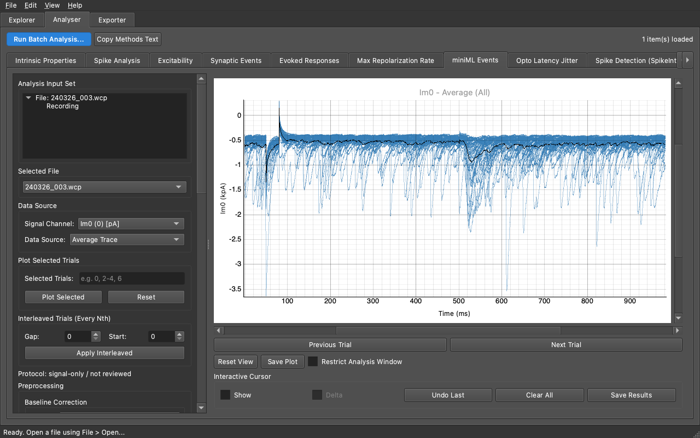
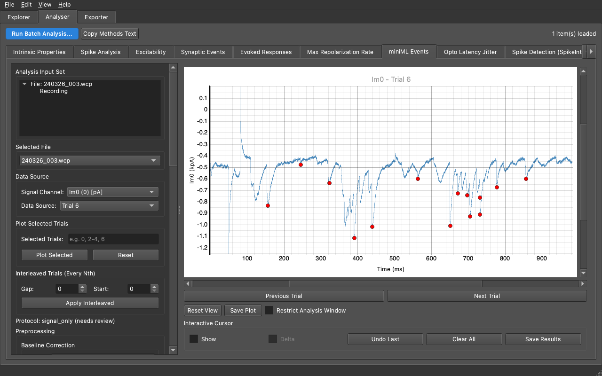

# Writing Custom Analysis Plugins for Synaptipy

This guide explains how to add custom analysis functions and signal
preprocessors to Synaptipy **without modifying any Synaptipy source code**.
Write a single Python file, save it in `~/.synaptipy/plugins/`, and load it into
the GUI Analyser and headless batch engine.

---

## Table of Contents

1. [Overview - How the Plugin System Works](#1-overview-how-the-plugin-system-works)
2. [Getting Started - Your First Plugin in 5 Minutes](#2-getting-started-your-first-plugin-in-5-minutes)
3. [The Plugin File - Anatomy of a Custom Analysis](#3-the-plugin-file-anatomy-of-a-custom-analysis)
   - [3.1 Part 1: Pure Analysis Logic](#31-part-1-pure-analysis-logic)
   - [3.2 Part 2: Registry Wrapper](#32-part-2-registry-wrapper)
   - [3.3 Return Dict Conventions](#33-return-dict-conventions)
   - [3.4 The `expects_list` Parameter](#34-the-expects_list-parameter)
   - [3.5 Registering Custom Signal Preprocessors](#35-registering-custom-signal-preprocessors)
4. [Defining GUI Parameters (`ui_params`)](#4-defining-gui-parameters-ui_params)
   - [4.1 `float` Parameter](#41-float-parameter)
   - [4.2 `int` Parameter](#42-int-parameter)
   - [4.3 `choice` / `combo` Parameter](#43-choice-combo-parameter)
   - [4.4 `bool` Parameter](#44-bool-parameter)
   - [4.5 `string` Parameter](#45-string-parameter)
   - [4.6 `filepath` Parameter (with Browse button)](#46-filepath-parameter-with-browse-button)
   - [4.7 `dirpath` Parameter (with Browse button)](#47-dirpath-parameter-with-browse-button)
   - [4.8 Common Optional Fields](#48-common-optional-fields)
   - [4.9 Conditional Visibility (`visible_when`)](#49-conditional-visibility-visible_when)
5. [Defining Plot Overlays (`plots`)](#5-defining-plot-overlays-plots)
   - [5.1 `hlines` - Horizontal Lines](#51-hlines-horizontal-lines)
   - [5.2 `vlines` - Vertical Lines](#52-vlines-vertical-lines)
   - [5.3 `markers` - Scatter Points](#53-markers-scatter-points)
   - [5.4 `interactive_region` - Draggable Region](#54-interactive_region-draggable-region)
   - [5.5 `threshold_line` - Draggable Threshold](#55-threshold_line-draggable-threshold)
   - [5.6 `overlay_fit` - Curve Overlay](#56-overlay_fit-curve-overlay)
   - [5.7 `popup_xy` - Popup Scatter/Line Plot](#57-popup_xy-popup-scatterline-plot)
   - [5.8 `brackets` - Burst/Event Brackets](#58-brackets-burstevent-brackets)
   - [5.9 `event_markers` - Interactive Event Points](#59-event_markers-interactive-event-points)
   - [5.10 `trace` - Base Trace with Overlay](#510-trace-base-trace-with-overlay)
   - [5.11 `fill_between` - Shaded Region Between Two Curves](#511-fill_between-shaded-region-between-two-curves)
   - [5.12 `trace_overlay` - Highlight a Region on the Raw Trace](#512-trace_overlay-highlight-a-region-on-the-raw-trace)
   - [5.13 `event_fit_overlay` - Overlay Fitted Event Decay Curves](#513-event_fit_overlay-overlay-fitted-event-decay-curves)
6. [Where to Put Your Plugin File](#6-where-to-put-your-plugin-file)
7. [For Core Contributors - 5-Pillar Architecture Rules](#7-for-core-contributors-5-pillar-architecture-rules)
8. [Testing Your Plugin](#8-testing-your-plugin)
9. [Full Annotated Example - Synaptic Charge Transfer](#9-full-annotated-example-synaptic-charge-transfer)
10. [Plot Overlay Styling and Customization](#10-plot-overlay-styling-and-customization)
11. [SpikeInterface Integration Plugin](#11-spikeinterface-integration-plugin)
12. [Deep Learning and Third-Party Integrations (miniML)](#12-deep-learning-and-third-party-integrations-miniml)
13. [Troubleshooting](#13-troubleshooting)

---

## 1. Overview - How the Plugin System Works

Synaptipy has a central **`AnalysisRegistry`** class that maps named analysis
and preprocessing functions to the GUI and batch engine. Register a function by
decorating it with `@AnalysisRegistry.register(...)` (or
`@AnalysisRegistry.register_processor(...)` for signal preprocessors). The
decorator stores the callable together with its UI parameter definitions, plot
overlays, protocol declarations, and display label.

At startup (or during an in-process hot-reload), Synaptipy:

1. Loads all **built-in** analyses and preprocessors from `src/synaptipy/core/analysis/`
   and snapshots their keys as the immutable core registry set.
2. Scans `~/.synaptipy/plugins/` for personal, downloaded, or third-party
   plugins when **Enable Custom Plugins** is active in **Edit > Preferences**
   (**Extensions** group on the **General** tab). Example plugins can be
   installed on demand via **Help > Download Example Plugins...**; source
   checkouts and desktop bundles may also expose `examples/plugins/` directly.
   When a file with the same stem exists in both locations, the user copy in
   `~/.synaptipy/plugins/` takes precedence and logs a warning.
3. Prompts for one-time user confirmation per SHA-256 content fingerprint before
   executing new or modified code from `~/.synaptipy/plugins/`.
4. Builds the Analyser GUI. After the five immutable core pillar tabs, every
   registered custom analysis automatically receives a `MetadataDrivenAnalysisTab`
   containing parameter widgets, an optional Run button, a results table, and
   interactive plot overlays.

```text
┌──────────────────────────────────────────────────────────┐
│  ~/.synaptipy/plugins/synaptic_charge.py                 │
│                                                          │
│  @AnalysisRegistry.register(                             │
│      name="synaptic_charge",                             │
│      label="Synaptic Charge (AUC)",                      │
│      ui_params=[...],                                    │
│      plots=[...]                                         │
│  )                                                       │
│  def run_auc(data, time, sampling_rate, **kwargs):       │
│      ...                                                 │
│      return {"Charge_pC": -1.23,                         │
│              "Baseline_pA": -42.0,                       │
│              "_int_x": win_t, "_int_y": win_d}           │
└──────────────────────────────────────────────────────────┘
         │
         v  startup / hot-reload -> PluginManager.load_plugins()
┌──────────────────────────────────────────────────────────┐
│  AnalysisRegistry                                        │
│  ├── passive_properties    (core pillar 1)               │
│  ├── single_spike          (core pillar 2)               │
│  ├── firing_dynamics       (core pillar 3)               │
│  ├── synaptic_events       (core pillar 4)               │
│  ├── evoked_responses      (core pillar 5)               │
│  └── synaptic_charge       <-- YOUR PLUGIN               │
└──────────────────────────────────────────────────────────┘
         │
         v  GUI build -> auto-generated MetadataDrivenAnalysisTab
┌──────────────────────────────────────────────────────────┐
│  Analyser Tab:  ... | Synaptic Events | Evoked Responses │
│                     | Synaptic Charge (AUC) <--          │
│  ┌────────────────────────────────────────────┐          │
│  │ Search Window Start (s): [0.0000     ]     │          │
│  │ Search Window End (s):   [0.1000     ]     │          │
│  │ Local Baseline (ms):     [10.0       ]     │          │
│  │ ──────────────────────────────────────      │          │
│  │ Results: Charge_pC = -1.23                 │          │
│  └────────────────────────────────────────────┘          │
└──────────────────────────────────────────────────────────┘
```

**No GUI code is required.** The `ui_params` list generates the parameter
controls, and the `plots` list renders the trace overlays from declarative
metadata.

### Scientific Input Declarations

Plugins can declare the recording context required for their output to be
scientifically valid:

```python
@AnalysisRegistry.register(
    name="my_evoked_metric",
    requires_secondary_channel={
        "param_name": "ttl_data",
        "label": "TTL / Stimulus Channel:",
    },
    protocol_requirements={
        "families": ("optogenetic", "single_stim"),
        "requires_stimulus_timing": True,
    },
    supported_channel_units=("pA",),
)
def run_my_evoked_metric(data, time, sampling_rate, **kwargs):
    ...
```

`requires_secondary_channel` must be a dictionary, not `True`. The GUI builds a
secondary channel selector from that dictionary. In a batch pipeline JSON, set
the top-level `secondary_channel` field to the target channel ID or native
channel name. `supported_channel_units` prevents a unit-specific plugin (such as
a picocoulomb charge integral) from executing on an incompatible channel.

---

## 2. Getting Started - Your First Plugin in 5 Minutes

1. Copy the starter template into your user plugin folder:
   ```bash
   # macOS / Linux
   mkdir -p ~/.synaptipy/plugins
   cp src/synaptipy/templates/plugin_template.py ~/.synaptipy/plugins/my_analysis.py

   # Windows (PowerShell)
   New-Item -ItemType Directory -Force "$HOME\.synaptipy\plugins"
   Copy-Item src\synaptipy\templates\plugin_template.py ~\.synaptipy\plugins\my_analysis.py
   ```

   > **Note:** User plugin directory paths by platform:
   >
   > | Platform | Path |
   > |---|---|
   > | macOS / Linux | `~/.synaptipy/plugins/` |
   > | Windows | `C:\Users\<YourUsername>\.synaptipy\plugins\` (or `%USERPROFILE%\.synaptipy\plugins` in File Explorer) |

2. Open `my_analysis.py` in a text editor.

3. Set a unique `name=` and display `label=`, configure `ui_params` and `plots`,
   and implement your pure NumPy calculation.

4. Load the plugin in Synaptipy:
   - If Synaptipy is closed, launch `synaptipy`; plugins in `~/.synaptipy/plugins/`
     are discovered automatically at startup when **Enable Custom Plugins** is checked.
   - If Synaptipy is already running, open **Edit > Preferences** (or
     **Synaptipy > Preferences** on macOS), toggle **Enable Custom Plugins** off
     and back on in the **Extensions** section, and click **Apply** or **OK** to
     hot-reload plugins in-process without restarting the application.

---

## 3. The Plugin File - Anatomy of a Custom Analysis

Every analysis plugin separates pure mathematical logic from registry metadata
in two layers:

### 3.1 Part 1: Pure Analysis Logic

Write a standard Python function with explicit typed arguments. Do not import
GUI libraries (`PySide6`, `PyQt6`, `pyqtgraph`, or `matplotlib.pyplot`).

```python
from typing import Any, Dict
import numpy as np


def calculate_area_under_curve(
    data: np.ndarray,
    time: np.ndarray,
    sampling_rate: float,
    baseline_start: float,
    baseline_end: float,
    window_start: float,
    window_end: float,
) -> Dict[str, Any]:
    """Integrate baseline-subtracted current trace to obtain synaptic charge (pC)."""
    if data.size == 0:
        return {"error": "Empty data array"}

    bl0 = int(np.searchsorted(time, baseline_start, side="left"))
    bl1 = int(np.searchsorted(time, baseline_end, side="right"))
    baseline = float(np.mean(data[bl0:bl1])) if bl1 > bl0 else 0.0

    wi0 = int(np.searchsorted(time, window_start, side="left"))
    wi1 = int(np.searchsorted(time, window_end, side="right"))
    win_t = time[wi0:wi1]
    win_d = data[wi0:wi1] - baseline

    if win_t.size < 2:
        return {"error": "Integration window too narrow (need >= 2 samples)"}

    charge_pc = float(np.trapezoid(win_d, win_t))
    return {
        "Charge_pC": round(charge_pc, 6),
        "Baseline_pA": round(baseline, 4),
        "_int_x": win_t,
        "_int_y": data[wi0:wi1],
        "_base": baseline,
    }
```

**Rules for the pure logic function:**

- Accept explicit, typed arguments rather than unvalidated `**kwargs`.
- Use NumPy vectorization (`np.trapezoid`, `np.searchsorted`, boolean masks)
  rather than Python loops over sample arrays. Note that `np.trapz` was removed
  in NumPy 2.0; always use `np.trapezoid`.
- Handle empty arrays, degenerate windows, and near-zero denominators (using an
  epsilon guard such as `abs(denom) < 1e-9` returning `np.nan`) gracefully.
- Never import GUI packages.

### 3.2 Part 2: Registry Wrapper

Decorate a thin wrapper function with `@AnalysisRegistry.register(...)`. The
wrapper extracts UI parameters from `**kwargs`, calls the pure logic function,
and returns a flat metrics dictionary.

```python
from synaptipy.core.analysis.registry import AnalysisRegistry


@AnalysisRegistry.register(
    name="synaptic_charge_basic",        # unique internal identifier
    label="Synaptic Charge (Basic)",     # sub-tab label in the Analyser
    expects_list=False,                  # True only for multi-trial statistics
    supported_channel_units=("pA",),
    ui_params=[...],                     # parameter widgets (see Section 4)
    plots=[...],                         # plot overlays (see Section 5)
)
def run_auc_wrapper(
    data: np.ndarray,
    time: np.ndarray,
    sampling_rate: float,
    **kwargs: Any,
) -> Dict[str, Any]:
    """Registry wrapper for synaptic charge integration."""
    return calculate_area_under_curve(
        data=data,
        time=time,
        sampling_rate=sampling_rate,
        baseline_start=float(kwargs.get("baseline_start", 0.0)),
        baseline_end=float(kwargs.get("baseline_end", 0.05)),
        window_start=float(kwargs.get("window_start", 0.05)),
        window_end=float(kwargs.get("window_end", 0.3)),
    )
```

**The wrapper signature is fixed:**

```python
def wrapper(data: np.ndarray, time: np.ndarray, sampling_rate: float, **kwargs: Any) -> Dict[str, Any]:
    ...
```

| Parameter | Type | Description |
|---|---|---|
| `data` | `np.ndarray` (or `list[np.ndarray]` when `expects_list=True`) | 1-D voltage or current trace for the selected sweep or average |
| `time` | `np.ndarray` (or `list[np.ndarray]` when `expects_list=True`) | 1-D time vector in seconds matching `data` |
| `sampling_rate` | `float` | Sampling frequency in Hz |
| `**kwargs` | `Any` | Current `ui_params` values keyed by their `"name"` field, plus optional secondary channel data |

### 3.3 Return Dict Conventions

Plugin wrappers should return a **flat metrics dictionary** (`Dict[str, Any]`).
`AnalysisRegistry.execute(...)` serves as the single normalization boundary: it
converts the returned dictionary into a canonical `AnalysisResult` object
(schema version 1) consumed by the GUI results table, plot manager, batch
engine, and CSV/NWB exporters.

```python
return {
    "My_Metric": 42.0,
    "Baseline_pA": -55.2,
    # Private keys prefixed with '_' feed plot overlays and are hidden from tables/CSV:
    "_overlay_x": win_time,
    "_overlay_y": win_data,
}
```

| Key / Value Pattern | Behaviour |
|---|---|
| Public scalar keys (`"Charge_pC"`, `"Jitter_ms"`) | Displayed in the GUI results table and exported as columns in wide/tidy CSVs. |
| Private keys prefixed with `_` (`"_int_x"`, `"_peak_t"`) | Stored for plot overlays (`plots=[...]`) and hidden from the results table and CSV exports. |
| `"error"` key (`{"error": "Window too narrow"}`) | Displays the error message in the GUI status/results area instead of metric rows. |
| Numeric scalars (`int`, `float`, `np.nan`) | Formatted numerically (`None` renders as `"N/A"` in the GUI and empty/NaN in CSV). |
| Legacy nested dict (`{"module_used": "...", "metrics": {...}}`) | Still accepted for backward compatibility; `AnalysisResult.from_raw` flattens `"metrics"` and preserves top-level `"error"` and `"_"` keys automatically. New plugins should return the flat dictionary above. |

> **Note:** **Custom plugins vs. core pillar modules.** Custom plugin wrappers
> return a flat `dict` that `AnalysisRegistry.execute` wraps into
> `synaptipy.core.analysis.contracts.AnalysisResult`. By contrast, the pure-logic
> functions inside Synaptipy's five built-in pillar modules (`passive_properties`,
> `single_spike`, `firing_dynamics`, `synaptic_events`, `evoked_responses`)
> return typed dataclasses from `synaptipy.core.results` (`RinResult`,
> `SingleSpikeResult`, `BurstResult`, etc.). When calling a core logic function
> directly in Python rather than through `AnalysisRegistry.execute`, read
> dataclass attributes (for example `result.rin_steady_state_mohm`) rather than
> dictionary keys.

---

### 3.4 The `expects_list` Parameter

The `expects_list` keyword argument in `@AnalysisRegistry.register(...)`
controls how `BatchAnalysisEngine` and multi-trial scopes pass sweep data to
your wrapper:

| Value | `data` / `time` passed to wrapper | When to use |
|---|---|---|
| `False` (default) | Single 1-D `np.ndarray` (individual sweep or time-aligned trial average) | Single-trace metrics (charge transfer, AP repolarization rate, tau, peak amplitude) |
| `True` | Python `list[np.ndarray]` containing one 1-D array per sweep | Trial-to-trial variability metrics (optogenetic latency jitter, failure rate across sweeps) |

When the batch pipeline scope is `"all_trials"` and `expects_list=False`, the
batch engine computes the time-aligned average across eligible sweeps before
invoking your wrapper, preventing sweep-length mismatch errors on recordings
with truncated final sweeps.

```python
# Multi-trial plugin (trial-to-trial latency jitter)
@AnalysisRegistry.register(
    name="latency_jitter",
    label="Latency Jitter",
    expects_list=True,  # wrapper receives list[np.ndarray]
    ui_params=[...],
)
def run_jitter(data, time, sampling_rate, **kwargs):
    latencies_ms = [find_first_spike_latency_ms(d, t) for d, t in zip(data, time)]
    return {"Jitter_ms": float(np.nanstd(latencies_ms))}


# Single-trace plugin (default)
@AnalysisRegistry.register(
    name="synaptic_charge",
    label="Synaptic Charge (AUC)",
    expects_list=False,  # wrapper receives 1-D np.ndarray
    ui_params=[...],
)
def run_charge(data, time, sampling_rate, **kwargs):
    return calculate_synaptic_charge(data, time, sampling_rate, **kwargs)
```

---

### 3.5 Registering Custom Signal Preprocessors

In addition to analysis tabs, plugins can register custom **signal
preprocessors** using `@AnalysisRegistry.register_processor(name, ...)` (an
alias for `@AnalysisRegistry.register(name, type="preprocessing", ...)`).

Unlike analysis wrappers, a preprocessor returns a modified 1-D `np.ndarray`
signal trace of the same shape and units as `data`. `AnalysisRegistry.execute`
leaves `type="preprocessing"` outputs as raw `np.ndarray` arrays rather than
wrapping them in `AnalysisResult`, allowing preprocessors to be chained ahead of
analyses in `BatchAnalysisEngine` and `synaptipy-batch` pipeline JSON files
alongside the 7 built-in preprocessors (`baseline_subtraction`, `lowpass_filter`,
`highpass_filter`, `bandpass_filter`, `notch_filter`, `comb_filter`, and
`detrend_filter`).

```python
import numpy as np
from scipy.ndimage import median_filter
from synaptipy.core.analysis.registry import AnalysisRegistry


@AnalysisRegistry.register_processor("median_despike", label="Median Despike Filter")
def run_median_despike_processor(
    data: np.ndarray,
    time: np.ndarray,
    sampling_rate: float,
    **kwargs,
) -> np.ndarray:
    """Suppress isolated single-sample hardware glitches with a short median window."""
    if data is None or data.size == 0:
        return data
    kernel_samples = max(3, int(kwargs.get("kernel_samples", 5)))
    if kernel_samples % 2 == 0:
        kernel_samples += 1
    return median_filter(np.asarray(data, dtype=float), size=kernel_samples)
```

Inspect all available preprocessors with:

```python
from synaptipy.core.analysis.registry import AnalysisRegistry

print(AnalysisRegistry.list_preprocessing())
```

---

## 4. Defining GUI Parameters (`ui_params`)

The `ui_params` list in `@AnalysisRegistry.register(...)` defines the parameter
widgets generated in your Analyser tab. Each entry is a dictionary describing
one control.

### 4.1 `float` Parameter

Creates a double-precision spin box (`QDoubleSpinBox`).

```python
{
    "name": "threshold",          # keyword argument passed to your wrapper
    "label": "Threshold (mV):",   # label text shown in the GUI
    "type": "float",
    "default": -20.0,             # initial value (default: 0.0)
    "min": -200.0,                # minimum allowed (default: -1e9)
    "max": 200.0,                 # maximum allowed (default: 1e9)
    "decimals": 2,                # decimal places (default: 4)
    "step": 0.5,                  # step increment (optional)
}
```

### 4.2 `int` Parameter

Creates an integer spin box (`QSpinBox`).

```python
{
    "name": "min_spikes",
    "label": "Min Spikes:",
    "type": "int",
    "default": 3,
    "min": 1,
    "max": 10000,
}
```

### 4.3 `choice` / `combo` Parameter

Creates a drop-down selector (`QComboBox`).

```python
{
    "name": "direction",
    "label": "Detection Direction:",
    "type": "choice",             # "combo" is also accepted
    "choices": ["negative", "positive", "both"],
    "default": "negative",
}
```

> **Note:** Both `"choices"` and `"options"` are accepted for listing combo-box items.

### 4.4 `bool` Parameter

Creates a check box (`QCheckBox`).

```python
{
    "name": "auto_detect",
    "label": "Auto-Detect Baseline",
    "type": "bool",
    "default": False,
}
```

### 4.5 `string` Parameter

Creates a text entry field (`QLineEdit`) for free-form strings or identifiers.

```python
{
    "name": "cell_label",
    "label": "Cell Label:",
    "type": "string",             # aliases: "str", "path"
    "default": "",
    "placeholder": "e.g. CA1 pyramidal",
    "tooltip": "Optional label stored in the results table.",
}
```

### 4.6 `filepath` Parameter (with Browse button)

Creates a `QLineEdit` paired with a **Browse...** button that opens a file-picker
dialog (pre-filtered to `*.h5 *.keras` model files, with an all-files option).

```python
{
    "name": "model_path",
    "label": "Model Path (.h5):",
    "type": "filepath",
    "default": "",
    "placeholder": "/path/to/model.h5",
    "tooltip": "Absolute path to the trained model file.",
}
```

### 4.7 `dirpath` Parameter (with Browse button)

Creates a `QLineEdit` paired with a **Browse...** button that opens a directory
picker. Use this when a plugin dynamically adds an external repository folder to
`sys.path`.

```python
{
    "name": "miniml_core_path",
    "label": "miniML core/ Path:",
    "type": "dirpath",
    "default": "",
    "placeholder": "/path/to/miniML/core",
    "tooltip": "Folder containing miniML.py (click Browse to select).",
}
```

### 4.8 Common Optional Fields

These optional keys apply to any `ui_params` entry:

| Field | Type | Description |
|---|---|---|
| `"tooltip"` | `str` | Hover tooltip explaining the parameter's scientific role. |
| `"hidden"` | `bool` | When `True`, omits the widget from the GUI while keeping the default in metadata. |
| `"visible_when"` | `dict` | Shows or hides the widget dynamically based on another parameter or clamp context. |

### 4.9 Conditional Visibility (`visible_when`)

Show or hide a parameter widget based on the active value of a sibling widget:

```python
ui_params=[
    {
        "name": "event_type",
        "type": "choice",
        "choices": ["Spikes", "EPSCs"],
        "label": "Event Type:",
        "default": "Spikes",
    },
    {
        "name": "spike_threshold",
        "type": "float",
        "default": -20.0,
        "label": "Spike Threshold (mV):",
        "visible_when": {"param": "event_type", "value": "Spikes"},
    },
    {
        "name": "epsc_threshold",
        "type": "float",
        "default": -5.0,
        "label": "EPSC Threshold (pA):",
        "visible_when": {"param": "event_type", "value": "EPSCs"},
    },
]
```

Clamp-mode context rules are also supported:

```python
{
    "name": "step_current_pa",
    "type": "float",
    "default": -20.0,
    "label": "Injected Current (pA):",
    "visible_when": {"context": "clamp_mode", "value": "current_clamp"},
}
```

---

## 5. Defining Plot Overlays (`plots`)

The `plots` list in `@AnalysisRegistry.register(...)` declares visual overlays
drawn on the trace canvas after analysis runs.

### 5.1 `hlines` - Horizontal Lines

Draws horizontal `InfiniteLine` items at y-coordinates read from result metrics.

```python
{"type": "hlines", "data": ["Baseline_pA"], "color": "b", "styles": ["dash"]}
{"type": "hlines", "data": ["mean", "mean_plus_sd", "mean_minus_sd"],
 "color": "b", "styles": ["solid", "dash", "dash"]}
```

| Field | Description |
|---|---|
| `data` | List of result-dict keys (each finite scalar value draws one horizontal line). |
| `color` | Line colour string or hex code (default `"r"`). |
| `styles` | List of `"solid"` or `"dash"`, one per entry in `data` (default: all `"solid"`). |

### 5.2 `vlines` - Vertical Lines

Draws vertical `InfiniteLine` items at x-positions (seconds).

```python
{"type": "vlines", "data": "_stimulus_times", "color": "c"}
```

| Field | Description |
|---|---|
| `data` | Result-dict key holding a scalar or 1-D array of x-positions (seconds). |
| `color` | Line colour. When omitted, uses the global **H/V Lines** pen from **View > Plot Customization...**. |

### 5.3 `markers` - Scatter Points

Draws `ScatterPlotItem` markers at `(x, y)` coordinates read from result arrays.

```python
{"type": "markers", "x": "_peak_t", "y": "_peak_v", "color": "r", "symbol": "star"}
```

| Field | Description |
|---|---|
| `x`, `y` | Result-dict keys holding equal-length 1-D coordinate arrays. |
| `color` | Marker fill colour. When omitted, uses the global **Scatter Points** style from **View > Plot Customization...**. |
| `symbol` | `pyqtgraph` symbol code such as `"o"`, `"t"`, `"d"`, `"s"`, `"+"`, or `"star"` (default `"o"`). |

### 5.4 `interactive_region` - Draggable Region

Creates a vertical `LinearRegionItem` bidirectionally synced with two `float`
parameter spinboxes.

```python
{"type": "interactive_region", "data": ["window_start", "window_end"], "color": "blue"}
```

`"data"` must be a 2-element list of `ui_params` `"name"` strings (not result
keys). Note that `MetadataDrivenAnalysisTab` renders a single custom
`interactive_region` entry from `plots=[...]` (unless your parameters use the
built-in paired names `baseline_start`/`baseline_end` and
`response_start`/`response_end`, which are auto-registered as dual regions).

### 5.5 `threshold_line` - Draggable Threshold

Creates a draggable horizontal line synced to a `float` parameter spinbox.

```python
{"type": "threshold_line", "param": "threshold"}
```

### 5.6 `overlay_fit` - Curve Overlay

Plots a fitted curve (such as an exponential decay) over the raw trace.

```python
{
    "type": "overlay_fit",
    "x": "_fit_time",
    "y": "_fit_values",
    "color": "r",
    "width": 2,
    "label": "Exponential Fit",
}
```

### 5.7 `popup_xy` - Popup Scatter/Line Plot

Opens an interactive secondary plot window (for I-V or F-I relationships) when
requested in the Analyser tab.

```python
{
    "type": "popup_xy",
    "title": "F-I Curve",
    "x": "current_steps_pa",
    "y": "firing_rates_hz",
    "x_label": "Current (pA)",
    "y_label": "Firing Rate (Hz)",
}
```

Optionally supply `"slope_key"` and `"intercept_key"` to overlay a linear
regression line.

### 5.8 `brackets` - Burst/Event Brackets

Draws horizontal bracket bars above detected burst groups.

```python
{"type": "brackets", "data": "bursts", "color": "r"}
```

`"data"` must reference a list of spike-time arrays (one array per burst).

### 5.9 `event_markers` - Interactive Event Points

Renders curatable event markers supporting click-to-remove and Ctrl+click-to-add.

```python
{"type": "event_markers"}
```

Reads `event_indices` from the analysis result automatically.

### 5.10 `trace` - Base Trace with Overlay

Plots the base trace with optional detected spike or event markers.

```python
{"type": "trace", "show_spikes": True}
```

### 5.11 `fill_between` - Shaded Region Between Two Curves

Draws a translucent `FillBetweenItem` between a primary curve (`y1`) and a
baseline array or scalar (`y2`), suitable for visualizing integrated synaptic
charge or area under the curve.

```python
{
    "type": "fill_between",
    "x": "_int_x",                # shared time array key
    "y1": "_int_y",               # primary curve array key
    "y2": "_baseline",            # baseline array or scalar key (default: 0.0)
    "brush": (0, 150, 255, 100),  # RGBA fill tuple
}
```

`y2` may point to a 1-D array matching `y1`, a scalar float (expanded to a
constant horizontal baseline), or be omitted (`0.0`). Return the referenced
arrays as `_`-prefixed keys in your flat result dictionary:

```python
return {
    "Charge_pC": round(charge_pc, 6),
    "Baseline_pA": round(baseline_val, 4),
    "_int_x": int_x,
    "_int_y": int_y_abs,
    "_baseline": baseline_arr,
}
```

### 5.12 `trace_overlay` - Highlight a Region on the Raw Trace

Draws a semi-transparent coloured segment directly over the plotted trace between
`start_time` and `end_time` (in seconds).

```python
{
    "type": "trace_overlay",
    "start_time": "_baseline_start_s",
    "end_time": "_baseline_end_s",
    "color": "#00cfff",
    "width": 3,
    "opacity": 60,
}
```

| Field | Type | Description |
|---|---|---|
| `start_time` | `str` or `float` | Result key or literal float giving the region start time (s). |
| `end_time` | `str` or `float` | Result key or literal float giving the region end time (s). |
| `color` | `str` | Hex or named colour. Falls back to the **Trace Overlay** tab in **View > Plot Customization...** when omitted. |
| `width` | `int` | Pen width in pixels (default `3`). |
| `opacity` | `int` | Opacity percentage `0`-`100` (default `60`). |

### 5.13 `event_fit_overlay` - Overlay Fitted Event Decay Curves

Plots fitted curves (for example mono- or bi-exponential synaptic decays) across
one or more detected events. Supports either a single 1-D array pair or a list
of 1-D arrays (one array per event).

```python
{
    "type": "event_fit_overlay",
    "times_key": "_event_fit_times",
    "values_key": "_event_fit_values",
    "color": "#ff9900",
    "width": 2,
    "opacity": 80,
}
```

| Field | Type | Description |
|---|---|---|
| `times_key` | `str` | Result key holding a 1-D time array or list of per-event time arrays. |
| `values_key` | `str` | Result key holding a 1-D fitted-value array or list of per-event arrays. |
| `color` | `str` | Hex or named colour. Falls back to **Event Fit Overlay** in **View > Plot Customization...** when omitted. |
| `width` | `int` | Pen width in pixels (default `2`). |
| `opacity` | `int` | Opacity percentage `0`-`100` (default `80`). |

Example flat return dictionary for a multi-pulse decay fit:

```python
return {
    "decay_tau_ms_p1": tau_p1,
    "decay_tau_ms_p2": tau_p2,
    "_event_fit_times": [t_arr_p1, t_arr_p2],
    "_event_fit_values": [v_arr_p1, v_arr_p2],
}
```

---

## 6. Where to Put Your Plugin File

> **Note:** Ensure **Enable Custom Plugins** is checked under **Edit > Preferences**
> (or **Synaptipy > Preferences** on macOS) in the **Extensions** section on the
> **General** tab. This setting is enabled by default. Toggling **Enable Custom
> Plugins** off and back on (and clicking **Apply** or **OK**) hot-reloads
> `~/.synaptipy/plugins/` in-process without restarting Synaptipy.

### Option A: Downloadable and Bundled Example Plugins

Synaptipy provides five annotated example plugins covering single-sweep
integration, multi-trial TTL jitter, derivative kinetics, deep-learning event
detection, and extracellular spike detection. Install them into
`~/.synaptipy/plugins/` via **Help > Download Example Plugins...** (source
checkouts also include them under `examples/plugins/`).

#### Included Example Plugins

| File | Label in GUI | Purpose |
|---|---|---|
| `examples/plugins/synaptic_charge.py` | Synaptic Charge (AUC) | Integrates a baseline-subtracted postsynaptic current trace between zero-crossings using `np.trapezoid` to compute total charge (pC), with `fill_between`, peak star marker, and baseline `hlines` overlays. |
| `examples/plugins/opto_jitter.py` | Opto Latency Jitter | Detects evoked spikes or postsynaptic peak deflections per TTL pulse across sweeps (`expects_list=True`) and quantifies trial-to-trial latency standard deviation (jitter). |
| `examples/plugins/miniml_integration.py` | miniML Events | Runs deep-learning synaptic event detection via miniML using lazy runtime imports (`run_button=True`, `dirpath` and `filepath` Browse controls; optional external dependency). |
| `examples/plugins/spike_interface_integration.py` | Spike Detection (SpikeInterface) | Wraps extracellular traces in a `SpikeInterface` `NumpyRecording`, bandpass-filters, and detects peaks (`run_button=True`; requires optional `pip install spikeinterface`). |

To activate or customize an example plugin:

1. Select **Help > Download Example Plugins...** to copy the four files into `~/.synaptipy/plugins/`.
2. Edit any downloaded file in `~/.synaptipy/plugins/` (changing `name=` and `label=` if creating a new variant).
3. Toggle **Enable Custom Plugins** in **Edit > Preferences** (**Extensions** group) to hot-reload changed plugin code in-process, and confirm the security prompt when your modified file fingerprint is detected.

### Option B: User Plugin Directory (Recommended for Personal and Lab Plugins)

| Platform | Full path |
|---|---|
| macOS / Linux | `~/.synaptipy/plugins/my_analysis.py` |
| Windows | `C:\Users\<YourUsername>\.synaptipy\plugins\my_analysis.py` |

- Requires zero edits to the Synaptipy repository or installation.
- Discovered automatically at startup and by `synaptipy-batch` CLI runs.
- Preserved across package upgrades.
- Takes precedence over any bundled example sharing the same filename stem.

### Option C: Repository Contributions (`examples/plugins/` vs. Core Pillars)

If you are contributing an analysis back to the Synaptipy repository, follow the
immutable **5-Pillar UI Architecture** rule:

- **Standalone or specialized analyses:** Contribute the file under
  `examples/plugins/<your_plugin>.py` with accompanying tests in
  `examples/tests/`. Never add a sixth top-level tab or custom GUI tab subclass
  for domain-specific metrics.
- **Core sub-analyses within an existing pillar:** Only metrics that belong
  directly inside one of the five canonical pillars (`passive_properties.py`,
  `single_spike.py`, `firing_dynamics.py`, `synaptic_events.py`, or
  `evoked_responses.py`) are added to `src/synaptipy/core/analysis/` (see
  Section 7).

---

## 7. For Core Contributors - 5-Pillar Architecture Rules

Synaptipy's core Analyser UI is locked to exactly five pillar tabs:

1. `Passive Properties` (`src/synaptipy/core/analysis/passive_properties.py`)
2. `Single Spike Kinetics` (`src/synaptipy/core/analysis/single_spike.py`)
3. `Firing Dynamics` (`src/synaptipy/core/analysis/firing_dynamics.py`)
4. `Synaptic Events` (`src/synaptipy/core/analysis/synaptic_events.py`)
5. `Evoked Responses` (`src/synaptipy/core/analysis/evoked_responses.py`)

When adding a new built-in leaf routine to one of these five pillars:

| Step | File | Action |
|---|---|---|
| 1 | `src/synaptipy/core/results.py` | Define or reuse a typed `@dataclass` inheriting from `AnalysisResult` (including a `parameters` dict for provenance). |
| 2 | `src/synaptipy/core/analysis/<pillar>.py` | Implement the pure vectorized logic function returning that dataclass, plus the `@AnalysisRegistry.register` wrapper returning a flat `Dict[str, Any]`, and add the routine to the pillar's `method_selector` mapping. |
| 3 | `src/synaptipy/core/protocols.py` | Register the routine's `ProtocolRequirement` in `BUILTIN_ANALYSIS_REQUIREMENTS`. |
| 4 | `tests/core/test_registry_metadata.py` | Add the new registry `name` to `EXPECTED_BUILTIN_ANALYSES`. |
| 5 | `tests/core/test_<pillar>.py` | Add deterministic `pytest` unit tests covering nominal inputs, empty arrays, and epsilon-guarded edge cases. |

> **Important:** Core analyses are loaded because `src/synaptipy/core/analysis/__init__.py`
> imports all five pillar modules and `preprocessing.py`. Never add standalone
> top-level GUI tabs in `src/synaptipy/application/gui/analysis_tabs/`; any metric
> outside the five pillars must be contributed as a plugin in `examples/plugins/`.

---

## 8. Testing Your Plugin

### Unit-Testing the Pure Logic Function

Because Part 1 is pure Python and NumPy, test it directly with `pytest` without
initializing Qt:

```python
import numpy as np
from my_analysis import calculate_area_under_curve


def test_auc_basic():
    fs = 10000.0
    t = np.arange(0.0, 0.5, 1.0 / fs)
    data = np.zeros_like(t)
    data[(t >= 0.1) & (t < 0.3)] = -100.0  # -100 pA rectangular step for 0.2 s

    result = calculate_area_under_curve(
        data,
        t,
        fs,
        baseline_start=0.0,
        baseline_end=0.05,
        window_start=0.1,
        window_end=0.3,
    )
    # Expected charge: -100 pA * 0.2 s = -20 pC
    assert abs(result["Charge_pC"] - (-20.0)) < 0.05
    assert result["Baseline_pA"] == 0.0


def test_auc_error_on_narrow_window():
    fs = 1000.0
    t = np.array([0.0, 0.001])
    data = np.array([0.0, -1.0])
    result = calculate_area_under_curve(
        data,
        t,
        fs,
        baseline_start=0.0,
        baseline_end=0.001,
        window_start=0.5,
        window_end=0.6,
    )
    assert "error" in result
```

### Integration-Testing the Registry Execution Boundary

Verify registration and canonical `AnalysisResult` normalization through
`AnalysisRegistry.execute`:

```python
import numpy as np
from synaptipy.application.plugin_manager import PluginManager
from synaptipy.core.analysis.registry import AnalysisRegistry


def test_synaptic_charge_registered():
    PluginManager.load_plugins()

    meta = AnalysisRegistry.get_metadata("synaptic_charge")
    assert "ui_params" in meta
    assert meta.get("label") == "Synaptic Charge (AUC)"

    fs = 10000.0
    t = np.arange(0.0, 0.2, 1.0 / fs)
    trace = np.zeros_like(t)
    trace[(t >= 0.02) & (t <= 0.06)] = -50.0

    res = AnalysisRegistry.execute(
        "synaptic_charge",
        trace,
        t,
        fs,
        window_start=0.01,
        window_end=0.10,
    )
    assert "Charge_pC" in res.metrics
```

### Validating the Starter Template

The repository test suite validates `src/synaptipy/templates/plugin_template.py`:

```bash
conda run -n synaptipy python -m pytest tests/core/test_plugin_template.py -v
```

---

## 9. Full Annotated Example - Synaptic Charge Transfer

This complete example measures **synaptic charge** ($Q$, in picocoulombs)
delivered during a postsynaptic current by subtracting a local pre-window
baseline, locating the event peak, bounding the deflection at its zero
crossings, and integrating with `np.trapezoid`:

$$Q = \int_{t_1}^{t_2} \left(I(t) - I_{\text{baseline}}\right) dt$$

For current $I(t)$ in $\text{pA}$ and time $t$ in seconds, the integral has
units of $\text{pA}\cdot\text{s} = \text{pC}$.

Save this file as `~/.synaptipy/plugins/synaptic_charge.py` (aligned with
`examples/plugins/synaptic_charge.py`):

```python
"""
Custom Synaptipy Plugin: Synaptic Charge (AUC) with Local Baseline Correction.

Place in ~/.synaptipy/plugins/ and toggle Enable Custom Plugins in
Edit > Preferences (Extensions) to hot-reload in-process without restarting.
"""

import logging
from typing import Any, Dict

import numpy as np

from synaptipy.core.analysis.registry import AnalysisRegistry

log = logging.getLogger(__name__)


# ── Part 1: Pure analysis logic ────────────────────────────────────
def _find_zero_crossing_left(baseline_subtracted: np.ndarray, peak_idx: int) -> int:
    """Step backward from peak_idx until the trace crosses baseline (zero)."""
    if peak_idx <= 0 or baseline_subtracted.size == 0:
        return 0
    peak_sign = np.sign(baseline_subtracted[peak_idx])
    if peak_sign == 0:
        return peak_idx
    crossed = np.where(np.sign(baseline_subtracted[:peak_idx]) != peak_sign)[0]
    return int(crossed[-1] + 1) if crossed.size > 0 else 0


def _find_zero_crossing_right(baseline_subtracted: np.ndarray, peak_idx: int) -> int:
    """Step forward from peak_idx until the trace crosses baseline (zero)."""
    n = baseline_subtracted.size
    if peak_idx >= n - 1 or n == 0:
        return max(0, n - 1)
    peak_sign = np.sign(baseline_subtracted[peak_idx])
    if peak_sign == 0:
        return peak_idx
    crossed = np.where(np.sign(baseline_subtracted[peak_idx + 1 :]) != peak_sign)[0]
    return int(peak_idx + crossed[0]) if crossed.size > 0 else n - 1


def calculate_synaptic_charge(
    data: np.ndarray,
    time: np.ndarray,
    sampling_rate: float,
    window_start: float,
    window_end: float,
    baseline_method: str = "Pre-Window",
    detection_method: str = "Absolute Peak",
    local_baseline_window_ms: float = 10.0,
) -> Dict[str, Any]:
    """Compute synaptic charge (pC) via zero-crossing trapezoidal integration."""
    if data.size == 0:
        return {"error": "Empty data array"}
    if window_start >= window_end:
        return {"error": "window_start must be less than window_end"}

    # 1. Baseline estimation (local pre-window tracks slow holding-current drift)
    if baseline_method == "Pre-Window":
        local_win_s = max(1e-4, local_baseline_window_ms / 1000.0)
        pre_start = max(float(time[0]), window_start - local_win_s)
        pre_mask = (time >= pre_start) & (time < window_start)
        pre_slice = data[pre_mask]
        baseline_val = float(np.mean(pre_slice)) if pre_slice.size > 0 else float(np.mean(data))
    else:
        baseline_val = float(np.mean(data))

    # 2. Extract search window
    win_i0 = max(0, min(int(np.searchsorted(time, window_start, side="left")), len(data) - 1))
    win_i1 = max(win_i0 + 1, min(int(np.searchsorted(time, window_end, side="right")), len(data)))
    win_time = time[win_i0:win_i1]
    win_data = data[win_i0:win_i1]
    if win_time.size < 2:
        return {"error": "Search window too narrow (need >= 2 samples)"}

    # 3. Locate peak and zero-crossing integration bounds
    win_bs = win_data - baseline_val
    peak_idx_rel = (
        int(np.argmin(win_bs))
        if detection_method == "Negative Peak"
        else int(np.argmax(np.abs(win_bs)))
    )
    peak_t = float(win_time[peak_idx_rel])
    peak_v_abs = float(win_data[peak_idx_rel])
    peak_v_bs = float(win_bs[peak_idx_rel])

    left_idx = _find_zero_crossing_left(win_bs, peak_idx_rel)
    right_idx = _find_zero_crossing_right(win_bs, peak_idx_rel)
    if right_idx <= left_idx:
        right_idx = min(left_idx + 1, len(win_bs) - 1)

    int_x = win_time[left_idx : right_idx + 1]
    int_y_bs = win_bs[left_idx : right_idx + 1]
    int_y_abs = win_data[left_idx : right_idx + 1]
    baseline_arr = np.full(len(int_x), baseline_val)
    if int_x.size < 2:
        return {"error": "Integration region too narrow after zero-crossing search"}

    # 4. Trapezoidal integration (NumPy >= 2.0 compatible: pA * s = pC)
    charge_pc = float(np.trapezoid(int_y_bs, int_x))

    return {
        "Charge_pC": round(charge_pc, 6),
        "Peak_Amp": round(peak_v_abs, 4),
        "Peak_Amp_Baseline_Subtracted": round(peak_v_bs, 4),
        "Baseline_pA": round(baseline_val, 4),
        "Integration_Start_s": round(float(int_x[0]), 6),
        "Integration_End_s": round(float(int_x[-1]), 6),
        # Private overlay arrays (hidden from results table and CSV export)
        "_int_x": int_x,
        "_int_y": int_y_abs,
        "_baseline": baseline_arr,
        "_peak_t": np.array([peak_t]),
        "_peak_v": np.array([peak_v_abs]),
    }


# ── Part 2: Registry wrapper ───────────────────────────────────────
@AnalysisRegistry.register(
    name="synaptic_charge",
    label="Synaptic Charge (AUC)",
    expects_list=False,
    supported_channel_units=("pA",),
    ui_params=[
        {
            "name": "baseline_method",
            "label": "Baseline Method:",
            "type": "choice",
            "options": ["Pre-Window", "Global"],
            "default": "Pre-Window",
            "tooltip": "Pre-Window averages a short window before window_start; Global uses trace mean.",
        },
        {
            "name": "detection_method",
            "label": "Detection Method:",
            "type": "choice",
            "options": ["Absolute Peak", "Negative Peak"],
            "default": "Absolute Peak",
        },
        {
            "name": "window_start",
            "label": "Search Window Start (s):",
            "type": "float",
            "default": 0.0,
            "min": 0.0,
            "max": 1e9,
            "decimals": 4,
        },
        {
            "name": "window_end",
            "label": "Search Window End (s):",
            "type": "float",
            "default": 0.1,
            "min": 0.0,
            "max": 1e9,
            "decimals": 4,
        },
        {
            "name": "local_baseline_window_ms",
            "label": "Local Baseline Window (ms):",
            "type": "float",
            "default": 10.0,
            "min": 0.5,
            "max": 500.0,
            "decimals": 1,
            "visible_when": {"param": "baseline_method", "value": "Pre-Window"},
        },
    ],
    plots=[
        {
            "type": "interactive_region",
            "data": ["window_start", "window_end"],
            "color": "blue",
        },
        {
            "type": "fill_between",
            "x": "_int_x",
            "y1": "_int_y",
            "y2": "_baseline",
            "brush": (0, 150, 255, 100),
        },
        {
            "type": "markers",
            "x": "_peak_t",
            "y": "_peak_v",
            "color": "r",
            "symbol": "star",
        },
        {
            "type": "hlines",
            "data": ["Baseline_pA"],
            "color": "b",
            "styles": ["dash"],
        },
    ],
)
def run_synaptic_charge_wrapper(
    data: np.ndarray,
    time: np.ndarray,
    sampling_rate: float,
    **kwargs: Any,
) -> Dict[str, Any]:
    """Registry wrapper for synaptic charge transfer analysis."""
    return calculate_synaptic_charge(
        data=data,
        time=time,
        sampling_rate=sampling_rate,
        window_start=float(kwargs.get("window_start", 0.0)),
        window_end=float(kwargs.get("window_end", 0.1)),
        baseline_method=str(kwargs.get("baseline_method", "Pre-Window")),
        detection_method=str(kwargs.get("detection_method", "Absolute Peak")),
        local_baseline_window_ms=float(kwargs.get("local_baseline_window_ms", 10.0)),
    )
```

Key design points demonstrated above:

- **NumPy 2.0 compatibility:** Uses `np.trapezoid(int_y_bs, int_x)` rather than
  the removed `np.trapz` function.
- **Channel unit guard:** Declares `supported_channel_units=("pA",)` so charge
  in picocoulombs is only computed on current-clamp picoampere channels.
- **Single interactive search window:** Declares one `interactive_region` bound
  to `["window_start", "window_end"]`, paired with `fill_between`, a peak `star`
  marker, and a dashed `hlines` overlay reading `"data": ["Baseline_pA"]`.
- **Flat return dictionary:** Returns scalar metrics directly alongside
  `_`-prefixed overlay arrays; `AnalysisRegistry.execute` normalizes the output
  into `AnalysisResult` (schema v1).

---

## 10. Plot Overlay Styling and Customization

Synaptipy centralizes plot appearance in `PlotCustomizationManager`
(`src/synaptipy/shared/plot_customization.py`), which users configure from
**View > Plot Customization...**. When the user clicks **Apply** or **OK** in
that dialog, `PlotCustomizationSignals.preferences_updated` fires and open plot
canvases refresh their pens and brushes immediately.

### How Plugin Overlays Resolve Colours and Styles

Plugin wrappers never receive GUI theme objects in `**kwargs` and must never
import `PySide6` or `pyqtgraph`. Instead, `MetadataDrivenAnalysisTab` styles
your plugin's overlays declaratively from the `plots=[...]` metadata list:

1. **Explicit per-overlay keys in `plots=[...]`:** When an overlay dictionary
   specifies `"color"`, `"brush"`, `"width"`, `"opacity"`, `"styles"`, or
   `"symbol"`, `MetadataDrivenAnalysisTab` applies those explicit values.
2. **Global user preferences fallback:** Omit `"color"` on supported overlay
   types (`markers`, `vlines`, `trace_overlay`, and `event_fit_overlay`) to
   inherit the user's active settings from **View > Plot Customization...** via
   `get_plot_customization_manager()`:

| PlotCustomizationDialog Tab | Internal Key | Helper Function / Fallback Used by GUI |
|---|---|---|
| Average | `average` | `get_average_pen()` |
| Single Trial | `single_trial` | `get_single_trial_pen()` |
| Grid | `grid` | `get_grid_pen()`, `is_grid_enabled()` |
| Scatter Points | `scatter_points` | `get_scatter_pen_and_brush()` (used by `markers` when `"color"` is omitted) |
| Selection Windows | `selection_windows` | `get_selection_window_pen()`, `get_selection_window_brush()` |
| AUC Fill | `auc_fill` | `get_auc_brush()` |
| H/V Lines | `hv_lines` | `get_hv_line_pen()` (used by `vlines` when `"color"` is omitted) |
| Trace Overlay | `trace_overlay` | `get_trace_overlay_pen()` (used by `trace_overlay` when `"color"` is omitted) |
| Event Fit Overlay | `event_fit_overlay` | `get_event_fit_overlay_pen()` (used by `event_fit_overlay` when `"color"` is omitted) |

Example `plots=[...]` declaration that inherits user-configured colours from
**View > Plot Customization...** while overriding specific line styles where
needed:

```python
plots=[
    # Omitting "color" inherits the user's Scatter Points colour preference
    {"type": "markers", "x": "_peak_times", "y": "_peak_values", "symbol": "o"},
    # Omitting "color" inherits the user's H/V Lines pen preference
    {"type": "vlines", "data": "_stimulus_times"},
    # Omitting "color" inherits the user's Trace Overlay colour/width/opacity
    {"type": "trace_overlay", "start_time": "_win_start", "end_time": "_win_end"},
    # Explicit colour and style for a reference baseline line
    {"type": "hlines", "data": ["Baseline_pA"], "color": "#0072b2", "styles": ["dash"]},
]
```

### Querying Plot Preferences in Application-Layer GUI Code

Core contributors maintaining custom GUI widgets under
`src/synaptipy/application/gui/` can query pens from
`get_plot_customization_manager()` and connect to live preference updates via
`get_plot_customization_signals()`:

```python
from synaptipy.shared.plot_customization import (
    get_plot_customization_manager,
    get_plot_customization_signals,
)

mgr = get_plot_customization_manager()
avg_pen = mgr.get_average_pen()

signals = get_plot_customization_signals()
signals.preferences_updated.connect(my_canvas_widget.refresh_pens)
```

---

## 11. SpikeInterface Integration Plugin

Synaptipy includes an optional plugin integrating
[SpikeInterface](https://spikeinterface.readthedocs.io/en/stable/) extracellular
spike detection into the Analyser workflow (`examples/plugins/spike_interface_integration.py`,
tab label **Spike Detection (SpikeInterface)**). Because SpikeInterface is an
optional dependency, it is not included in `pyproject.toml` or
`requirements.txt`; install it when needed with `pip install spikeinterface`.

### What the Plugin Does

1. Select an extracellular recording channel in the Analyser tab.
2. The plugin wraps the 1-D NumPy sweep in a `spikeinterface.core.NumpyRecording`,
   applies a bandpass filter (default 300-6000 Hz), and executes `detect_peaks`
   with the `by_channel` method (no external spike-sorter binary required).
3. Detected spikes are rendered as:
   - Dashed vertical lines at each spike timestamp.
   - Scatter markers at the filtered peak amplitude.
4. Summary metrics are reported in the Results table: `Spike_Count`,
   `Noise_Estimate`, `Threshold`, and `Mean_Firing_Rate_Hz`.

### Before Running



Setting `run_button=True` in `@AnalysisRegistry.register(...)` adds an explicit
**Run Analysis** button so the bandpass and peak-detection pipeline runs on
demand rather than on every spinbox keystroke.

### After Running - Detected Spikes


### Installation

```bash
conda activate synaptipy
pip install spikeinterface

# Copy from a source checkout (or use Help > Download Example Plugins... in the GUI):
cp examples/plugins/spike_interface_integration.py ~/.synaptipy/plugins/
```

### Key Parameters

| Parameter | Default | Description |
|---|---|---|
| `freq_min` | `300.0` Hz | Lower bandpass cutoff (removes local field potential drift) |
| `freq_max` | `6000.0` Hz | Upper bandpass cutoff (attenuates high-frequency noise) |
| `threshold_mad` | `5.0` | Detection threshold as a multiple of the MAD noise estimate |
| `peak_sign` | `"neg"` | Spike polarity (`"neg"`, `"pos"`, or `"both"`) |
| `exclude_sweep_ms` | `5.0` ms | Refractory lockout window preventing duplicate peak triggers |

### Running Example Plugin Tests

Tests for the optional example plugins reside in `examples/tests/` (outside CI's
default `tests/` collection path) and can be executed directly:

```bash
conda run -n synaptipy python -m pytest examples/tests/ -v
```

---

## 12. Deep Learning and Third-Party Integrations (miniML)

Synaptipy's plugin system isolates optional machine-learning frameworks from the
core distribution. External libraries such as
[miniML](https://github.com/delvendahl/miniML) can be integrated in a local
environment without modifying Synaptipy source files or adding heavy ML packages
to `pyproject.toml`, `requirements.txt`, or `environment.yml`.

> **Important:** `miniML`, `tensorflow`, `tf_keras`, `keras`, `ruptures`, and
> other third-party ML packages must never be added to Synaptipy's core
> dependency manifests.

### 4-Step Setup Workflow

1. **Clone miniML outside the Synaptipy repository:**
   ```bash
   git clone https://github.com/delvendahl/miniML.git ~/miniML
   ```
   miniML is distributed as source modules rather than a PyPI wheel; the plugin
   appends `miniML/core/` to `sys.path` lazily when analysis runs.

2. **Install compatible ML dependencies in your `synaptipy` environment:**
   ```bash
   conda activate synaptipy
   pip install "tensorflow>=2.17" tf_keras h5py scikit-learn ruptures==1.1.10
   ```
   > **Warning:** Do **not** run `pip install -r ~/miniML/requirements.txt`.
   > Upstream miniML pins `numpy==1.23.5` and `pandas==1.5.3`, which conflict
   > with Synaptipy's `numpy>=2.0` requirement (`np.trapezoid`).

   TensorFlow 2.16+ defaults to Keras 3, whereas pre-trained miniML `.h5` models
   use the Keras 2 serialization format; `tf_keras` supplies the required
   compatibility layer.

3. **Install and hot-reload the plugin:**
   ```bash
   # macOS / Linux
   cp examples/plugins/miniml_integration.py ~/.synaptipy/plugins/

   # Windows (PowerShell)
   Copy-Item examples\plugins\miniml_integration.py ~\.synaptipy\plugins\
   ```
   Or choose **Help > Download Example Plugins...** inside Synaptipy. If the
   application is already open, toggle **Enable Custom Plugins** off and back on
   in **Edit > Preferences** (**Extensions** group) to load **miniML Events**
   in-process without restarting.

4. **Select model paths in the GUI:**
   - Open a voltage-clamp recording, switch to **Analyser**, and select the
     **miniML Events** tab.
   - Click **Browse...** beside **miniML core/ Path** and select `~/miniML/core/`.
   - Click **Browse...** beside **Model Path (.h5)** and select a trained model
     (for example `~/miniML/models/GC_lstm_model.h5`).
   - Configure **Prediction Threshold** and **Direction**, then click **Run Analysis**.

### miniML Integration Screenshots


Because `examples/plugins/miniml_integration.py` defers `tensorflow` and
`miniML` imports until **Run Analysis** is clicked, the tab loads cleanly even on
machines without TensorFlow installed.



Once paths are configured, **Run Analysis** executes inference and overlays
detected synaptic events on the trace:



#### Installation Warning

Do not run `pip install miniML` (which installs an unrelated package from PyPI),
and do not clone `miniML` inside the Synaptipy git working tree.

### Template Highlights (`examples/plugins/miniml_integration.py`)

- **Lazy `sys.path` import:** Imports `miniML` inside the execution function
  rather than at module top level so startup time is unaffected.
- **`dirpath` and `filepath` Browse widgets:** Generates native folder and file
  pickers from `ui_params` metadata.
- **`run_button=True`:** Prevents expensive neural-network inference from
  triggering automatically on parameter edits.
- **Private overlay arrays:** Returns `_event_times` and `_event_peaks` for
  plot markers while exposing scalar summary metrics (`Event_Count`,
  `Frequency_Hz`, `Model_Used`) in the results table.

### miniML API Notes (Common Pitfalls)

miniML splits configuration across `EventDetection.__init__()` and
`detect_events()`. Passing post-processing arguments to `__init__()` raises
`TypeError`.

#### `EventDetection.__init__()` Parameters

```python
detector = EventDetection(
    data=trace,
    event_direction=direction,   # "negative" or "positive"
    model_path=active_model,
    model_threshold=threshold,
    batch_size=batch_size,
    window_size=window_size,
)
```

#### `detect_events()` Parameters

```python
detector.detect_events(
    eval=True,
    rel_prom_cutoff=rel_prom_cutoff,              # default 0.25
    convolve_win=convolve_win,                    # default 20 (must be > 0)
    gradient_convolve_win=gradient_convolve_win,  # default 40 (must be > 0)
)
```

> **Warning:** Never pass `convolve_win=0` or `gradient_convolve_win=0`.
> miniML uses `-convolve_win` as a slice index (`smth_gradient[-0:]`), which
> zeroes the gradient array and triggers `ValueError: cannot convert float NaN
> to integer` under NumPy >= 2.0. Always keep both windows strictly positive.

#### Marker Placement: Onset vs. Amplitude Peak

`detector.event_locations` stores steepest-slope **onset** sample indices rather
than peak amplitude indices. Search forward within `window_size // 2` samples to
place markers on the true event extremum:

```python
half_win = max(1, window_size // 2)
find_extremum = np.argmin if direction == "negative" else np.argmax
for k, onset in enumerate(valid_locs):
    end_idx = min(int(onset) + half_win, len(data))
    seg = data[int(onset):end_idx]
    peak_indices[k] = int(onset) + int(find_extremum(seg)) if len(seg) > 0 else int(onset)
```

### Adapting the Pattern to Other Inference Libraries

| Component | Adaptation |
|---|---|
| Lazy import helper | Import PyTorch, ONNX Runtime, or custom packages inside the analysis call rather than at module import time |
| `filepath` / `dirpath` `ui_params` | Expose `.onnx`, `.pt`, or checkpoint paths with Browse buttons |
| `run_button=True` | Require explicit click before running heavy model inference |
| `plots` | Bind returned `_`-prefixed timestamp/amplitude arrays to `markers`, `vlines`, or `event_fit_overlay` |

---

## 13. Troubleshooting

| Symptom | Cause | Fix |
|---|---|---|
| Plugin tab does not appear | Syntax or import error in plugin file | Inspect `~/.synaptipy/logs/app.log` (or timestamped `~/.synaptipy/logs/synaptipy_<timestamp>.log`) for `SyntaxError` or `ImportError` entries. |
| Plugin tab does not appear | Custom plugins disabled or security prompt declined | Open **Edit > Preferences** (**Extensions** group), verify **Enable Custom Plugins** is checked, toggle it off and on to trigger hot-reload, and click **OK** on the plugin security confirmation dialog. |
| Plugin tab does not appear | File saved in the wrong folder | Verify `~/.synaptipy/plugins/` on macOS/Linux or `%USERPROFILE%\.synaptipy\plugins` on Windows. |
| Plugin tab does not appear | Missing `@AnalysisRegistry.register` decorator | Decorate the wrapper function with `@AnalysisRegistry.register(name=..., label=...)`. |
| `AttributeError: module 'numpy' has no attribute 'trapz'` | Plugin calls `np.trapz`, which was removed in NumPy 2.0 | Replace `np.trapz(y, x)` with `np.trapezoid(y, x)`. |
| `ImportError` logged when loading plugin | Optional third-party package is not installed | Activate the `synaptipy` environment and install the package (`pip install <package>`), or move the import inside the wrapper function. |
| Plugin registered with `_1` suffix (e.g. `rin_analysis_1`) | Plugin `name=` collides with an immutable built-in core analysis | Choose a unique `name=` that does not match any built-in analysis or preprocessor key. |
| Parameter widget missing | Unsupported `"type"` string in `ui_params` | Use one of `"float"`, `"int"`, `"bool"`, `"choice"` (or `"combo"`), `"string"`, `"filepath"`, or `"dirpath"`. |
| Browse button not shown | Parameter uses `"type": "string"` | Change `"type"` to `"filepath"` (file picker) or `"dirpath"` (directory picker). |
| `hlines` overlay does not draw | Used `"values"` / `"colors"` instead of `"data"` / `"color"` | Specify `{"type": "hlines", "data": ["Baseline_pA"], "color": "b", "styles": ["dash"]}` and ensure `"Baseline_pA"` is present in the returned dict. |
| Second `interactive_region` does not appear | Only one custom `interactive_region` plot entry is created per plugin tab | Use a single `interactive_region` in `plots=[...]` (or name paired parameters `baseline_start`/`baseline_end` and `response_start`/`response_end`). |
| Private array appears in Results table | Key does not start with an underscore | Prefix overlay-only array keys with `_` (for example `"_int_x"`). |
