# Synaptipy User Tutorial and Documentation

Synaptipy is a desktop application for exploring, analysing, and exporting
electrophysiology recordings. Built on Python and Qt6, it provides high-density
signal visualisation, automated analysis modules, and provenance tracking for
reproducible research. This tutorial covers the application workflow and
summarises the mathematical methods used in each analysis module.

```{note}
Screenshots in this tutorial reflect the current release. Where a screenshot
shows a UI element that differs from what you see, the behaviour described in
the text is authoritative. The **Manual Trial Averaging** panel's
"Selected:" label shows only trials queued for cross-file analysis (not the
display-only "Plot Selected Trials" value), and **Mark Current Trial** requires
**Cycle Single Trial** plot mode.
```

---

## Table of Contents

1. [The Explorer Tab](#1-the-explorer-tab)
   - [1.6 Protocol Map](#16-protocol-map)
2. [Signal Preprocessing](#2-signal-preprocessing)
3. [The Analyser Tab](#3-the-analyser-tab)
   - [3.6 Adding Your Own Analysis Tab](#36-adding-your-own-analysis-tab)
4. [Analysis Modules: Detailed Reference](#4-analysis-modules-detailed-reference)
   - [4.1 Baseline / RMP Analysis](#41-baseline--rmp-analysis)
   - [4.2 Input Resistance (Rin)](#42-input-resistance-rin)
   - [4.3 Tau (Membrane Time Constant)](#43-tau-membrane-time-constant)
   - [4.4 Sag Ratio (Ih)](#44-sag-ratio-ih)
   - [4.5 I-V Curve](#45-i-v-curve)
   - [4.6 Capacitance](#46-capacitance)
   - [4.7 Spike Detection](#47-spike-detection)
   - [4.8 Phase Plane Analysis](#48-phase-plane-analysis)
   - [4.9 Excitability (F-I Curve)](#49-excitability-f-i-curve)
   - [4.10 Burst Analysis](#410-burst-analysis)
   - [4.11 Spike Train Dynamics](#411-spike-train-dynamics)
   - [4.12 Event Detection: Amplitude](#412-event-detection-amplitude)
   - [4.13 Event Detection: Template](#413-event-detection-template)
   - [4.14 Evoked Sync](#414-evoked-sync)
   - [4.15 Paired-Pulse Ratio (PPR)](#415-paired-pulse-ratio-ppr)
   - [4.16 Stimulus Train (STP)](#416-stimulus-train-stp)
5. [Batch Processing](#5-batch-processing)
6. [The Exporter Tab](#6-the-exporter-tab)
7. [Preferences and Customization](#7-preferences-and-customization)

---

## 1. The Explorer Tab

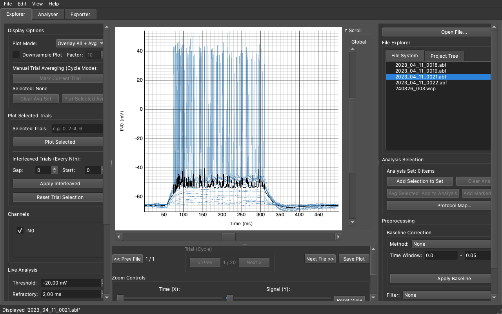

*Multi-channel current-clamp view:*

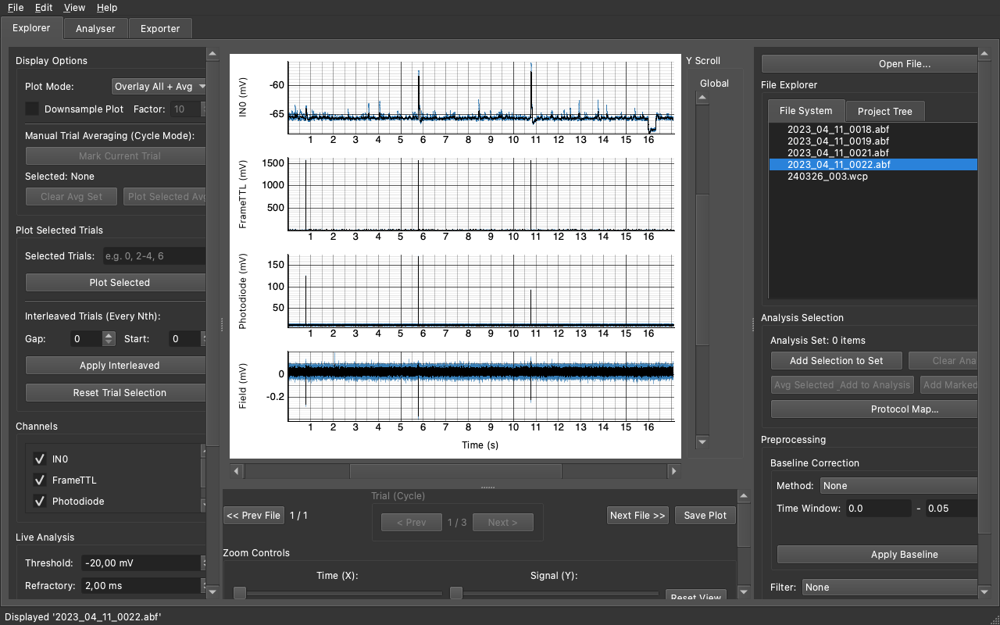

*Voltage-clamp view:*

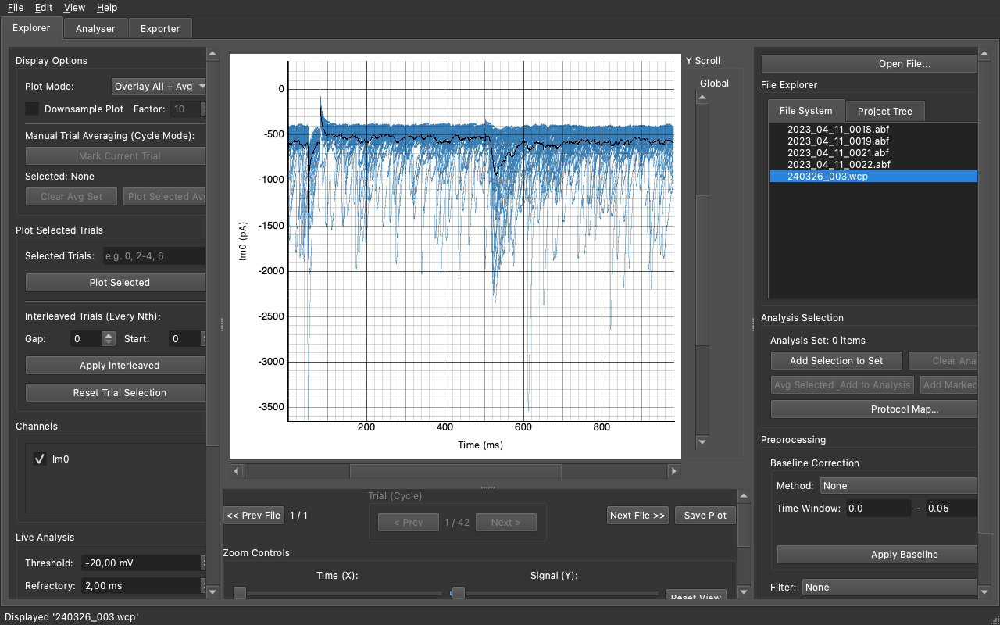

The Explorer tab is the starting point for loading, browsing, and inspecting
electrophysiology data files. It supports all formats handled by the Neo library
(`.abf`, `.wcp`, `.smr`, `.smrx`, `.nex`, `.nwb`, `.h5`, and 30+ more).

> **Resizable panels:** The Explorer tab has three side-by-side panels separated
> by draggable dividers. Drag the handle between the Configuration panel and the
> plot, or between the plot and the File/Analysis panel, to redistribute the
> available width. Default widths are 320 px (left), 800 px (centre), and
> 360 px (right).

### 1.1 File Sidebar

- **File System Tree** - A live tree filtered to supported electrophysiology extensions.
  Click any file to load it.
- **Project Tree** - Groups recordings hierarchically by **Animal > Slice > Cell**.
  Supports multi-selection for batch operations.
- **Drag & Drop** - Drag files from the OS file manager directly into the sidebar.
- **Quality Indicator** - Traffic-light badge per file:
  - Green **Good** - Clean signal, low drift, acceptable SNR.
  - Yellow **Warning** - Moderate baseline drift or line noise detected.
  - Red **Bad** - Excessive noise, drift, or signal quality issues.
  Hover to see detailed metrics: RMS noise, drift rate, and specific warnings.

### 1.2 Plot Canvas

- **Multi-Channel Display** - Each channel is plotted on a separate axis with linked
  X-axes for synchronized panning and zooming.
- **Hardware-Accelerated Rendering** - Experimental opt-in OpenGL hardware acceleration is available in **Edit > Preferences** under the **Performance** tab (`Enable Hardware Acceleration (OpenGL) - Experimental`, disabled by default; requires application restart).
- **Interactive Navigation** - Scroll to zoom, drag to pan, toolbar for fine control.
- **Interactive Cursors** - Enable crosshair cursors via the **Interactive Cursor**
  group in the display panel. Clicking on the trace places a persistent marker at the
  selected (time, amplitude) coordinate. Enable **Delta Mode** to measure differences
  between successive cursor placements ($\Delta t$, $\Delta V$/$\Delta I$). Undo and Clear buttons manage
  cursor history.

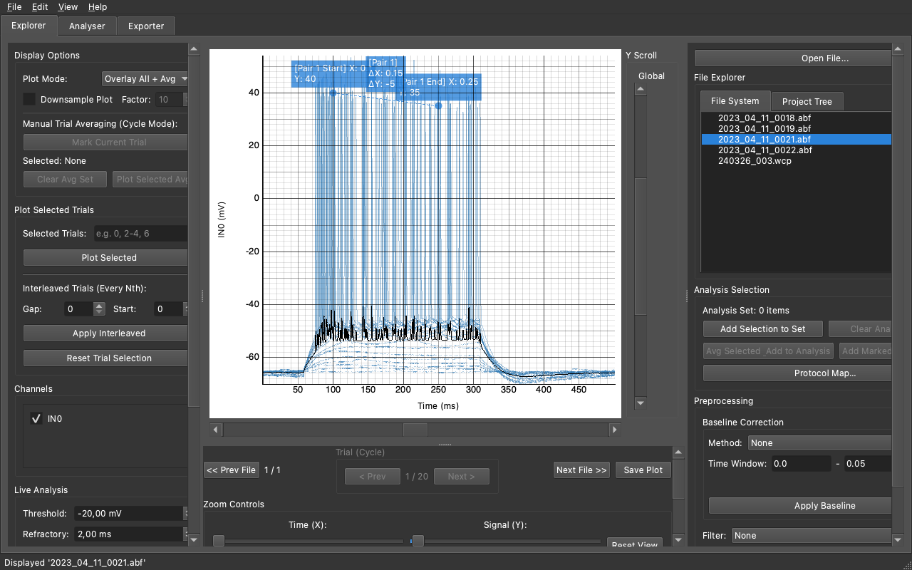

*The interactive cursor group is located in the display configuration panel on the right side of the Explorer tab.*

### 1.3 Display Configuration Panel

- **Plot Mode**
  - *Overlay All + Average* - All trials with average highlighted in bold.
  - *Cycle Single Trial* - One trial at a time with Prev/Next buttons.
- **Auto Downsample** - Reduces data density automatically for large files.
- **Manual Trial Averaging** (Cycle mode) - **Mark Current Trial** (queue the
  displayed sweep for cross-file averaging), **Add Marked Trials to Set** (commit
  to Analysis Set), **Clear Average** / **Plot Selected Average** (overlay the
  in-progress average on the current trace).
- **Trial Selection** - Trial Gap (skip N) and Start Trial index for sub-sampling.
- **Channel Visibility** - Per-channel show/hide checkboxes. When a channel is
  hidden its plot row collapses completely so no blank space is left in the canvas.
  Re-checking the box restores the row to its normal height.
- **Live Spike Detection** - Real-time detection with configurable threshold
  (default `-20 mV`) and refractory period (default `2 ms`). Spikes shown as red dots.
- **Trial Quality Metrics** - Displays series resistance ($R_s$), membrane capacitance
  ($C_m$), and signal-to-noise ratio (SNR) extracted from channel metadata for the
  currently visible trial. These metrics update automatically when navigating between
  trials.

### 1.4 Toolbar

- **Prev / Next File** - Navigate through all files in the directory.
  When a single file is opened (via drag-and-drop or **Help > Download Demo Data**)
  Synaptipy scans the parent folder for other files with the same extension, so
  **Prev / Next File** operates immediately.
- **Save Plot** - Export the current view to PNG, JPG, SVG, or PDF.
- **Reset View** - Restore default zoom and position.
- **Lock Zoom** - Preserve the viewport when switching files (for cross-file
  comparison of the same time window). The viewport is restored precisely to the
  saved ranges, preventing cumulative zoom drift across file cycles.
- **X Zoom Slider** - Fine horizontal zoom control.
- **Prev / Next Trial** (Cycle mode) - Navigate individual sweeps.

### 1.5 Y-Axis Controls

- **Lock Y Views** - Link or unlink Y-axes across channels.
- **Global Y Controls** (locked) - Single slider + scroll bar for all channels.
- **Per-Channel Y Controls** (unlocked) - Independent slider + scroll bar per channel.
  All controls are debounced (50 ms) for responsive interaction.

### 1.6 Protocol Map

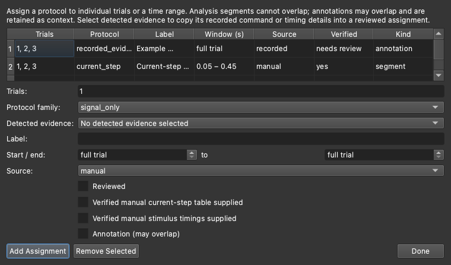

Use **Protocol Map...** in the Explorer's Analysis Selection panel when the
acquisition file does not carry enough trustworthy command or stimulus metadata
to identify the protocol automatically. Neo-loaded ABF command waveforms and
explicitly labelled TTL timing traces appear as unverified contextual evidence
in this dialog. Select that evidence to carry its recorded details into a new
assignment, then choose and review the experimental family. The dialog maps
one-based trial ranges and optional time windows to protocol families. It
distinguishes an exclusive analysis segment from an overlapping contextual
annotation, and records whether the provenance is manual, drawn, imported,
recorded, or signal-only.

The tutorial capture above uses the bundled recording with a **reviewed manual
current-step table**. It does not claim that the command waveform was imported.
Only mark an assignment reviewed after checking it against the acquisition
record; this controls the compatibility/readiness checks used by analyses and
compatible cross-file averaging.

An imported filename or reader label is displayed as provenance only. Detected
command and TTL evidence also never chooses an analysis family or timing
window; review it in the Protocol Map when that scientific context is needed.

### 1.7 Adding Data to the Analyser

**Whole recording** - Click **"Add to Analysis Set"** to send the full file as a
single Recording item. The Analyser averages across all trials in that file.

**Specific trials (cross-file workflow)**

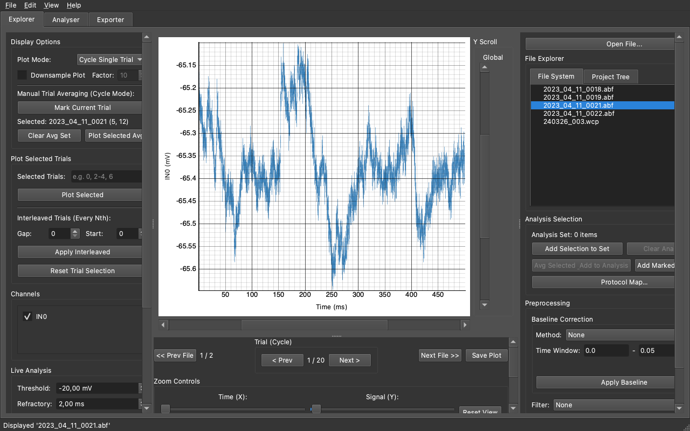

Use this workflow to select individual sweeps from any combination of files
and average them together in the Analyser:

1. Set **Plot Mode** to *Cycle Single Trial*.
2. Navigate to any trial you want to include and click **"Mark Current Trial"**.
   A badge on the **"Add Marked Trials to Set"** button updates to show how many
   trials are pending (e.g. *"Add Marked Trials to Set (2)"*).
3. Navigate freely between files and continue marking. Marks from different files
   accumulate in the pending set.
4. When ready, click **"Add Marked Trials to Set"**. The pending marks are moved
   to the Analysis Set and the mark queue is cleared automatically - clicking the
   button again without marking new trials shows a *"no trials marked"* notice
   rather than a duplicate warning.
5. Switch to the **Analyser** tab, choose **Cross-File Average** as the data
   source, and click **Run Analysis**.

The Analysis Set header in the Analyser shows the item count and unique file
count (e.g. **"3 items (2 files)"**) so you always know how many sweeps are
included across all files.

---

## 2. Signal Preprocessing

A unified preprocessing panel is available in both the Explorer and Analyser tabs.
Preprocessing applied in any analysis sub-tab propagates globally to all sub-tabs.

### 2.1 Digital Filters

`signal_processor.py` supports three selectable filter topologies (`butterworth`
default, phase-matched `bessel` via `norm="phase"`, and symmetric time-domain
`gaussian` via `-3 dB` `scipy.ndimage.gaussian_filter1d` for lowpass/highpass).
All SOS IIR filters execute zero-phase forward-backward filtering through
`_sosfiltfilt_safe`, which solves each Direct-Form II Transposed biquad's
steady-state initial condition `zi` analytically and applies odd-reflection
boundary padding around `scipy.signal.sosfilt` to eliminate boundary transients
on non-zero resting potentials without invoking BLAS `linalg.solve`.

| Filter | Parameters | Description |
|--------|------------|-------------|
| **Lowpass** | Cutoff (Hz), Order, Topology (`butterworth`, `bessel`, `gaussian`) | Attenuate high-frequency noise while preserving waveform phase |
| **Highpass** | Cutoff (Hz), Order, Topology (`butterworth`, `bessel`, `gaussian`) | Remove slow baseline drift |
| **Bandpass** | Low & High cutoff (Hz), Order, Topology (`butterworth`, `bessel`) | Pass a specific frequency band |
| **Notch** | Center (Hz), Q-factor | Remove a narrow line-noise band (e.g., 50/60 Hz mains) via `scipy.signal.iirnotch` -> `zpk2sos` |
| **Comb** | Fundamental freq (Hz), Q, Max harmonics | Harmonic notch comb filter (`scipy.signal.iircomb`, with `multi_harmonic_notch` cascaded-notch fallback) removing a fundamental frequency and its harmonics |

### 2.2 Baseline Subtraction Methods

| Method | Description |
|--------|-------------|
| **Mode** | Subtract statistical mode (configurable decimal precision; full trace or restricted to optional `[start_t, end_t]` Time Window) |
| **Mean** | Subtract arithmetic mean (full trace or restricted to optional `[start_t, end_t]` Time Window) |
| **Median** | Subtract median (full trace or restricted to optional `[start_t, end_t]` Time Window) |
| **Linear Detrend** | Fit and remove a linear trend across the full trace via `scipy.signal.detrend(..., type="linear")` |
| **Region** | Subtract arithmetic mean of a user-specified pre-stimulus **Time Window** `[start_t, end_t]` |

### 2.3 Artifact Blanking

The preprocessing pipeline includes a general-purpose artifact blanking step
that can be applied before any analysis:

| Method | Description |
|--------|-------------|
| **Hold** | Replace the artifact window with the last pre-artifact sample value (sample-and-hold) |
| **Zero** | Set all samples in the artifact window to zero |
| **Linear** | Linearly interpolate between the last pre-artifact and first post-artifact sample |

Configure via the `SignalProcessingPipeline` API:

```python
from synaptipy.core.processing_pipeline import SignalProcessingPipeline

pipeline = SignalProcessingPipeline()
pipeline.add_step({
    "type": "artifact",
    "onset_time": 0.1,       # seconds
    "duration_ms": 5.0,      # milliseconds
    "method": "linear",      # "hold", "zero", or "linear"
})
```

### 2.4 Trace Quality Assessment

Computed on file load; shown as a traffic-light badge with tooltip:
- **RMS Noise** - root-mean-square of the linearly detrended trace.
- **Baseline Drift** - linear regression slope over the full trace.
- **Line Noise** - Welch PSD power ratio at 50/60 Hz relative to flanking bands.
- **Low-Frequency Variance** - `< 1 Hz` drift variance relative to high-frequency noise variance.

### 2.5 Preprocessing Comparison

A side-by-side comparison dialog allows visual inspection of the signal before
and after preprocessing. Two linked PyQtGraph plots display the raw and processed
traces with synchronised X-axes, accompanied by a statistics table comparing
mean, standard deviation, minimum, and maximum values for each condition. This
lets you verify that preprocessing parameters produce the intended
effect without introducing artefacts.

---

## 3. The Analyser Tab

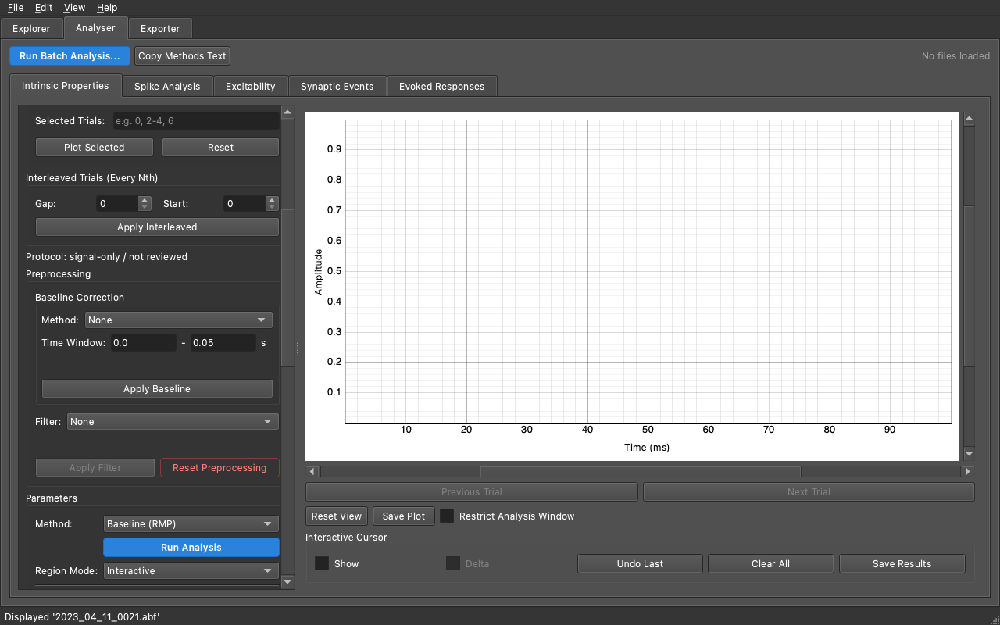

The central analysis engine. All 16 built-in analyses are organised across 5
core module tabs and auto-built from registry metadata - parameter widgets,
interactive plots, and result tables are generated automatically.

### 3.1 File and Data Source Selection

- **File Selector** - All files in the analysis set. The header label shows the
  item count and unique file count, e.g. **"3 items (2 files)"**, so you can
  confirm that all expected sweeps are present.
- **Channel Selector** - Choose the channel to analyze. Clamp mode (CC / VC) is
  auto-detected from channel units and controls which parameters appear.
- **Data Source** - Average (mean of all trials), Trial 1, Trial 2, etc., or
  **Cross-File Average** (grand average across all items in the Analysis Set,
  with per-item faint traces shown alongside the bold average).

  ```{note}
  When **Cross-File Average** is selected the plot shows all per-item traces in
  a faint colour and the grand average as a bold line. The title bar reports
  the number of items and files (e.g. "3 items / 2 files") and warns if trace
  lengths differ across files.
  ```
- **Drag-and-Drop File List** - Drop files directly from the Explorer sidebar.

### 3.2 Analysis Sub-Tab Features

Each sub-tab provides:

- **Parameter Panel** - Auto-generated spin boxes, combo boxes, and checkboxes.
  All include tooltips (populated from registry metadata), unit suffixes, and valid
  min/max ranges.
  - *Free-form numeric entry* - Number fields accept typed values directly;
    intermediate states (a lone `-`, an empty field, etc.) are tolerated while
    typing and validated on commit. Stepping uses adaptive decimal increments.
  - *Validation feedback* - Parameters that fall outside their valid range are
    highlighted with a red border, providing immediate visual indication of
    invalid entries without blocking interaction.
  - *Interactive / Manual mode* - Sub-tabs with draggable plot regions expose a
    mode selector. In **Interactive** mode the time-window spinboxes are read-only
    (their values are driven by the plot regions); switching to **Manual** mode
    unlocks all spinboxes for direct entry.
  - *Conditional visibility* - Parameters that are irrelevant for the current
    clamp mode, analysis type, or detection method are hidden automatically.
- **Preprocessing Indicator** - When preprocessing (baseline subtraction, filtering)
  is active, a coloured banner appears at the top of the Analyser listing the active
  steps (e.g. "Active Preprocessing: Baseline: mode | Filter: lowpass (500 Hz)").
  This ensures the operator is aware that the displayed signal differs from the raw
  acquisition.
- **Interactive Plot**
  - *Draggable Regions* - Color-coded overlays (blue = baseline, red = response,
    orange = peak, green = steady-state) bidirectionally linked to parameter boxes.
  - *Interactive Event Markers* - Click to remove; Ctrl+click on trace to add.
  - *Draggable Threshold Line* - Syncs with the threshold parameter.
  - *Artifact Overlay* - Semi-transparent green shading on detected artifact windows.
  - *Fit Overlays* - Exponential or regression curves overlaid on the trace.
  - *Statistical Annotations* - Popup plots display quantitative annotations
    ($R^2$, regression slope, $\tau$ values, event counts) directly on the figure.
- **Results Table** - Parameter / Value pairs for all computed metrics.
- **Clamp-Mode Awareness** - Parameters show/hide automatically (CC vs. VC).

### 3.3 Shared Controls

- **Run Analysis** - Executes with current parameters; also auto-triggers (debounced)
  on parameter change.
- **Add to Session** - Accumulate the current result to the session for later
  export or cross-cell comparison. A numeric badge on the button displays the
  running count of accumulated results (e.g. "Add to Session (5)").
- **View Session** - Inspect accumulated results; also badged with the current count.
- **Copy Methods Text** - Publication-ready methods paragraph copied to clipboard.
- **Run Batch** - Opens the Batch Analysis Dialog (see [Section 5](#5-batch-processing)).
- **Cross-Tab Zoom Sync** - Zoom states shared across all analysis sub-tabs.
- **Auto-Save** - The session state is persisted automatically at five-minute
  intervals, reducing the risk of data loss during prolonged analysis sessions.

### 3.4 Popup Windows

- **RMP Stability popup** - Per-sweep resting potential vs. sweep index.
- **I-V Curve popup** - Scatter + linear regression with slope and $R^2$ annotation.
- **F-I Curve popup** - Firing frequency vs. current with regression.
- **Phase Plane popup** - $dV/dt$ vs. $V$ with threshold circles and max-$dV/dt$ crosses.
- **ISI Plot popup** - ISI number vs. ISI duration scatter.
- **STP Profile popup** - Normalised amplitude ($R_n / R_1$) vs. pulse number.

### 3.5 Session Summary

Shows all accumulated results with **Mean +/- SD** for numeric columns across cells.

### 3.6 Adding Your Own Analysis Tab

You can add a new analysis tab to the Analyser **without modifying any
Synaptipy source code**. Provide a single Python file in `~/.synaptipy/plugins/`,
and Synaptipy generates the parameter panel, Run button, results table, and plot
overlays automatically from the decorator metadata.

#### Downloadable Example Plugins

Download four ready-to-run example plugins from **Help > Download Example
Plugins...**. When **Enable Custom Plugins** is checked in **Edit > Preferences**
(enabled by default), they appear automatically as sub-tabs in the Analyser:

| File | Tab label | What it measures |
|------|-----------|-----------------|
| `examples/plugins/synaptic_charge.py` | **Synaptic Charge (AUC)** | Total synaptic charge (`pC`) in voltage-clamp or postsynaptic potential AUC (`mV*ms`) in current-clamp via trapezoidal integration over a user-defined window; shaded fill overlay marks the integrated area and a star marks the detected peak amplitude. |
| `examples/plugins/opto_jitter.py` | **Opto Latency Jitter** | Trial-to-trial latency variability for evoked spikes or postsynaptic responses across TTL pulses; requires a secondary digital/TTL channel. |
| `examples/plugins/miniml_integration.py` | **miniML Events** | Deep-learning event detection via miniML reporting baseline-subtracted event amplitudes (`pA`/`mV`) and kinetics (optional dependency; requires `tensorflow` + cloned miniML repository). |
| `examples/plugins/spike_interface_integration.py` | **Spike Detection (SpikeInterface)** | Bandpass filtering and spike detection via SpikeInterface for extracellular or intracellular traces (optional dependency; `pip install spikeinterface`). |


To customise an example, edit its copy in `~/.synaptipy/plugins/`.

---

#### Step 1 - Create the plugin file

Copy the starter template that ships with Synaptipy:

```bash
# macOS / Linux
cp src/synaptipy/templates/plugin_template.py ~/.synaptipy/plugins/my_analysis.py

# Windows (PowerShell)
Copy-Item src\synaptipy\templates\plugin_template.py ~\.synaptipy\plugins\my_analysis.py
```

> **Plugin folder location by platform:**
>
> | Platform | Path |
> |----------|------|
> | macOS / Linux | `~/.synaptipy/plugins/` |
> | Windows | `C:\Users\<YourUsername>\.synaptipy\plugins\` |
>
> If the folder does not exist yet, create it manually or start Synaptipy once
> so the application creates the directory automatically.
>
> **Windows tip:** Open the folder in Explorer by typing
> `%USERPROFILE%\.synaptipy\plugins` in the address bar, or in PowerShell:
> `explorer "$HOME\.synaptipy\plugins"`

#### Step 2 - Write your analysis function

Open `~/.synaptipy/plugins/my_analysis.py` in any text editor. The file has two
parts. The example below implements **area-under-the-curve (AUC)** measurement
following the bundled `synaptic_charge.py` plugin.

**Part A - Your analysis logic** (plain Python + NumPy, no GUI code):

```python
import numpy as np

def calculate_area_under_curve(data, time, sampling_rate,
                               baseline_start, baseline_end,
                               window_start, window_end):
    """Integrate a baseline-subtracted trace to obtain synaptic charge (pC)."""
    # Baseline: mean over the pre-event window
    bl0 = int(np.searchsorted(time, baseline_start, side="left"))
    bl1 = int(np.searchsorted(time, baseline_end,   side="right"))
    baseline = float(np.mean(data[bl0:bl1])) if bl1 > bl0 else 0.0

    # Integration window
    wi0 = int(np.searchsorted(time, window_start, side="left"))
    wi1 = int(np.searchsorted(time, window_end,   side="right"))
    win_t = time[wi0:wi1]
    win_d = data[wi0:wi1] - baseline

    if win_t.size < 2:
        return {"error": "Integration window too narrow"}

    # np.trapezoid: pA * s = pC
    charge_pc = float(np.trapezoid(win_d, win_t))
    return {
        "Charge_pC":   round(charge_pc, 6),
        "Baseline_pA": round(baseline,  4),
        "_int_x": win_t,          # hidden - fed to fill_between overlay
        "_int_y": data[wi0:wi1],  # hidden - raw (unshifted) curve for shading
        "_base":  baseline,       # hidden - baseline level for hline
    }
```

**Part B - Register it with the decorator:**

```python
from synaptipy.core.analysis.registry import AnalysisRegistry

@AnalysisRegistry.register(
    name="synaptic_charge",              # unique internal ID
    label="Synaptic Charge (AUC)",       # name shown on the tab
    ui_params=[...],                     # parameter widgets  (see below)
    plots=[...],                         # plot overlays      (see below)
)
def run_auc(data, time, sampling_rate, **kwargs):
    """Wrapper - pulls GUI values from kwargs and calls the logic."""
    return calculate_area_under_curve(
        data, time, sampling_rate,
        baseline_start = kwargs.get("baseline_start", 0.0),
        baseline_end   = kwargs.get("baseline_end",   0.05),
        window_start   = kwargs.get("window_start",   0.05),
        window_end     = kwargs.get("window_end",     0.3),
    )
```

> **The wrapper signature is fixed:** `def f(data, time, sampling_rate, **kwargs)`
> - Synaptipy passes in the trace array, time array, and sampling rate, plus
> every parameter widget value as a keyword argument.

#### Step 3 - Define parameter widgets (`ui_params`)

Each dict in the `ui_params` list creates one widget in the parameter panel.
Common widget types include:

| Type | Widget | Example |
|------|--------|---------|
| `"float"` | Decimal spin box | `{"name": "threshold", "label": "Threshold (mV):", "type": "float", "default": -20.0, "min": -200, "max": 200, "decimals": 2}` |
| `"int"` | Integer spin box | `{"name": "min_events", "label": "Min Events:", "type": "int", "default": 3, "min": 1, "max": 10000}` |
| `"bool"` | Check box | `{"name": "auto_detect", "label": "Auto-Detect Baseline", "type": "bool", "default": False}` |
| `"choice"` | Drop-down | `{"name": "direction", "label": "Direction:", "type": "choice", "choices": ["negative", "positive"], "default": "negative"}` |

Full example for the AUC analysis:

```python
ui_params=[
    {"name": "baseline_start", "label": "Baseline Start (s):", "type": "float",
     "default": 0.0,  "min": 0.0, "max": 1e9, "decimals": 4},
    {"name": "baseline_end",   "label": "Baseline End (s):",   "type": "float",
     "default": 0.05, "min": 0.0, "max": 1e9, "decimals": 4},
    {"name": "window_start",   "label": "Window Start (s):",   "type": "float",
     "default": 0.05, "min": 0.0, "max": 1e9, "decimals": 4},
    {"name": "window_end",     "label": "Window End (s):",     "type": "float",
     "default": 0.3,  "min": 0.0, "max": 1e9, "decimals": 4},
],
```

**Optional extras on any parameter:**

- `"tooltip": "Hover text"` - shows on mouse-over.
- `"visible_when": {"param": "mode", "value": "advanced"}` - shows this widget
  only when another widget named `"mode"` has the value `"advanced"`.

#### Step 4 - Define plot overlays (`plots`)

Each dict in the `plots` list draws an item on the trace after the analysis
runs. Common overlay types:

| Type | What it draws | Example |
|------|---------------|---------|
| `"interactive_region"` | Draggable shaded region synced to two float parameters | `{"type": "interactive_region", "data": ["window_start", "window_end"], "color": "g"}` |
| `"hlines"` | Horizontal lines at result values | `{"type": "hlines", "data": ["_base"], "color": "b", "styles": ["dash"]}` |
| `"vlines"` | Vertical lines at result values | `{"type": "vlines", "data": "stim_times", "color": "c"}` |
| `"markers"` | Scatter dots at (x, y) arrays from result | `{"type": "markers", "x": "peak_times", "y": "peak_voltages", "color": "r"}` |
| `"threshold_line"` | Draggable h-line synced to a parameter | `{"type": "threshold_line", "param": "threshold"}` |
| `"overlay_fit"` | Curve overlay (e.g. exponential fit) | `{"type": "overlay_fit", "x": "_fit_t", "y": "_fit_v", "color": "r"}` |
| `"fill_between"` | Shaded filled area between two curves | `{"type": "fill_between", "x": "_int_x", "y1": "_int_y", "y2": "_base", "brush": (0, 100, 255, 100)}` |
| `"popup_xy"` | Opens a separate plot window | `{"type": "popup_xy", "title": "F-I Curve", "x": "currents", "y": "rates", "x_label": "I (pA)", "y_label": "f (Hz)"}` |

Full example - integration region, baseline h-line, and shaded integrated area:

```python
plots=[
    {"type": "interactive_region", "data": ["window_start", "window_end"], "color": "g"},
    {"type": "hlines", "data": ["_base"], "color": "b", "styles": ["dash"]},
    {"type": "fill_between", "x": "_int_x", "y1": "_int_y", "y2": "_base",
     "brush": (0, 100, 255, 100)},
],
```

#### Step 5 - Control what shows in the results table

Every key in the dict your function returns becomes a row in the results table.
To keep helper data out of the table (e.g. arrays used only by plot overlays),
prefix the key with an underscore:

```python
return {
    "Charge_pC":    1.23,       # shown in results table
    "Baseline_pA":  -42.0,      # shown in results table
    "_int_x":  time_array,      # hidden (used by fill_between overlay)
    "_int_y":  data_array,      # hidden (used by fill_between overlay)
    "_base":   -42.0,           # hidden (used by hlines overlay)
}
```

If your function encounters an error, return `{"error": "message"}` and the GUI
displays the message instead of a results table.

#### Step 6 - Reload and use

Save your file, then open **Edit > Preferences** and toggle **Enable Custom Plugins**
off and back on. Synaptipy reloads the plugin and the new tab appears in the
Analyser without restarting the application:

```text
Analyser -> Intrinsic Properties | Spike Analysis | Excitability | Synaptic Events | Evoked Responses | Synaptic Charge (AUC)
```

Load a voltage-clamp recording, select the current channel, and click
**Run Analysis** (or adjust any parameter to trigger an automatic re-run).
The results table, shaded fill overlay, and batch processing operate
immediately.

#### Tips

- **No rebuild needed** - save the `.py` file, then toggle **Enable Custom
  Plugins** off and on in Preferences to reload it.
- **Errors are isolated** - if your plugin has a syntax error or raises an
  exception during import, Synaptipy logs the failure, omits that tab, and
  continues loading all remaining plugins. Inspect logs at `~/.synaptipy/logs/`
  (Windows: `C:\Users\<YourUsername>\.synaptipy\logs\`).
- **Multiple plugins** - place any number of `.py` files in `~/.synaptipy/plugins/`;
  each function decorated with `@AnalysisRegistry.register` creates an
  independent tab after the five core pillars.
- **Use any installed package** - your plugin can import SciPy, scikit-learn,
  or any library installed in the active Python environment.
- **Template location** - the starter template is located at
  `src/synaptipy/templates/plugin_template.py`.
- **Full reference** - for all parameter types, plot overlay specifications, and
  conditional visibility rules, see
  [Writing Custom Analysis Plugins](../extending_synaptipy.md).

---

## 4. Analysis Modules: Detailed Reference

> **Formal mathematics:** For publication-ready LaTeX derivations of every metric
> computed below, see [Algorithmic Definitions](../algorithmic_definitions.md).

All 16 built-in analyses are grouped into five module tabs matching the standard
patch-clamp workflow from passive membrane characterisation through synaptic and
evoked-response studies.

| UI Module Tab | Built-in Analyses Covered (16 total) |
|---------------|--------------------------------------|
| **Intrinsic Properties** (`passive_properties`) | [4.1 Baseline / RMP](#41-baseline--rmp-analysis), [4.2 Input Resistance](#42-input-resistance-rin), [4.3 Tau](#43-tau-membrane-time-constant), [4.4 Sag Ratio](#44-sag-ratio-ih), [4.5 I-V Curve](#45-i-v-curve), [4.6 Capacitance](#46-capacitance) |
| **Spike Analysis** (`single_spike`) | [4.7 Spike Detection](#47-spike-detection), [4.8 Phase Plane](#48-phase-plane-analysis) |
| **Excitability** (`firing_dynamics`) | [4.9 Excitability (F-I Curve)](#49-excitability-f-i-curve), [4.10 Burst Analysis](#410-burst-analysis), [4.11 Spike Train Dynamics](#411-spike-train-dynamics) |
| **Synaptic Events** (`synaptic_events`) | [4.12 Event Detection: Amplitude](#412-event-detection-amplitude), [4.13 Event Detection: Template](#413-event-detection-template) |
| **Evoked Responses** (`evoked_responses`) | [4.14 Evoked Sync](#414-evoked-sync), [4.15 Paired-Pulse Ratio](#415-paired-pulse-ratio-ppr), [4.16 Stimulus Train (STP)](#416-stimulus-train-stp) |

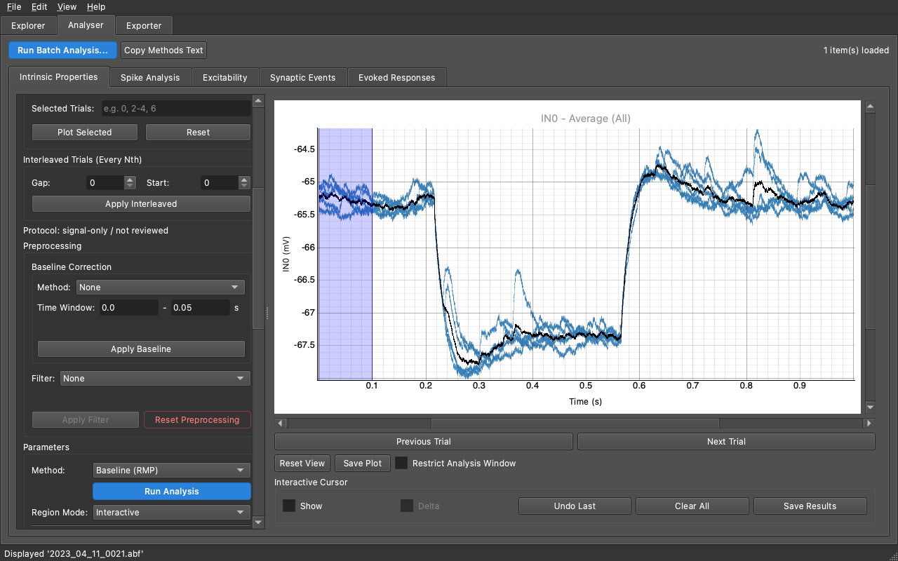

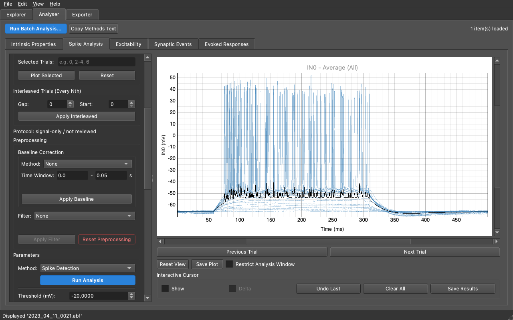


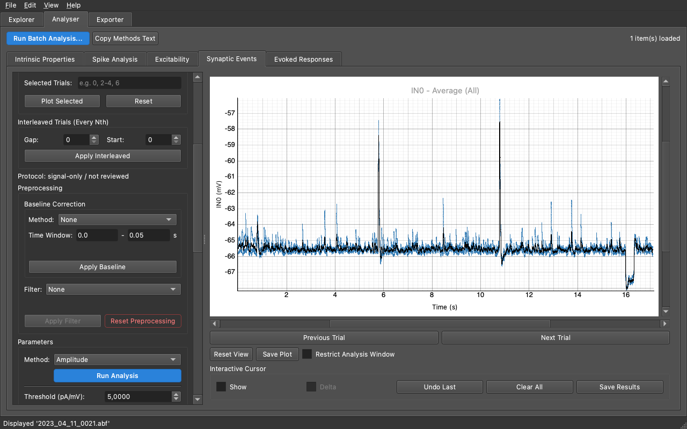

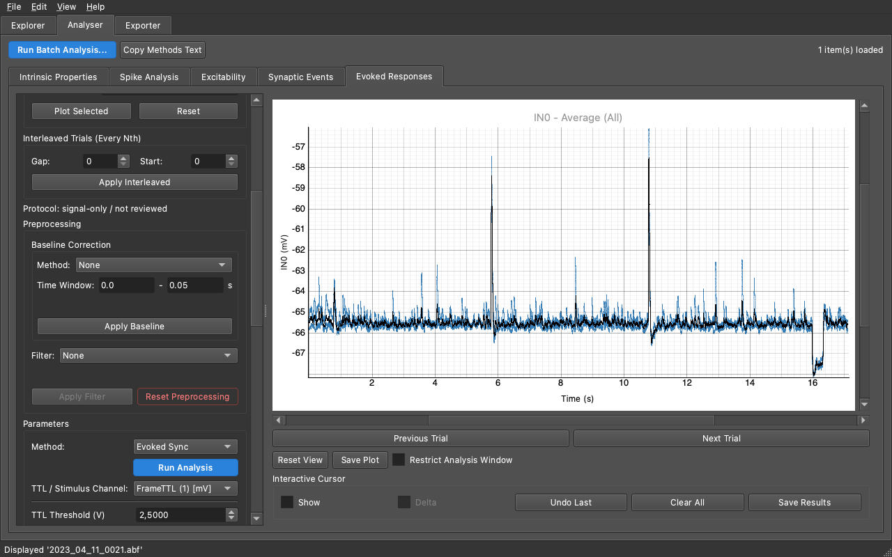

---

### 4.1 Baseline / RMP Analysis

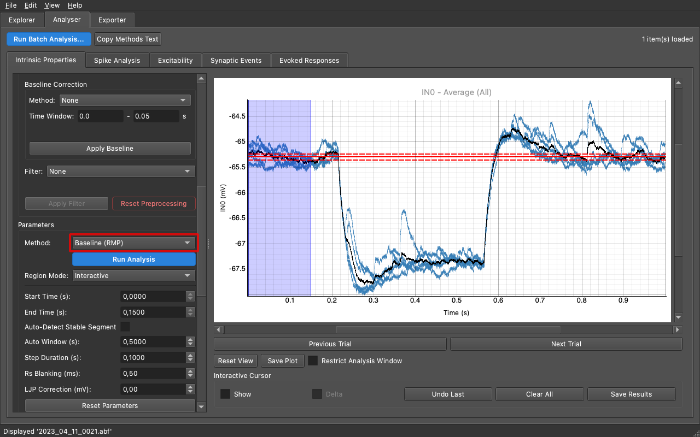

**Registry name**: `rmp_analysis` | **Tab label**: *Baseline (RMP)*

Computes resting membrane potential, within-sweep baseline stability, and
cross-sweep drift across single- or multi-trial recordings.

#### Parameters

| Parameter | Key | Type | Description |
|-----------|-----|------|-------------|
| Start Time (s) | `baseline_start` | float (s) | Start of baseline window (default `0.0`) |
| End Time (s) | `baseline_end` | float (s) | End of baseline window (default `0.1`) |
| Auto-Detect Stable Segment | `auto_detect` | bool | Locate lowest-variance baseline segment automatically |
| Auto Window (s) | `window_duration` | float (s) | Sliding window width in auto mode (default `0.5`) |
| Step Duration (s) | `step_duration` | float (s) | Sliding window step in auto mode (default `0.1`) |
| Rs Blanking (ms) | `rs_artifact_blanking_ms` | float (ms) | Skip initial ms of window to avoid $R_s$ artifact (default `0.5`) |
| LJP Correction (mV) | `ljp_correction_mv` | float (mV) | Subtract liquid junction potential ($V_{\text{true}} = V_{\text{rec}} - \text{LJP}$, default `0.0`) |

#### Methods

- **Per-sweep RMP** = arithmetic mean voltage over the effective baseline window.
- **Single-sweep drift** (`RmpResult.drift`) = OLS linear slope (mV/s) after pre-smoothing with a 50 ms uniform moving average to suppress high-frequency electronic noise.
- **Cross-sweep drift** (`rmp_drift_rate_mv_per_sweep`) = OLS linear slope across valid per-sweep RMP values.
- **Auto-detect**: `find_stable_baseline()` minimises sliding-window variance while rejecting clipped amplifier rails.

#### Results

`rmp_mv`, `rmp_std`, `rmp_drift_rate_mv_per_sweep`, `rmp_per_sweep`,
`sweep_indices`, `rmp_mv_plus_sd`, `rmp_mv_minus_sd` (plus `drift` and
`duration` on `RmpResult`).

#### Visualization

Green draggable baseline region; solid red h-line at `rmp_mv`; dashed red
h-lines at `rmp_mv_plus_sd` and `rmp_mv_minus_sd`; popup `RMP Stability` plot.

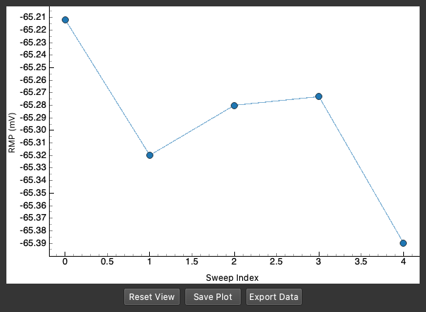

---

### 4.2 Input Resistance (Rin)

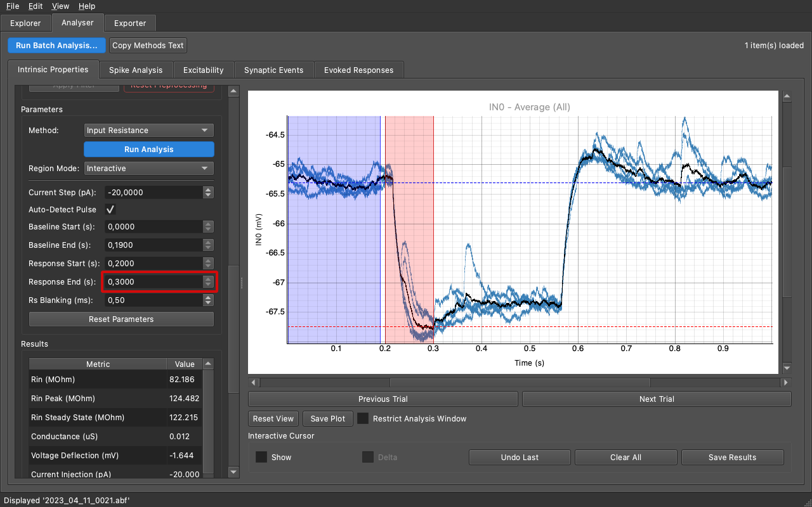

**Registry name**: `rin_analysis` | **Tab label**: *Input Resistance*

Computes mean, peak, and steady-state input resistance (and conductance) from
current-clamp or voltage-clamp step protocols.

#### Parameters

| Parameter | Key | Type | Description |
|-----------|-----|------|-------------|
| Current Step (pA) | `current_amplitude` | float (pA) | CC step amplitude (default `-50.0`, visible in CC mode) |
| Voltage Step (mV) | `voltage_step` | float (mV) | VC step amplitude (default `-10.0`, visible in VC mode) |
| Auto-Detect Pulse | `auto_detect_pulse` | bool | Derivative-based step edge detection (default `True`) |
| Baseline Start / End (s) | `baseline_start`, `baseline_end` | float (s) | Pre-step baseline window (`0.0` - `0.1` s) |
| Response Start / End (s) | `response_start`, `response_end` | float (s) | Step response window (`0.3` - `0.4` s) |
| Rs Blanking (ms) | `rs_artifact_blanking_ms` | float (ms) | Exclude initial ms of response window from $R_{\text{in}}$ (default `0.5`) |

#### Methods

- **Mean $R_{\text{in}}$** (`rin_mohm`): $|\bar{V}_{\text{resp}} - \bar{V}_{\text{base}}| / |\Delta I_{\text{nA}}|$ (MOhm) after blanking the first `rs_artifact_blanking_ms`.
- **Peak $R_{\text{in}}$** (`rin_peak_mohm`): computed from the maximum absolute voltage deflection in the blanked response window (captures pre-sag peak).
- **Steady-State $R_{\text{in}}$** (`rin_steady_state_mohm`): computed from the mean of the **last 20%** of the blanked response window (post-$I_h$ plateau).
- **Conductance** (`conductance_us`): $1 / R_{\text{in}}$ ($\mu\text{S}$) in CC mode, or $(\Delta I / \Delta V) / 1000$ ($\mu\text{S}$) in VC mode.
- **Auto-detection** locates step onset and offset from the smoothed command trace (or spike-clipped voltage trace) derivative and validates $\ge 2$ samples per window before updating spinboxes.

For dedicated $I_h$ sag ratio and rebound quantification, see
[Section 4.4 Sag Ratio (Ih)](#44-sag-ratio-ih).

#### Results

`rin_mohm`, `rin_peak_mohm`, `rin_steady_state_mohm`, `conductance_us`,
`voltage_deflection_mv`, `current_injection_pa`, `baseline_voltage_mv`,
`steady_state_voltage_mv`, `auto_detected`

#### Visualization

Blue baseline region + red response region; blue h-line at `baseline_voltage_mv`;
red h-line at `steady_state_voltage_mv`.

---

### 4.3 Tau (Membrane Time Constant)

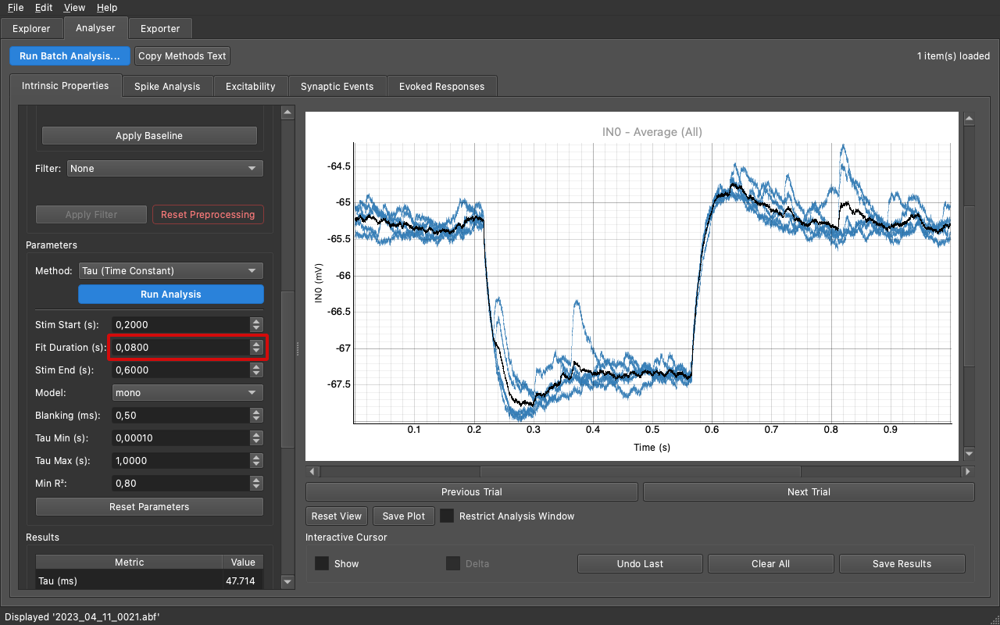

**Registry name**: `tau_analysis` | **Tab label**: *Tau (Time Constant)*

Fits the membrane charging trajectory after step onset (and off-relaxation after
step offset) using bounded non-linear least squares.

#### Parameters

| Parameter | Key | Type | Description |
|-----------|-----|------|-------------|
| Stim Start (s) | `stim_start_time` | float (s) | Current step onset (default `0.1`) |
| Fit Duration (s) | `fit_duration` | float (s) | Duration of charging region to fit (default `0.05`) |
| Stim End (s) | `stim_end_time` | float (s) | Step offset used for post-stimulus decay $\tau$ (default `0.6`) |
| Model | `tau_model` | choice | `mono` (default) or `bi` exponential |
| Blanking (ms) | `artifact_blanking_ms` | float (ms) | Skip initial ms after step onset/offset (default `0.5`) |
| Tau Min / Max (s) | `tau_bound_min`, `tau_bound_max` | float (s) | Optimizer bounds for $\tau$ (default `0.0001` - `1.0` s) |
| Min R2 | `min_r_squared` | float | Quality gate rejecting fits with $R^2 < \texttt{min\_r\_squared}$ (default `0.80`) |

#### Methods

- **Sag-peak truncation**: if a voltage extremum occurs inside the fit window (`2 < peak_idx < N - 1`) and leaves $\ge 3$ points, the fit window is truncated at that peak so $I_h$ sag rebound does not contaminate $\tau$.
- **Initial guess**: deterministic OLS log-linear regression on $\ln(|V - V_{\text{ss}}|)$ vs. time (`-1.0 / slope`, with `10 ms` fallback).
- **Mono** (`tau_model="mono"`): $V(t) = V_{\text{ss}} + (V_0 - V_{\text{ss}}) \exp(-t/\tau)$.
- **Bi** (`tau_model="bi"`): $V(t) = V_{\text{ss}} + A_{\text{fast}} \exp(-t/\tau_{\text{fast}}) + A_{\text{slow}} \exp(-t/\tau_{\text{slow}})$, ordered so $\tau_{\text{fast}} \le \tau_{\text{slow}}$.
- **Quality gate & 95% CI**: enforced on **both** `mono` and `bi` fits (`NaN` returned when $R^2 < \texttt{min\_r\_squared}$); 95% confidence bounds are derived as $\tau \pm 1.96 \cdot \text{SE}$ from the covariance matrix diagonal.

#### Results

- **Mono**: `tau_ms`, `r_squared`, `tau_ci_95_low`, `tau_ci_95_high`, `tau_model`, `tau_decay_after_stimulus_ms`, `_fit_time`, `_fit_values` (core `calculate_tau` returns `tau_se_ms`, `tau_ci_lower`, `tau_ci_upper`).
- **Bi**: `tau_fast_ms`, `tau_slow_ms`, `amplitude_fast`, `amplitude_slow`, `tau_model`, `_fit_time`, `_fit_values` (core `calculate_tau` also returns `V_ss`, `r_squared`, `tau_fast_ci_lower`/`upper`, `tau_slow_ci_lower`/`upper`).

#### Visualization

Red exponential fit curve (`_fit_time`, `_fit_values`) overlaid on the trace,
plus a cyan `trace_overlay` highlighting the 5 ms pre-stimulus baseline window.

---

### 4.4 Sag Ratio (Ih)

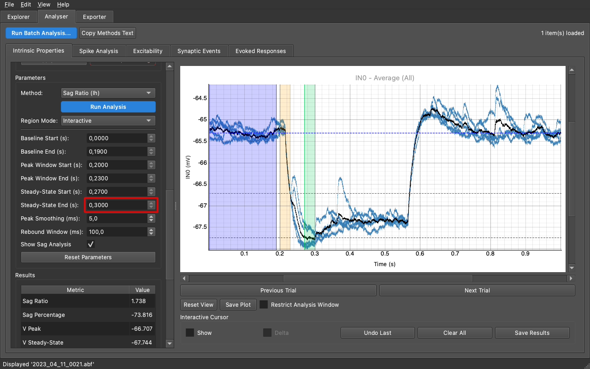

**Registry name**: `sag_ratio_analysis` | **Tab label**: *Sag Ratio (Ih)*

Quantifies hyperpolarisation-activated voltage sag ($I_h$ current) and
post-step rebound depolarisation. While [Section 4.2 Input Resistance](#42-input-resistance-rin)
separates `rin_peak_mohm` and `rin_steady_state_mohm`, this dedicated module
provides independent window and smoothing controls for sag and rebound.

#### Parameters

| Parameter | Key | Type | Description |
|-----------|-----|------|-------------|
| Baseline Start / End (s) | `baseline_start`, `baseline_end` | float (s) | Pre-step baseline window (`0.0` - `0.1` s) |
| Peak Window Start / End (s) | `peak_window_start`, `peak_window_end` | float (s) | Early step window containing peak hyperpolarisation (`0.1` - `0.3` s) |
| Steady-State Start / End (s) | `ss_window_start`, `ss_window_end` | float (s) | Late step plateau window (`0.8` - `1.0` s) |
| Peak Smoothing (ms) | `peak_smoothing_ms` | float (ms) | Savitzky-Golay smoothing window for peak and rebound (default `5.0`) |
| Rebound Window (ms) | `rebound_window_ms` | float (ms) | Post-step window after `ss_window_end` for rebound peak (default `100.0`) |
| Show Sag Analysis | `show_sag` | bool | Toggle sag display (default `True`) |

#### Methods

1. **$V_{\text{baseline}}$** = mean voltage in `[baseline_start, baseline_end)`.
2. **$V_{\text{peak}}$** = minimum of Savitzky-Golay-smoothed voltage (polynomial order 3, odd window from `peak_smoothing_ms`) in `[peak_window_start, peak_window_end)`.
3. **$V_{\text{ss}}$** = mean voltage in `[ss_window_start, ss_window_end)`.
4. **Sag Ratio** = $(V_{\text{ss}} - V_{\text{baseline}}) / (V_{\text{peak}} - V_{\text{baseline}})$. A value **$< 1$** indicates hyperpolarisation-activated $I_h$ sag; a value of **$1$** indicates no sag (returns `NaN` when $|V_{\text{peak}} - V_{\text{baseline}}| < 10^{-9}\,\text{mV}$).
5. **Sag Percentage** = $100 \times (V_{\text{peak}} - V_{\text{ss}}) / (V_{\text{peak}} - V_{\text{baseline}})$.
6. **Rebound Depolarisation** = $\max(\tilde{V}_{\text{rebound}}) - V_{\text{baseline}}$ over `[ss_window_end, ss_window_end + rebound_window_ms/1000)`.

#### Results

`sag_ratio`, `sag_percentage`, `v_peak`, `v_ss`, `v_baseline`,
`rebound_depolarization`

#### Visualization

Blue h-line at `v_baseline`; magenta h-line at `v_peak`; red h-line at `v_ss`.

---

### 4.5 I-V Curve

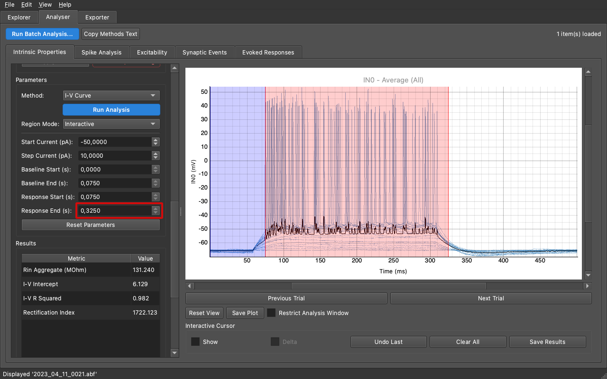

**Registry name**: `iv_curve_analysis` | **Tab label**: *I-V Curve*
**Requires multiple trials** (multi-sweep step protocol).

#### Parameters

| Parameter | Key | Type | Description |
|-----------|-----|------|-------------|
| Start Current (pA) | `start_current` | float (pA) | Current of sweep 0 (default `-50.0`) |
| Step Current (pA) | `step_current` | float (pA) | Current increment per sweep (default `10.0`) |
| Baseline Start / End (s) | `baseline_start`, `baseline_end` | float (s) | Baseline measurement window (`0.0` - `0.1` s) |
| Response Start / End (s) | `response_start`, `response_end` | float (s) | Steady-state measurement window (`0.3` - `0.4` s) |

#### Methods

- Per sweep $n$: $I_n = I_{\text{start}} + n \cdot I_{\text{step}}$ and $\Delta V_n = \bar{V}_{\text{response},n} - \bar{V}_{\text{baseline},n}$.
- **Subthreshold Ohmic sweep filtering**: sweeps whose maximum response-window voltage reaches $\ge -15.0\,\text{mV}$ (suprathreshold spiking sweeps) are automatically excluded from linear regression when at least 2 subthreshold sweeps exist, preventing active action potentials from distorting $R_{\text{in,aggregate}}$.
- **Linear regression**: $\Delta V$ vs. $\Delta I_{\text{nA}}$ yields slope `rin_aggregate_mohm` (MOhm), `iv_intercept`, and `iv_r_squared`.
- **Dynamic Rectification Index** (`rectification_index`): ratio of chord conductance $|I| / |\Delta V|$ at the most hyperpolarised step to that at the smallest negative step ($> 1$ indicates inward rectification; $1.0$ indicates linear Ohmic behaviour).

#### Results

`rin_aggregate_mohm`, `iv_intercept`, `iv_r_squared`, `rectification_index`,
`baseline_voltages`, `steady_state_voltages`, `delta_vs`, `current_steps`

#### Visualization

Popup I-V scatter + linear regression line with slope annotation and $R^2$.

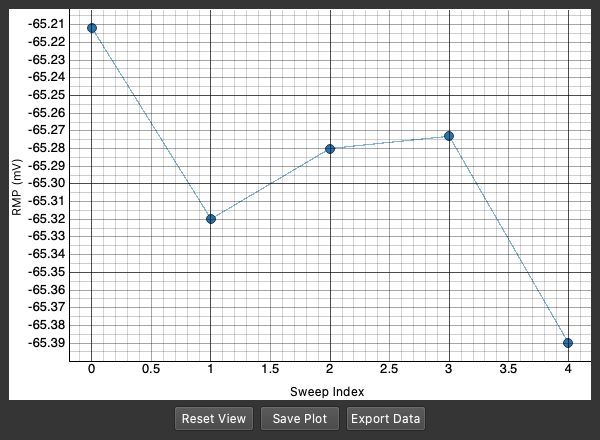

---

### 4.6 Capacitance

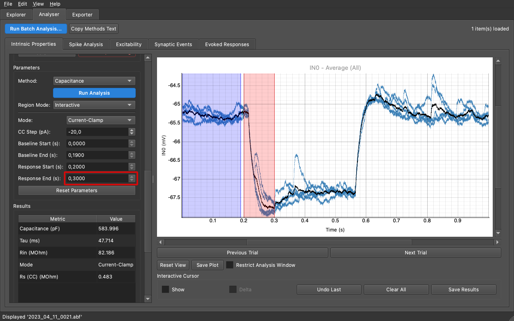

**Registry name**: `capacitance_analysis` | **Tab label**: *Capacitance*

Estimates whole-cell membrane capacitance ($C_m$) and series resistance ($R_s$)
from current-clamp or voltage-clamp step protocols.

#### Parameters

| Parameter | Key | Type | Description |
|-----------|-----|------|-------------|
| Mode | `mode` | choice | `Current-Clamp` (default) or `Voltage-Clamp` |
| CC Step (pA) | `current_amplitude_pa` | float (pA) | Current step amplitude in CC mode (default `-100.0`) |
| VC Step (mV) | `voltage_step_mv` | float (mV) | Command voltage step in VC mode (default `-5.0`) |
| Baseline Start / End (s) | `baseline_start_s`, `baseline_end_s` | float (s) | Pre-step baseline window (`0.0` - `0.1` s) |
| Response Start / End (s) | `response_start_s`, `response_end_s` | float (s) | Step / transient window (`0.1` - `0.3` s) |

#### Methods

- **Current-Clamp mode**: Computes $R_{\text{in}}$ (`calculate_rin`), $\tau$ (`calculate_tau`), and fast series resistance $R_s^{\text{CC}}$ (`rs_cc_mohm`, estimated by fitting $A\exp(-t/\tau)+C$ over the initial `0.5 ms` step-onset window and extrapolating to $t = 0$), then evaluates the $R_s$-corrected capacitance:
  $$
  C_m \;(\text{pF}) = \frac{\tau \;(\text{ms})}{R_{\text{in}} - R_s^{\text{CC}} \;(\text{M}\Omega)} \times 10^3
  $$
  (falling back to $\tau / R_{\text{in}} \times 10^3$ when $R_s^{\text{CC}}$ is unavailable).
- **Voltage-Clamp mode**: Subtracts pre-step baseline and steady-state leak (last 20% of transient window) to isolate $\Delta I(t)$, computes $R_s = |\Delta V| / \max |\Delta I| \times 10^3\;\text{M}\Omega$ (`series_resistance_mohm`), fits a mono-exponential decay to obtain `capacitance_pf` ($\tau_{\text{trans}} / R_s$, with trapezoidal AUC fallback), and unconditionally integrates `capacitance_charge_pf` ($|Q| / |\Delta V|$) in `calculate_capacitance_vc`.

#### Results

- **CC mode**: `capacitance_pf`, `tau_ms`, `rin_mohm`, `rs_cc_mohm` (when finite), `mode`
- **VC mode**: `capacitance_pf`, `series_resistance_mohm`, `mode` (plus `capacitance_charge_pf` from `calculate_capacitance_vc`)

---

### 4.7 Spike Detection

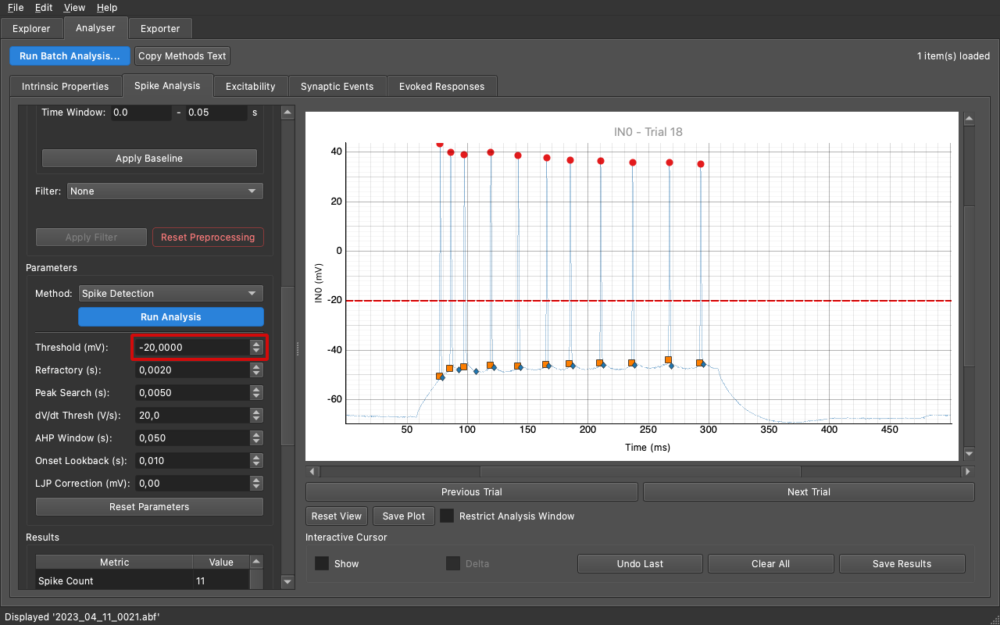

**Registry name**: `spike_detection` | **Tab label**: *Spike Detection*

Two-stage $dV/dt$ + voltage threshold action potential detector and vectorised
18-feature morphological analyser.

#### Parameters

| Parameter | Key | Type | Description |
|-----------|-----|------|-------------|
| Threshold (mV) | `threshold` | float (mV) | Minimum peak voltage required to accept a spike (default `-20.0`) |
| Refractory (s) | `refractory_period` | float (s) | Minimum inter-spike interval (default `0.002` = 2 ms) |
| Peak Search (s) | `peak_search_window` | float (s) | Forward window from $dV/dt$ crossing to locate peak (default `0.005`) |
| dV/dt Thresh (V/s) | `dvdt_threshold` | float (V/s) | Upstroke velocity threshold for spike & onset detection (default `20.0`) |
| AHP Window (s) | `ahp_window` | float (s) | Post-peak window for AHP/ADP evaluation (default `0.05`) |
| Onset Lookback (s) | `onset_lookback` | float (s) | Pre-peak window for backward AP onset search (default `0.01`) |
| LJP Correction (mV) | `ljp_correction_mv` | float (mV) | Subtract liquid junction potential prior to detection (default `0.0`) |

#### Methods

- **Detection** (`detect_spikes_threshold`): 4th-order 5 kHz zero-phase Butterworth pre-filter (`_sosfiltfilt_safe`), upward crossing of `dvdt_threshold`, greedy `refractory_period` enforcement, and peak verification $V_{\text{peak}} \ge \texttt{threshold}$.
- **Onset / Threshold** (`calculate_spike_features`): 4th-order 9.9 kHz zero-phase Bessel pre-filter, **backward search** from peak $dV/dt$ in `onset_lookback` to the last sample $< \texttt{dvdt\_threshold}$ (flagging boundary artifacts as `NaN` when `at_edge` and either $\max dV/dt > 300\,\text{V/s}$ or rising phase $< 0.2\,\text{ms}$).
- **Sub-sample interpolated kinetics**: `half_width` (50% amplitude), `rise_time_10_90`, and `decay_time_90_10` use **sub-sample linear interpolation** between bracketing voltage samples.
- **AHP & ADP**: separate raw-voltage `fahp_depth` (1-5 ms) and `mahp_depth` (10-50 ms); dynamic $dV/dt$ zero-crossing trough with $\pm 1\,\text{ms}$ raw mean (`trough_v`, `ahp_time`, `ahp_duration_half`); variation-diminishing Gaussian-smoothed (`sigma = max(1.0, 0.2 ms / dt)`) `adp_amplitude` bounded before the next AP onset and gated on prominence ($> 0.25\,\text{mV}$ rise and $\ge 0.20\,\text{mV}$ subsequent drop).
- **Derivatives & geometry**: 0.1 ms rolling-mean `max_dvdt`, `min_dvdt`, `upstroke_downstroke_ratio`, `absolute_peak_mv`, `overshoot_mv`, `ap_delay`, and `phase_plane_area` (Shoelace formula).

#### Results

`spike_count`, `mean_freq_hz`, `window_frequency_hz`, `first_spike_latency_s`,
`spike_times`, `spike_indices`, `spike_voltages`, `threshold`, plus `<key>_mean`
and `<key>_std` across detected spikes for `ap_threshold`, `amplitude`,
`half_width`, `rise_time_10_90`, `decay_time_90_10`, `fahp_depth`, `mahp_depth`,
`ahp_duration_half`, `adp_amplitude`, `max_dvdt`, `min_dvdt`,
`absolute_peak_mv`, `overshoot_mv`, `ap_delay`, `ahp_time`,
`upstroke_downstroke_ratio`, `phase_plane_area`, `trough_v`.

#### Visualization

Red dashed threshold h-line; red scatter markers at spike peaks.

---

### 4.8 Phase Plane Analysis

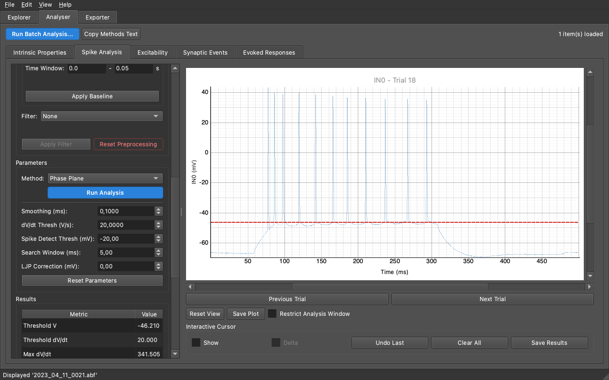

**Registry name**: `phase_plane_analysis` | **Tab label**: *Phase Plane*

Analyses action potential initiation dynamics in phase space ($dV/dt$ vs. $V$).

#### Parameters

| Parameter | Key | Type | Description |
|-----------|-----|------|-------------|
| Smoothing (ms) | `sigma_ms` | float (ms) | Savitzky-Golay smoothing window for $dV/dt$ (default `0.1`; `0` = none) |
| dV/dt Thresh (V/s) | `dvdt_threshold` | float (V/s) | Phase-plane crossing threshold (default `20.0`) |
| Spike Detect Thresh (mV) | `spike_threshold` | float (mV) | Peak voltage threshold for spike detection (default `-20.0`) |
| Search Window (ms) | `search_window_ms` | float (ms) | Pre-peak lookback window for threshold detection (default `5.0`) |
| LJP Correction (mV) | `ljp_correction_mv` | float (mV) | Liquid junction potential offset (default `0.0`) |

*(Programmatic parameter `kink_slope`, default `10.0`, provides a phase-slope fallback.)*

#### Methods

1. **$dV/dt$ calculation** (`calculate_dvdt`): computes `np.gradient(V, dt) / 1000.0` (V/s) and applies a 3rd-order **Savitzky-Golay filter** (`scipy.signal.savgol_filter`, dynamic odd window from `sigma_ms`) directly to $dV/dt$, preserving peak upstroke velocity without Gaussian attenuation.
2. **Inter-spike trough windowing** (`detect_threshold_kink`): bounds each pre-peak lookback window at the inter-spike voltage trough following the preceding spike peak so prior repolarisation never contaminates onset detection.
3. **Threshold resolution**: selects the sample immediately following the last sample $\le \texttt{dvdt\_threshold}$ (with phase-slope $\Delta(dV/dt)/\Delta V \ge \texttt{kink\_slope}$ fallback).

#### Results

`voltage`, `dvdt`, `threshold_indices`, `threshold_vals`, `threshold_v`,
`threshold_dvdt`, `threshold_mean`, `max_dvdt`, `trace_max_dvdt`

#### Visualization

Popup phase-plane plot ($dV/dt$ vs. $V$) with threshold and peak-$dV/dt$ markers.

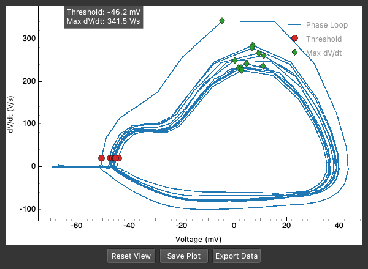

---

### 4.9 Excitability (F-I Curve)

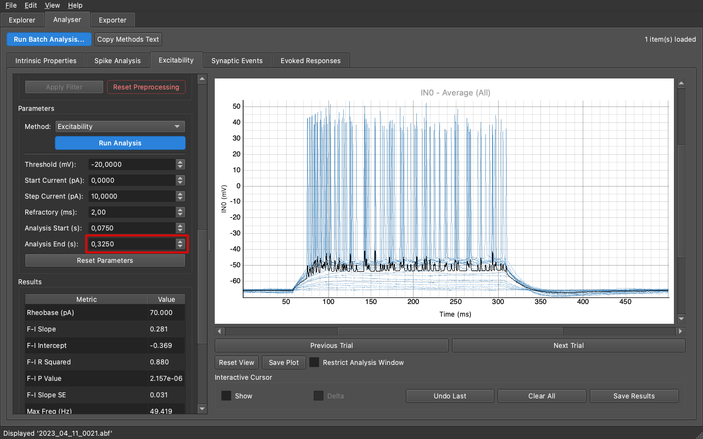

**Registry name**: `excitability_analysis` | **Tab label**: *Excitability*
**Requires multiple trials** (increasing current-step protocol).

#### Parameters

| Parameter | Key | Type | Description |
|-----------|-----|------|-------------|
| Threshold (mV) | `threshold` | float (mV) | Spike peak voltage threshold (default `-20.0`) |
| Start Current (pA) | `start_current` | float (pA) | Current of sweep 0 (default `0.0`) |
| Step Current (pA) | `step_current` | float (pA) | Current increment per sweep (default `10.0`) |
| Refractory (ms) | `refractory_ms` | float (ms) | Refractory period for spike detection (default `2.0`) |
| Analysis Start (s) | `analysis_start_s` | float (s) | Clip each sweep to start time before counting spikes (default `0.0`) |
| Analysis End (s) | `analysis_end_s` | float (s) | Clip each sweep to end time (`0.0` = full sweep) |

#### Methods

1. **Per-sweep firing rate**: uses mean instantaneous rate $(N - 1)/(t_{\text{last}} - t_{\text{first}})$ for sustained firing, with automatic fallback to sustained window rate $N / T_{\text{window}}$ under **single-spike censorship** ($N = 1$) or **early depolarisation block** ($2 \le N \le 3$ ceasing within the first 25% of the window).
2. **Rheobase** (`rheobase_pa`): minimum current eliciting $\ge 1$ spike.
3. **Depolarisation-block-aware F-I regression**: linear regression $f = \text{slope} \cdot I + b$ (Hz/pA) fitted from rheobase **up to the maximum firing frequency sweep** ($\arg\max f$), truncating post-peak depolarisation-block sweeps.
4. **Adaptation Ratio & Spike Broadening**: per-sweep `adaptation_ratios` = $\text{ISI}_{\text{last}} / \text{ISI}_{\text{first}}$ (for $\ge 3$ spikes) and `broadening_indices` = $\text{HW}_{\text{last}} / \text{HW}_{\text{first}}$.

#### Results

`rheobase_pa`, `fi_slope`, `fi_r_squared`, `fi_p_value`, `fi_slope_se`,
`max_freq_hz`, `frequencies`, `adaptation_ratios`, `broadening_indices`,
`current_steps`

#### Visualization

Popup F-I scatter plot with linear regression fit and slope/$R^2$ annotation.

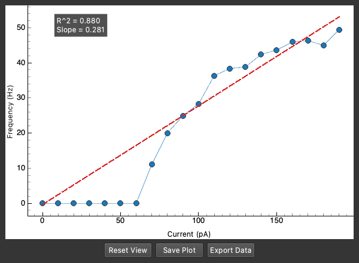

---

### 4.10 Burst Analysis

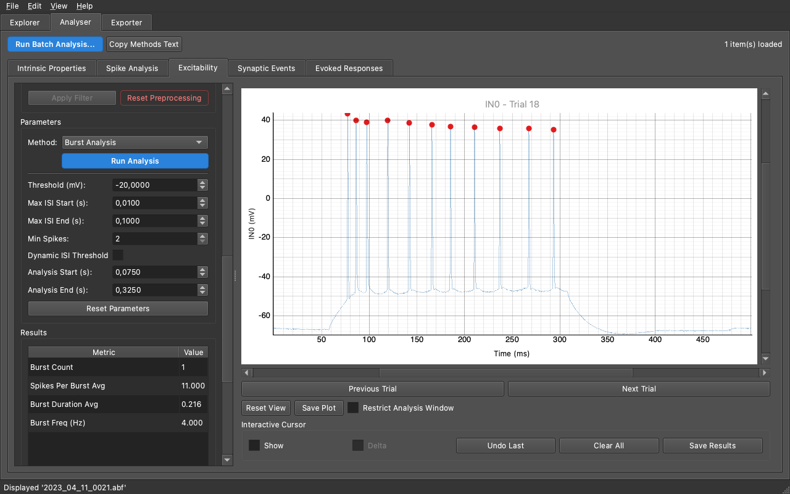

**Registry name**: `burst_analysis` | **Tab label**: *Burst*

Identifies action potential bursts using static or self-scaling dynamic ISI
criteria.

#### Parameters

| Parameter | Key | Type | Description |
|-----------|-----|------|-------------|
| Threshold (mV) | `threshold` | float (mV) | Spike detection threshold (default `-20.0`) |
| Max ISI Start (s) | `max_isi_start` | float (s) | Maximum ISI to initiate a burst (default `0.01`) |
| Max ISI End (s) | `max_isi_end` | float (s) | Maximum ISI to continue a burst (default `0.1`) |
| Min Spikes | `min_spikes` | int | Minimum spikes per burst (default `2`) |
| Dynamic ISI Threshold | `dynamic_burst` | bool | Set ISI boundary dynamically from mean train ISI (default `False`) |
| Burst ISI Fraction | `burst_isi_fraction` | float | Fraction of mean ISI defining a burst when `dynamic_burst=True` (default `0.3`) |
| Analysis Start / End (s) | `analysis_start_s`, `analysis_end_s` | float (s) | Optional time window clipping (`0.0` = full trace) |

#### Methods

1. Two-stage spike detection (`detect_spikes_threshold`).
2. **Static mode**: burst starts when $\text{ISI} \le \texttt{max\_isi\_start}$ and continues while $\text{ISI} \le \texttt{max\_isi\_end}$.
3. **Dynamic mode** (`dynamic_burst=True`): both thresholds equal $\texttt{burst\_isi\_fraction} \times \overline{\text{ISI}}$. Groups with fewer than `min_spikes` spikes are discarded.

#### Results

`burst_count`, `spikes_per_burst_avg`, `burst_duration_avg`, `burst_freq_hz`,
`bursts` (plus `burst_mean_frequency_hz` and `inter_burst_voltage_mv` on
`BurstResult`).

#### Visualization

Red bracket lines spanning each detected burst on the trace.

---

### 4.11 Spike Train Dynamics

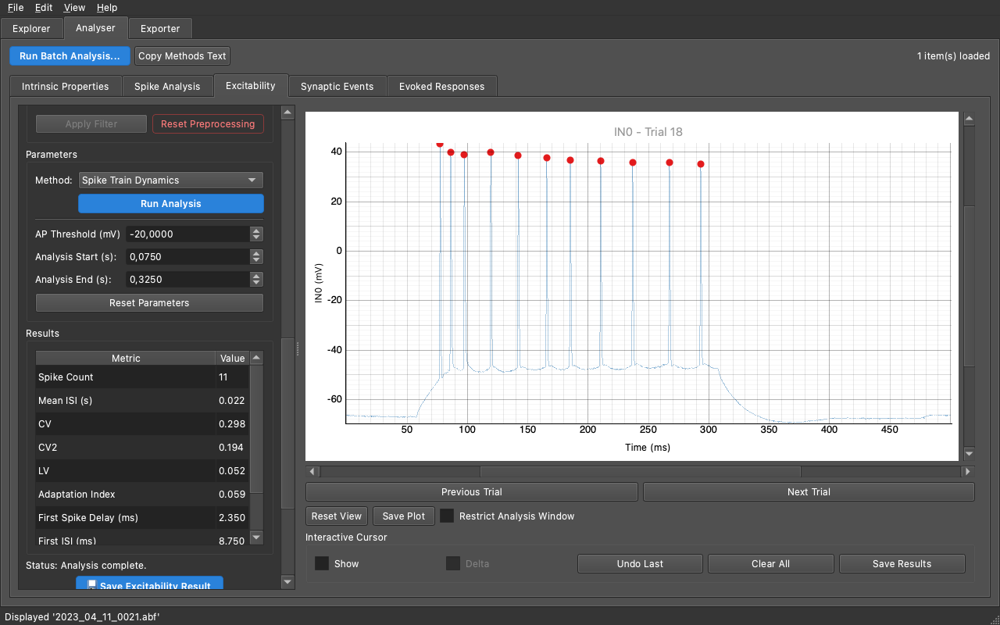

**Registry name**: `train_dynamics` | **Tab label**: *Spike Train Dynamics*

Quantifies spike train regularity, adaptation, latency, and AP broadening.

#### Parameters

| Parameter | Key | Type | Description |
|-----------|-----|------|-------------|
| AP Threshold (mV) | `spike_threshold` | float (mV) | Spike peak voltage threshold (default `-20.0`) |
| Analysis Start (s) | `analysis_start_s` | float (s) | Start of analysis window (default `0.0`) |
| Analysis End (s) | `analysis_end_s` | float (s) | End of analysis window (`0.0` = full trace) |

#### Methods

1. $\text{ISI} = \operatorname{diff}(t_{\text{spike}})$, `first_spike_delay_ms` = $(t_1 - t_{\text{start}}) \times 1000$, `first_isi_ms` = $\text{ISI}_1 \times 1000$.
2. **CV** = $\sigma_{\text{ISI}} / \mu_{\text{ISI}}$ ($0$ = regular, $1$ = Poisson).
3. **$\text{CV}_2$** (Holt et al., 1996) = $\operatorname{nanmean}\bigl(2|\text{ISI}_{i+1} - \text{ISI}_i| / (\text{ISI}_{i+1} + \text{ISI}_i)\bigr)$ (guarded by $\varepsilon = 10^{-9}\,\text{s}$).
4. **LV** (Shinomoto et al., 2003) = $\operatorname{nanmean}\bigl(3(\text{ISI}_i - \text{ISI}_{i+1})^2 / (\text{ISI}_i + \text{ISI}_{i+1})^2\bigr)$ (guarded by $\varepsilon^2 = 10^{-15}\,\text{s}^2$).
5. **Adaptation Index** (`adaptation_index`) = $\operatorname{nanmean}\bigl((\text{ISI}_{i+1} - \text{ISI}_i) / (\text{ISI}_{i+1} + \text{ISI}_i)\bigr)$ ($> 0$ slowing/adaptation, $< 0$ acceleration).
6. **Spike Broadening Index** (`spike_broadening_index`) = $\text{HW}_{\text{last}} / \text{HW}_{\text{first}}$ (for $\ge 3$ spikes).

#### Results

`spike_count`, `mean_isi_s`, `cv`, `cv2`, `lv`, `adaptation_index`,
`first_spike_delay_ms`, `first_isi_ms`, `spike_broadening_index`,
`isi_numbers`, `isi_ms`

#### Visualization

Spike markers on the voltage trace; popup ISI-number vs. ISI-duration scatter.

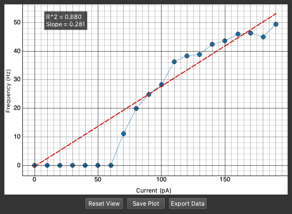

---

### 4.12 Event Detection: Amplitude

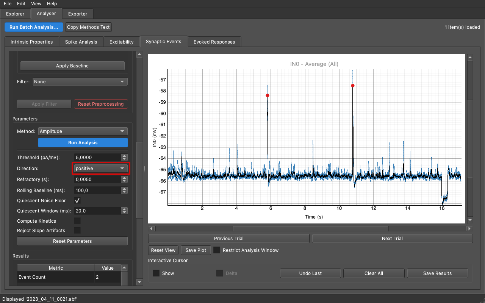

**Registry name**: `event_detection_threshold` | **Tab label**: *Event (Amplitude)*

Detects spontaneous or miniature synaptic events (mEPSCs, mIPSCs, EPSPs) using
adaptive prominence thresholding and quiescent baseline noise estimation. A
**method selector** dropdown switches between the two built-in event detectors
([Section 4.12](#412-event-detection-amplitude) and [Section 4.13](#413-event-detection-template)).

#### Parameters

| Parameter | Key | Type | Description |
|-----------|-----|------|-------------|
| Threshold (pA/mV) | `threshold` | float | Minimum event amplitude / prominence floor (default `5.0`) |
| Direction | `direction` | choice | `negative` (default) or `positive` |
| Refractory (s) | `refractory_period` | float (s) | Minimum inter-event interval (default `0.005`) |
| Rolling Baseline (ms) | `rolling_baseline_window_ms` | float (ms) | Rolling median baseline window (default `100.0`) |
| Quiescent Noise Floor | `use_quiescent_noise_floor` | bool | Estimate noise from quietest detrended window (default `True`) |
| Quiescent Window (ms) | `quiescent_window_ms` | float (ms) | Sliding window width for quiescent RMS (default `20.0`, visible when enabled) |
| Compute Kinetics | `compute_kinetics` | bool | Fit mono-/bi-exponential decays per event (default `False`) |
| Reject Slope Artifacts | `reject_artifacts` | bool | Mask steep stimulus/capacitive slope transients (default `False`; exposes `artifact_slope_threshold` and `artifact_padding_ms` when enabled) |

#### Methods

1. Rolling median subtraction removes slow holding-current or baseline drift.
2. **Noise floor**: when `use_quiescent_noise_floor=True` (default), `find_quiescent_baseline_rms` slides a `20.0 ms` 50%-overlapping linearly detrended window across the trace and returns the RMS of the minimum-variance segment; when `False`, falls back to Gaussian-scaled MAD ($1.4826 \times \text{MAD}$).
3. `scipy.signal.find_peaks` runs with adaptive prominence $\max(|\text{threshold}|, 2\hat{\sigma})$, height $|\text{threshold}|$, refractory distance, and $\ge 0.2\,\text{ms}$ width, followed by local raw-peak refinement.
4. Computes local pre-event foot amplitudes (`compute_local_pre_event_baseline`), dynamic event charge (`calculate_event_charge_dynamic`), and optional mono-/bi-exponential decay fits (`fit_biexponential_decay`). When zero events are detected, amplitude, charge, and $\tau$ summaries return `NaN` (`frequency_hz = 0.0`).

#### Results

`event_count`, `frequency_hz`, `mean_amplitude`, `amplitude_sd`,
`mean_local_amplitude`, `mean_event_charge`, `tau_mono_ms`, `tau_fast_ms`,
`tau_slow_ms`

#### Visualization

Interactive scatter markers (click to remove; Ctrl+click to add);
draggable holding-offset threshold line; mono-/bi-exponential event decay fit overlays; artifact overlay.

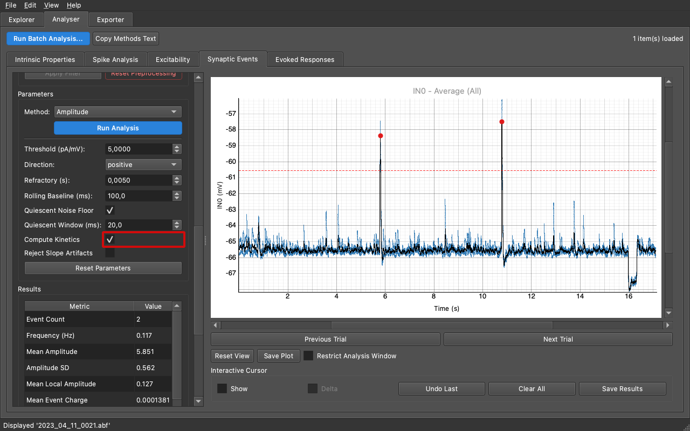

---

### 4.13 Event Detection: Template

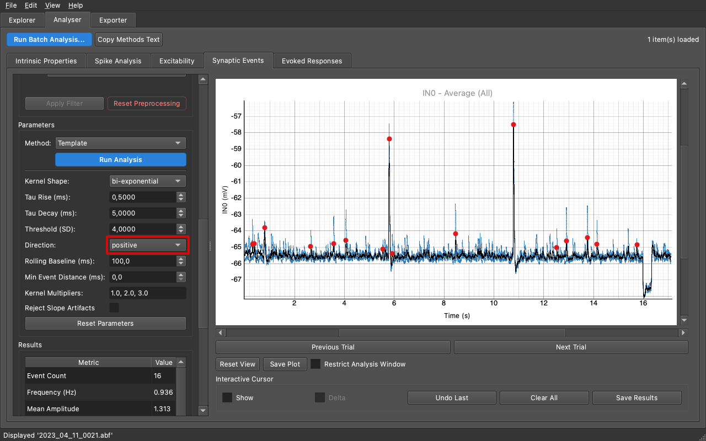

**Registry name**: `event_detection_deconvolution` | **Tab label**: *Event (Template)*

Detects synaptic events via a multi-scale matched-filter bank that tolerates
dendritic cable filtering.

#### Parameters

| Parameter | Key | Type | Description |
|-----------|-----|------|-------------|
| Kernel Shape | `kernel_shape` | choice | `bi-exponential` (default) or `mono-exponential` |
| Tau Rise (ms) | `tau_rise_ms` | float (ms) | Rise time constant (default `0.5`, visible when `bi-exponential`) |
| Tau Decay (ms) | `tau_decay_ms` | float (ms) | Base decay time constant (default `5.0`) |
| Threshold (SD) | `threshold_sd` | float | Z-score detection threshold (default `4.0`) |
| Direction | `direction` | choice | `negative` (default) or `positive` |
| Rolling Baseline (ms) | `rolling_baseline_window_ms` | float (ms) | Rolling median baseline window (default `100.0`) |
| Min Event Distance (ms) | `min_event_distance_ms` | float (ms) | Minimum event separation (`0.0` defaults to `tau_decay`) |
| Kernel Multipliers | `kernel_multipliers` | string | Comma-separated scaling factors for `tau_decay` (default `"1.0, 2.0, 3.0"`) |
| Reject Slope Artifacts | `reject_artifacts` | bool | Mask steep stimulus/capacitive slope transients (default `False`; exposes `artifact_slope_threshold` and `artifact_padding_ms` when enabled) |

#### Methods

1. Constructs a template bank across `kernel_multipliers` (`bi-exponential` $\exp(-t/(s\tau_{\text{decay}})) - \exp(-t/\tau_{\text{rise}})$ or `mono-exponential` $\exp(-t/(s\tau_{\text{decay}}))$), normalising each kernel to **unit peak amplitude**.
2. Cross-correlates (`scipy.signal.fftconvolve` with time-reversed kernel) each template against the polarity-oriented baseline-corrected trace.
3. Normalises each output trace to a MAD z-score ($1.4826 \times \text{MAD}$), aligns template peak offsets to the primary kernel, and takes the pointwise maximum $z_{\text{combined}}$.
4. Detects peaks above `threshold_sd` separated by `min_event_distance_ms` (or `tau_decay` when `0.0`), refines peak positions to true local extrema, and returns `NaN` for amplitude summaries when `event_count == 0`.

#### Results

`event_count`, `frequency_hz`, `mean_amplitude`, `amplitude_sd`,
`mean_local_amplitude`, `template_tau_rise_ms`, `template_tau_decay_ms`,
`tau_rise_ms`, `tau_decay_ms`, `threshold_sd`

#### Visualization

Interactive scatter markers; draggable SD threshold line; artifact overlay.

---

### 4.14 Evoked Sync


**Registry name**: `optogenetic_sync` | **Tab label**: *Evoked Sync*
**Requires secondary TTL channel** (dropdown to select the optical or electrical trigger channel).

#### Parameters

| Parameter | Key | Type | Description |
|-----------|-----|------|-------------|
| TTL Threshold (V) | `ttl_threshold` | float (V) | Binarisation threshold for TTL channel (default `2.5`) |
| Response Window (ms) | `response_window_ms` | float (ms) | Post-stimulus event search window (default `20.0`) |
| Event Type | `event_detection_type` | choice | `Spikes` / `Events (Threshold)` / `Events (Template)` |
| Peak Polarity | `response_polarity` | choice | `max` (CC default), `min` (VC default), or `abs` |
| Amplitude Window (ms) | `amplitude_window_ms` | float (ms) | Post-stimulus peak-amplitude window (default `100.0`) |
| Baseline Window (ms) | `baseline_window_ms` | float (ms) | Pre-stimulus baseline window (default `5.0`) |
| Artifact Blanking (ms) | `artifact_blanking_ms` | float (ms) | Post-stimulus blanking window excluded from peak search (default `1.0`) |
| Reject Slope Artifacts | `reject_artifacts` | bool | Mask high-slope stimulus artifacts before event detection (default `False`) |

Mode-specific detection parameters (`spike_threshold`; `event_threshold`,
`event_direction`, `event_refractory_s`; or `template_kernel_shape`,
`template_tau_rise_ms`, `template_tau_decay_ms`, `template_threshold_sd`,
`template_direction`, `template_kernel_multipliers`) appear conditionally based
on `Event Type`.

#### Methods

1. **TTL edge detection** (`extract_ttl_epochs`): binarises the trigger channel (with automatic midpoint fallback if range $> 0.3\,\text{V}$ yields no crossings) and extracts rising edges.
2. Detects events across the trace using the selected detector:
   - **Spikes** - two-stage $dV/dt$ + voltage threshold AP detection (`detect_spikes_threshold`).
   - **Events (Threshold)** - adaptive prominence event detection (`detect_events_threshold`).
   - **Events (Template)** - multi-scale **matched-filter cross-correlation** (`detect_events_template`) using configurable `template_kernel_shape` (`bi-exponential` / `mono-exponential`) and `template_kernel_multipliers` (default `"1.0, 2.0, 3.0"`).
3. Computes mean latency (`optical_latency_ms`) and standard deviation (`spike_jitter_ms`) across responding stimuli, `response_probability` (`Success Count / stimulus_count`), and baseline-subtracted evoked peak amplitudes (`mean_response_amplitude`, `response_amplitude_sd`).

#### Results

`optical_latency_ms`, `response_probability`, `response_probability_pct`,
`spike_jitter_ms`, `mean_response_amplitude`, `response_amplitude_sd`,
`stimulus_count`, `Success Count`, `Failure Count`, `event_count`,
`event_times`, `stimulus_onsets`, `response_amplitudes`

#### Visualization

Dashed vertical trigger lines at all TTL stimulus onsets; cyan `trace_overlay`
curve highlights across every post-stimulus response window; detected event
markers and red diamond response-peak markers on the trace.

---

### 4.15 Paired-Pulse Ratio (PPR)

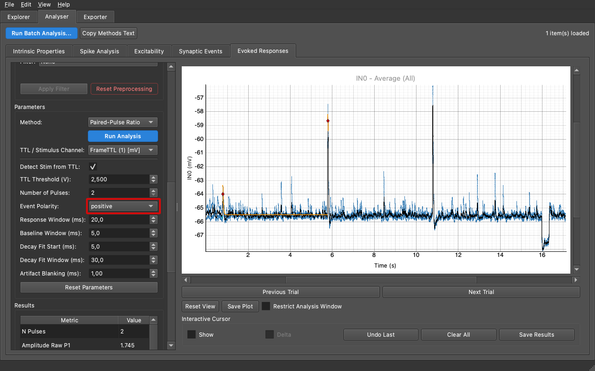

**Registry name**: `paired_pulse_ratio` | **Tab label**: *Paired-Pulse Ratio*
**Optional secondary TTL channel** (when `Detect Stim from TTL` is enabled).

Quantifies short-term synaptic plasticity across $N \ge 2$ stimulus pulses using
iterative cumulative decay subtraction (Thanawala & Regehr, 2013). Each pulse's
amplitude is corrected by evaluating the cumulative residual from all prior
pulses' fitted decays at the current pulse's peak timestamp.

#### Parameters

| Parameter | Key | Type | Description |
|-----------|-----|------|-------------|
| Detect Stim from TTL | `use_ttl` | bool | Auto-detect stimulus times from TTL channel (default `True`) |
| TTL Threshold (V) | `ttl_threshold` | float (V) | Binarisation threshold (default `2.5`, visible when `use_ttl=True`) |
| Number of Pulses | `n_pulses` | int | Number of stimulus pulses (default `2`) |
| Stim 1 / Stim 2 Onset (s) | `stim1_onset_s`, `stim2_onset_s` | float (s) | Manual stimulus times (`0.1`, `0.2` s); ISI = `stim2 - stim1` for $N > 2$ |
| Event Polarity | `polarity` | choice | `negative` (VC default) / `positive` (CC default) |
| Response Window (ms) | `response_window_ms` | float (ms) | Post-stimulus peak-search window (default `20.0`) |
| Baseline Window (ms) | `baseline_window_ms` | float (ms) | Pre-stimulus baseline window (default `5.0`) |
| Decay Fit Start (ms) | `fit_decay_from_ms` | float (ms) | Offset from each stimulus to begin exponential decay fit (default `5.0`) |
| Decay Fit Window (ms) | `fit_decay_window_ms` | float (ms) | Duration of decay-fit window (default `30.0`) |
| Artifact Blanking (ms) | `artifact_blanking_ms` | float (ms) | Post-stimulus blanking window excluded from peak search (default `1.0`) |

#### Methods

1. Measure $\text{bl}_1$ (resting baseline before pulse 1).
2. For each pulse $i = 1, \ldots, N$: locate the blanked response peak at $t_{\text{peak},i}$, evaluate the cumulative residual $\rho_i(t_{\text{peak},i})$ from all prior fitted decays at $t_{\text{peak},i}$, and compute `amplitude_corrected_p{i}`.
3. Subtract cumulative prior residuals from the raw trace in the decay-fit window and fit a bi-exponential decay (falling back to mono-exponential) to isolate pulse $i$'s tail.
4. Normalise all corrected amplitudes to pulse 1: `ratio_p{i} = amplitude_corrected_p{i} / amplitude_corrected_p1`.

#### Results (per pulse `i = 1..N`)

`n_pulses`, `amplitude_raw_p{i}`, `amplitude_corrected_p{i}`, `ratio_p{i}`,
`residual_p{i}`, `decay_tau_ms_p{i}`, `ppr_error`

#### Visualization

Dashed vertical trigger lines at all $N$ stimulus onsets; dark green baseline
`trace_overlay`; cyan response-window `trace_overlay` highlights across all $N$
pulses; amber exponential decay `event_fit_overlay` per pulse; red diamond
markers at each peak position.

---

### 4.16 Stimulus Train (STP)

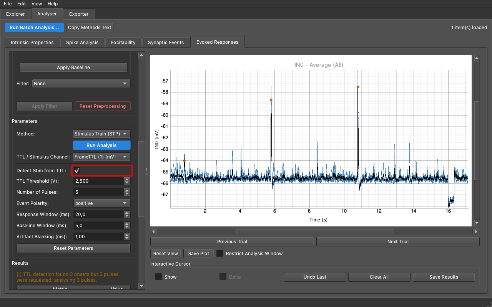

**Registry name**: `stimulus_train_stp` | **Tab label**: *Stimulus Train (STP)*
**Optional secondary TTL channel** for automatic stimulus detection.

Measures short-term plasticity across a stimulus train by computing
baseline-subtracted peak amplitudes per pulse, normalised to $R_1$, along with
steady-state plasticity and biphasic/facilitation/depression classification.

#### Parameters

| Parameter | Key | Type | Description |
|-----------|-----|------|-------------|
| Detect Stim from TTL | `use_ttl` | bool | Auto-detect pulse times from TTL channel (default `True`) |
| TTL Threshold (V) | `ttl_threshold` | float (V) | Binarisation threshold (default `2.5`, visible when `use_ttl=True`) |
| First Stim Onset (s) | `stim_start_s` | float (s) | Manual first-pulse time (default `0.1`, visible when `use_ttl=False`) |
| Stim Frequency (Hz) | `stim_frequency_hz` | float (Hz) | Pulse frequency for manual mode (default `10.0`, visible when `use_ttl=False`) |
| Number of Pulses | `n_pulses` | int | Maximum number of pulses to analyse (default `5`) |
| Event Polarity | `polarity` | choice | `negative` (VC default) / `positive` (CC default) |
| Response Window (ms) | `response_window_ms` | float (ms) | Post-stimulus peak-search window (default `20.0`) |
| Baseline Window (ms) | `baseline_window_ms` | float (ms) | Pre-stimulus baseline window (default `5.0`) |
| Artifact Blanking (ms) | `artifact_blanking_ms` | float (ms) | Post-stimulus blanking window excluded from peak search (default `1.0`) |

#### Methods

1. Detect $N$ stimulus onsets from the TTL channel or generate uniform onsets from `stim_start_s` and `1 / stim_frequency_hz`.
2. For each pulse $k$: measure pre-stimulus `baseline_window_ms` mean and find polarity-signed peak amplitude $R_k$ over `[onset + artifact_blanking_ms, onset + response_window_ms]`.
3. Normalise: $r_k = R_k / R_1$ (`R2/R1` through `Rn/R1`).
4. Compute **`steady_state_ratio`** as the mean of $r_k$ over the last `min(3, n)` pulses (for $n \ge 2$).
5. Classify **`stp_type`**: `biphasic` when $n \ge 4$ and $(R_2 > R_1) \neq (R_n > R_1)$, otherwise `facilitation` when $R_2 > R_1$ or `depression` when $R_2 \le R_1$ (`none` if $n < 2$).

#### Results

`pulse_count`, `r1_amplitude`, `steady_state_ratio`, `stp_type`,
`R2/R1` through `Rn/R1`, `amplitudes`, `amplitudes_norm`, `pulse_numbers`

#### Visualization

Dashed vertical trigger lines at each stimulus onset; cyan response-window
`trace_overlay` highlights across all pulses; diamond scatter markers at each
peak; popup `STP Profile` scatter plot of normalised amplitude ($R_n / R_1$) vs.
pulse number.

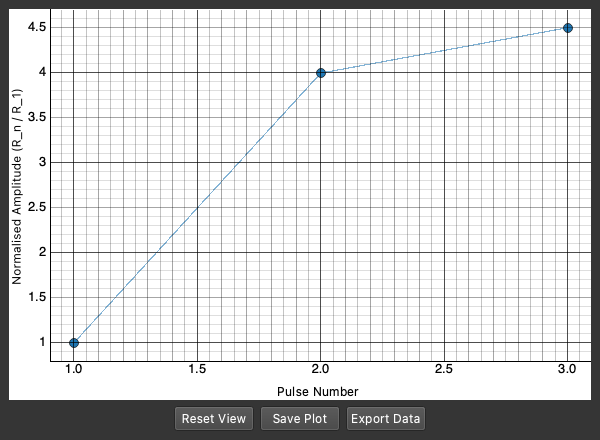

---

## 5. Batch Processing

### 5.1 Overview

The batch engine applies an analysis pipeline across many files automatically,
producing a consolidated Pandas DataFrame result. Every row is traceable to its
subject, cell, source file, protocol segment, channel, trial, and analysis step.
The output is structured for direct import into Excel, Origin, R, MATLAB,
GraphPad Prism, or Python scripts.

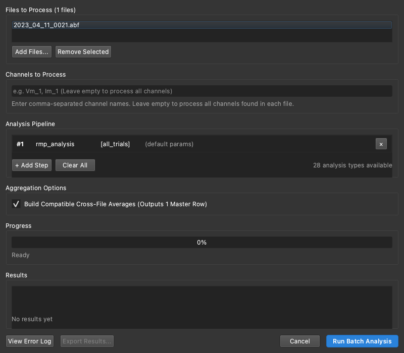

**Build Compatible Cross-File Averages** first averages technical repeats within
each file, then gives every file equal weight in the final average. When a
Protocol Map is available, only matching compatible protocol fingerprints are
pooled; exclusions and contributors are recorded in the result provenance.

### 5.2 Opening the Batch Dialog

Click **"Run Batch"** in the Analyser tab toolbar. The dialog shows:
- The file list from the analysis set (paths *or* in-memory `Recording` objects).
- A visual pipeline builder with an expanded method selector for browsing
  available analyses by module tab.
- A channel filter (comma-separated names/IDs; leave empty for all channels).
- A progress bar, status label, and cancel button.
- **View Error Log** - opens the batch error log file
  (`~/.synaptipy/logs/batch_errors.log`) for post-hoc diagnosis of failures
  encountered during prior batch runs.

### 5.3 Building a Pipeline

1. **Add Step** - select from all registered analyses or registered
   preprocessing processors.
2. **Scope** - determines how data is fed to the analysis function:
   - *Average* - single averaged trace across all trials.
   - *All Trials* - analysis runs once per trial, producing one row per trial.
   - *First Trial* - analysis runs on trial 0 only.
   - *Specific Trial* - pick a 0-based trial index.
   - *Selected Trials* / *Selected Trials Average* - subset of trials parsed from a selection string (e.g. `"0, 2-4"`).
   - *Channel Set* - pass the full list of trials to multi-sweep functions (`iv_curve_analysis`, `excitability_analysis`, `rmp_analysis`).
3. Configure **Parameters** with auto-generated widgets driven by
   `ui_params` in the registry metadata.
4. Optionally prepend **Preprocessing Steps** (`baseline_subtraction`, `lowpass_filter`, `highpass_filter`, `bandpass_filter`, `notch_filter`, `comb_filter`, `detrend_filter`).
   Preprocessing modifies the data context for all subsequent analysis steps
   in the same channel.

### 5.4 Running and Cancellation

A background `QThread` worker (with optional file-level `ProcessPoolExecutor`
parallelism controlled by `Max CPU cores` and `Max RAM allocation` in
**Edit > Preferences > Performance**) processes files with per-file progress
updates. Click **Stop** at any time - cancellation is thread-safe and returns a
partial-result DataFrame.

### 5.5 Output Columns

The result DataFrame orders columns into leading metadata, alphabetically sorted
analysis metrics, and trailing diagnostic columns:

#### Metadata columns (leading order when present)

| Column | Description |
|--------|-------------|
| `subject_id` | Animal / subject identifier (for hierarchical mixed-effects models) |
| `cell_id` | Cell identifier within subject |
| `file_name` | Source filename (e.g. `cell_01.abf`) |
| `file_path` | Full path to the source file |
| `protocol` | Acquisition protocol label from file metadata (when available) |
| `protocol_family` | Reviewed Protocol Map family (`current_step`, `paired_pulse`, etc.) |
| `protocol_fingerprint` | Compatibility hash used to group cross-file averages |
| `protocol_source` | Provenance source (`recorded`, `manual`, `drawn`, `imported`, `unmapped`) |
| `protocol_status` | Readiness status (`compatible`, `needs_review`, `incompatible`) |
| `protocol_assignment_id` | Identifier of the matched Protocol Map assignment |
| `segment_start_s`, `segment_end_s` | Resolved protocol segment bounds in seconds |
| `recording_duration_s` | Total recording duration in seconds |
| `channel` | Channel name or ID processed |
| `channel_units` | Physical units of the channel (`mV`, `pA`, etc.) |
| `analysis` | Registry key of the analysis function |
| `scope` | Data scope used (`average`, `all_trials`, etc.) |
| `trial_index` | 0-based trial index (present for per-trial scopes) |
| `trial_count` | Total number of trials available in the channel |
| `sampling_rate` | Sampling frequency in Hz |

#### Analysis result columns (middle, alphabetically sorted)

Examples by analysis module:

| Analysis | Representative columns |
|----------|------------------------|
| `rmp_analysis` | `rmp_mv`, `rmp_std`, `rmp_drift_rate_mv_per_sweep` |
| `spike_detection` | `spike_count`, `mean_freq_hz`, `ap_threshold_mean`, `half_width_mean`, `fahp_depth_mean`, `mahp_depth_mean` |
| `rin_analysis` | `rin_mohm`, `rin_peak_mohm`, `rin_steady_state_mohm`, `conductance_us` |
| `event_detection_*` | `event_count`, `frequency_hz`, `mean_amplitude`, `mean_local_amplitude` |
| `excitability_analysis` | `rheobase_pa`, `fi_slope`, `fi_r_squared`, `fi_p_value`, `max_freq_hz` |
| `capacitance_analysis` | `capacitance_pf`, `tau_ms`, `rin_mohm`, `rs_cc_mohm` / `series_resistance_mohm` |
| `optogenetic_sync` | `optical_latency_ms`, `response_probability`, `spike_jitter_ms`, `mean_response_amplitude` |
| `stimulus_train_stp` | `pulse_count`, `r1_amplitude`, `steady_state_ratio`, `stp_type`, `R2/R1` |

Dimensionless or abbreviated metrics also receive human-readable alias columns
automatically (`coeff_of_variation` for `cv`, `local_cv2_holt` for `cv2`,
`local_variation_shinomoto` for `lv`, `fi_gain_hz_per_pa` for `fi_slope`).

#### Array-valued results

Large arrays (spike times, I-V curves, etc.) are summarised as compact strings
in the tabular output (e.g. `n=42, mean=15.3, min=2.1, max=87.6`), while
discrete event arrays (`event_times`, `event_amplitudes`, `spike_times`, etc.)
are retained under `_raw_arrays` for NWB and relational `_events.csv` export,
and continuous arrays are stashed under `_<key>_raw`. Small arrays ($\le 5$
elements) remain inline as lists.

#### Trailing / debug columns

| Column | Description |
|--------|-------------|
| `batch_timestamp` | ISO 8601 timestamp of batch start |
| `error` | Error message if the analysis failed for this row |
| `debug_trace` | Python traceback (only present on error rows) |

### 5.6 Export Formats

Click **"Export Results..."** to save:

| Format | Extension | Notes |
|--------|-----------|-------|
| **CSV** | `.csv` | Comment header with batch metadata (`#`-prefixed lines), companion `<stem>_provenance.json`, and 10-significant-figure timestamps. Private columns stripped. |
| **Excel** | `.xlsx` | Multi-sheet workbook (`Summary` + provenance metadata; requires `openpyxl`). Private columns stripped. |
| **JSON** | `.json` | Array of records with `indent=2`. Arrays are preserved as lists for programmatic consumption. |

CSV files include a reproducibility header:

```text
# Synaptipy Batch Analysis Export
# Exported: 2026-03-03T14:22:01
# Files processed: 12
# Pipeline: rmp_analysis -> spike_detection
# Rows: 48
#
file_name,file_path,channel,...
```

### 5.7 Programmatic and Headless CLI Batch Usage

Run headless batch pipelines either from the `synaptipy-batch` CLI or from
Python:

```bash
# List all registered analyses and preprocessors:
synaptipy-batch list-analyses

# Run a pipeline JSON from the terminal (writes results.csv + results_provenance.json):
synaptipy-batch run data/*.abf \
    --pipeline pipeline.json \
    --output results.csv \
    --channel Vm_prime \
    --max-workers 2
```

Equivalent Python API usage:

```python
from pathlib import Path
from synaptipy.core.analysis.batch_engine import BatchAnalysisEngine

# Import the analysis package to register all built-in analyses and preprocessors
import synaptipy.core.analysis  # noqa: F401

engine = BatchAnalysisEngine(max_workers=1)
files = sorted(Path("data/").glob("*.abf"))

pipeline = [
    {"analysis": "lowpass_filter", "params": {"cutoff": 2000.0, "filter_type": "bessel"}},
    {"analysis": "rmp_analysis", "scope": "average",
     "params": {"baseline_start": 0.0, "baseline_end": 0.1}},
    {"analysis": "spike_detection", "scope": "all_trials",
     "params": {"threshold": -20.0}},
]

df = engine.run_batch(files, pipeline, channel_filter=["Vm_prime"])
clean = df.drop(columns=[c for c in df.columns if c.startswith("_")])
clean.to_csv("results.csv", index=False)
```

### 5.8 Pipeline Context and Preprocessing

Seven preprocessing tasks are registered in `synaptipy.core.analysis.preprocessing`
(`baseline_subtraction`, `lowpass_filter`, `highpass_filter`, `bandpass_filter`,
`notch_filter`, `comb_filter`, and `detrend_filter`). When placed in a pipeline,
each preprocessor transforms the signal in-order for all subsequent analysis
steps on the *same channel* without leaking across channels or files:

1. `bandpass_filter` (preprocessing) - filters channel trace in context
2. `spike_detection` - runs on the filtered trace
3. `burst_analysis` - also runs on the filtered trace

### 5.9 Troubleshooting

| Symptom | Cause | Fix |
|---------|-------|-----|
| 0 analyses in Add Step dialog | Registry not populated | Ensure `import synaptipy.core.analysis` runs before opening dialog (automatic in GUI and `synaptipy-batch`) |
| Channel filter matches nothing | Name mismatch | Check exact channel names in Explorer tab; filter is case-sensitive |
| Empty results DataFrame | No data in requested scope | Verify the file has trials and the scope matches |
| `error` column filled | Analysis function raised exception | Check the `debug_trace` column or `~/.synaptipy/logs/batch_errors.log` |
| Array columns show "n=..." | Large arrays are summarised | Use JSON export or access `_raw_arrays` / `_<key>_raw` columns in Python |

---

## 6. The Exporter Tab

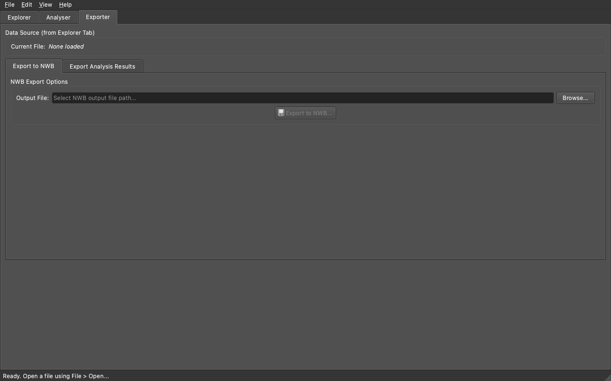

### 6.1 NWB Export

Click **"Export to NWB"** to open the NWB Metadata Dialog (four tabs):
- **Session** - `session_description` (required), `identifier` UUID (required, auto-generated), `session_start_time` (required), experimenter, lab, institution, temperature, LJP.
- **Subject** - `subject_id` (required), species, age (ISO 8601), sex, genotype, weight.
- **Device** - `device_name`, `device_description` (required), manufacturer.
- **Electrodes** - description (defaults to `"Recording Pipette"`), location, filtering.

`NWBExporter` pre-scales trace arrays directly into 64-bit SI base units
(`volts` or `amperes`) and writes `conversion=1.0` on every series so downstream
NWB/DANDI/Neo tools never double-scale values:

| Channel Units | NWB Series Class | Pre-Scale Applied to `data` | Stored `unit` & `conversion` |
|---------------|-----------------|-----------------------------|------------------------------|
| `uV`, `microvolt` | `CurrentClampSeries` | $\times 10^{-6}$ | `"volts"`, `conversion=1.0` |
| `mV`, `millivolt` | `CurrentClampSeries` | $\times 10^{-3}$ | `"volts"`, `conversion=1.0` |
| `V`, `volt` | `CurrentClampSeries` | $\times 1$ | `"volts"`, `conversion=1.0` |
| `pA`, `picoampere` | `VoltageClampSeries` | $\times 10^{-12}$ | `"amperes"`, `conversion=1.0` |
| `nA`, `nanoampere` | `VoltageClampSeries` | $\times 10^{-9}$ | `"amperes"`, `conversion=1.0` |
| `uA`, `microampere` | `VoltageClampSeries` | $\times 10^{-6}$ | `"amperes"`, `conversion=1.0` |
| `A`, `ampere` | `VoltageClampSeries` | $\times 1$ | `"amperes"`, `conversion=1.0` |
| Other / unknown | `PatchClampSeries` | $\times 1$ (unmodified) | Original unit, `conversion=1.0` |

Stimulus waveforms use a 3-step fallback (digitized command channel, synthetic
ABF step + linear ramp reconstruction from `EpochSections`, or `stimulus=None`
with response warning). Batch scalar results and discrete event arrays are
embedded in `/processing/analysis` (`scalar_metrics` and `{chan}_{analysis}`
`DynamicTable`s) and preprocessing provenance in `/processing/preprocessing`.
See [NWB Export Mapping](../nwb_mapping.md) for full details.

### 6.2 Analysis Results Export

- Table: Analysis Type, Source File, Data Source, Value, Timestamp, Details.
- Select/deselect individual results with checkboxes.
- **Refresh Results** syncs with the latest session accumulation.
- Export to **CSV** (with 10-significant-figure timestamps and companion `<stem>_provenance.json`, plus `CSVExporter.export_to_prism_format(..., aggregate_by_file=True)` for GraphPad Prism) or **JSON**.

### 6.3 Plot Export

Every Explorer and Analyser sub-tab has a **"Save Plot"** button that opens an
export dialog with the following options:

- **Preset selector** - Choose from predefined configurations:
  - *Journal Quality (300 DPI, PDF)* - Vector format at 300 DPI for manuscript submission.
  - *Presentation (150 DPI, PNG)* - Raster format at 150 DPI for slide decks.
  - *Web (72 DPI, PNG)* - Compact raster for online documentation or reports.
  - *Custom* - Manual control over format and resolution.
- **Format** - PNG, JPG, SVG, or PDF. Vector formats (SVG, PDF) retain editable
  text and scale without loss, accompanied by a JSON provenance sidecar.
- **DPI** - Configurable resolution from 72 to 1200 DPI.

---

## 7. Preferences and Customization

### 7.1 Preferences Dialog (Edit > Preferences)

The Preferences dialog organises global settings into two tabs:

- **General tab**
  - **Scroll Behavior** - `Natural`, `Inverted`, or `System`.
  - **Appearance** - Switch between **Light**, **Dark**, or **System** theme.
    Synaptipy selects native per-OS widget styles (`macOS` + `NSAppearance` on
    macOS, `windows11`/`windowsvista`/`Fusion` on Windows, and
    `Breeze`/`Adwaita`/`Fusion` on Linux) while keeping electrophysiology plot
    canvases white (`#ffffff`) with black axes (`#000000`). *System* detects the
    active OS dark/light preference (including GNOME, GTK, and KDE on Linux) and
    updates live without restarting.
  - **Extensions** - `Enable Custom Plugins` (checked by default). Toggling
    reloads `~/.synaptipy/plugins/` in-process without restarting.
- **Performance tab**
  - **Parallel Processing (`Max CPU cores`)** - Worker process count for
    `BatchAnalysisEngine` (`1` disables multiprocessing).
  - **Memory (`Max RAM allocation`)** - Approximate RAM budget in GB (`0.5` -
    `512.0 GB`, default `4.0 GB`) used to cap concurrent workers alongside
    per-file `gc.collect()`.
  - **Rendering (`Enable Hardware Acceleration (OpenGL) - Experimental`)** -
    Opt-in OpenGL plot acceleration (disabled by default; requires application
    restart to take effect).

### 7.2 Plot Customization Dialog (View > Plot Customization...)

Customises colours, line widths, symbols, line styles, and opacity across nine
category tabs:

- **Average** - average trace colour, line width, and opacity.
- **Single Trial** - single-sweep colour, width, and opacity.
- **Grid** - grid visibility toggle, width, and opacity.
- **Scatter Points** - detected spike/event marker colour, opacity, pixel size, and shape (`Circle`, `Triangle`, `Diamond`, `Square`, `Plus`, `Star`).
- **Selection Windows** - draggable `LinearRegionItem` fill colour, opacity, and border line style.
- **AUC Fill** - synaptic charge shaded area colour and opacity.
- **H/V Lines** - horizontal and vertical marker line colour, width, opacity, and line style.
- **Trace Overlay** - pre-stimulus baseline highlight colour, line width, and opacity slider (`0-100%`).
- **Event Fit Overlay** - fitted event/PPR decay curve colour, line width, and opacity slider (`0-100%`).
- **Performance (`Force Opaque Single Trials (Faster Rendering)`)** - disables per-trial alpha blending to accelerate rendering on dense multi-sweep overlays, plus **Reset to Defaults**.

### 7.3 Analysis Defaults (Edit > Configure Analysis Defaults)

Registry parameter editor - modify default values for any analysis module.
Changes persist across sessions.

---

## Appendix A: Supported File Formats

| Format | Extensions |
|--------|------------|
| Axon ABF | `.abf` |
| WinWCP | `.wcp` |
| Spike2 | `.smr`, `.smrx` |
| NeuroExplorer | `.nex` |
| HDF5 / NWB | `.h5`, `.nwb` |
| Axon ATF | `.atf` |
| Igor Pro | `.ibw`, `.pxp` |
| Additional formats | See [Neo documentation](https://neo.readthedocs.io/en/latest/iolist.html) |

---

## Appendix B: Architecture

| Layer | Responsibility | Technologies |
|-------|---------------|--------------|
| **Core** | Signal processing, analysis algorithms | NumPy, SciPy, pure Python |
| **Application** | GUI, CLI, user interaction, visualization | PySide6, PyQtGraph |
| **Infrastructure** | File I/O, format adapters, exporters | Neo, PyNWB, pandas |

The **Registry Pattern** (`AnalysisRegistry`) provides plugin extensibility:
any script decorated with `@AnalysisRegistry.register` becomes an analysis
sub-tab in the GUI and an executable task in `BatchAnalysisEngine` and
`synaptipy-batch`.
