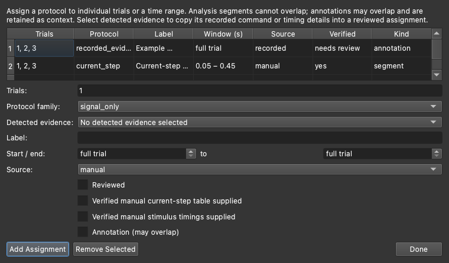

# Synaptipy User Guide

This document describes installation, configuration, and operation of Synaptipy for electrophysiology data visualization and analysis.

## Table of Contents

- [Installation](#installation)
  - [System Requirements](#system-requirements)
  - [Standard Installation](#standard-installation)
  - [Developer Installation](#developer-installation)
- [Getting Started](#getting-started)
  - [Running the Application](#running-the-application)
  - [User Interface Overview](#user-interface-overview)
  - [Demo Data](#demo-data)
- [Loading Data](#loading-data)
  - [Supported File Formats](#supported-file-formats)
  - [Opening Files](#opening-files)
- [Using the Explorer Tab](#using-the-explorer-tab)
  - [Navigation Controls](#navigation-controls)
  - [Plot Options](#plot-options)
- [Using the Analyser Tab](#using-the-analyser-tab)
  - [Input Resistance/Conductance Analysis](#input-resistanceconductance-analysis)
  - [Baseline/RMP Analysis](#baselinermp-analysis)
  - [Evoked Responses](#evoked-responses)
  - [Sag Ratio (Ih) Analysis](#sag-ratio-ih-analysis)
  - [Additional Analysis Modules](#additional-analysis-modules)
  - [Protocol Maps and Compatible Averaging](#protocol-maps-and-compatible-averaging)
  - [Visual Validation Overlays](#visual-validation-overlays)
- [Using the Exporter Tab](#using-the-exporter-tab)
  - [Exporting to NWB](#exporting-to-nwb)
  - [Exporting Analysis Results](#exporting-analysis-results)
  - [Exporting Plots](#exporting-plots)
- [Advanced Options](#advanced-options)
  - [Reproducibility: How GUI Adjustments Serialize to the Batch Engine](#reproducibility-how-gui-adjustments-serialize-to-the-batch-engine)
  - [Preferences](#preferences)
  - [Version Checking](#version-checking)
  - [Command Line Arguments](#command-line-arguments)
  - [Logging and Debugging](#logging-and-debugging)
- [Generating Publication-Quality Figures](#generating-publication-quality-figures)
  - [Standard rcParams block](#standard-rcparams-block)
  - [L-shaped scale bar for electrophysiology traces](#l-shaped-scale-bar-for-electrophysiology-traces)
  - [Statistical transparency: strip plots instead of bare bar charts](#statistical-transparency-strip-plots-instead-of-bare-bar-charts)
  - [Saving figures for headless / CI environments](#saving-figures-for-headless--ci-environments)
- [Licensing](#licensing)
- [Troubleshooting](#troubleshooting)
- [Analysis Parameter Reference](#analysis-parameter-reference)

## Installation

### System Requirements

**Operating Systems:**
- macOS 11.0 (Big Sur) or later
- Windows 10/11 (64-bit)
- Linux (Ubuntu 20.04+, Fedora 35+, or equivalent)

**Hardware:**
- CPU: Multi-core processor (quad-core or better recommended for batch processing)
- RAM: 8 GB minimum, 16 GB recommended for large recordings (>500 MB)
- Display: 1920x1080 resolution or higher recommended for optimal interface layout
- GPU: Optional - Experimental opt-in OpenGL hardware acceleration is available in **Edit > Preferences** under the **Performance** tab (`Enable Hardware Acceleration (OpenGL) - Experimental`, disabled by default; requires application restart); a discrete GPU improves rendering throughput on high-density traces

**Software Requirements:**
- Python 3.10-3.12 (3.11 recommended)
- Anaconda or Miniconda (recommended) or pip

### Dependencies

Dependencies are automatically installed during package installation:
- [PySide6](https://doc.qt.io/qtforpython-6/) - Qt6 bindings for Python (GUI framework)
- [PyQtGraph](https://www.pyqtgraph.org) - plotting library (with experimental OpenGL support)
- [Neo](https://neo.readthedocs.io/en/latest/) - electrophysiology file I/O (Garcia et al., 2014, *Front. Neuroinformatics* [doi:10.3389/fninf.2014.00010](https://doi.org/10.3389/fninf.2014.00010))
- [NumPy](https://numpy.org) / [SciPy](https://scipy.org) - numerical computation and signal processing
- [PyNWB](https://pynwb.readthedocs.io/en/stable/) - NWB data export (Rubel et al., 2022, *eLife* [doi:10.7554/eLife.78362](https://doi.org/10.7554/eLife.78362))

### Standard Installation

**WARNING: PySide6 must remain pinned to version 6.7.3 due to QTBUG-130070.**

Synaptipy is available both as a standalone application and as a Python package.

#### Default Install (PyPI)

The recommended approach for most users is to install Synaptipy directly via pip into a standard Python environment (Python 3.10-3.12).

```bash
pip install synaptipy
# Optional: include pyabf fallback reader alongside Neo
pip install "synaptipy[formats]"
```

#### Conda Install

If you prefer using Anaconda or Miniconda, create a dedicated environment using the repository's environment file:

```bash
git clone https://github.com/anzalks/synaptipy.git
cd synaptipy
conda env create -f environment.yml
conda activate synaptipy
pip install synaptipy
```

#### Standalone Application

Pre-built installers for Windows, macOS, and Linux are published on the [GitHub Releases page](https://github.com/anzalks/synaptipy/releases):
- **Windows**: Download and execute `Synaptipy_Setup_<version>.exe`.
- **macOS (Apple Silicon)**: Download `Synaptipy_<version>_macOS_arm64.dmg`, open the disk image, and drag Synaptipy to the `Applications` folder. Because release `.dmg` builds use ad-hoc code signing, run `xattr -cr /Applications/Synaptipy.app` (or approve the app in **System Settings > Privacy & Security**) if macOS Gatekeeper blocks the first launch.
- **macOS (Intel)**: Download `Synaptipy_<version>_macOS_x86_64.dmg`, open the disk image, and drag Synaptipy to the `Applications` folder (run `xattr -cr /Applications/Synaptipy.app` if Gatekeeper blocks the first launch).
- **Linux**: Download `Synaptipy-<version>-x86_64.AppImage`, mark it executable (`chmod +x Synaptipy-<version>-x86_64.AppImage`), and launch it. On distributions without FUSE 2 pre-installed (such as Ubuntu 24.04+), install `libfuse2t64`/`libfuse2` or launch with `./Synaptipy-<version>-x86_64.AppImage --appimage-extract-and-run`.

### Developer Installation

For developers, users who want to modify the application, or users working from the `main` branch, install from source using Conda/Miniconda:

```bash
git clone https://github.com/anzalks/synaptipy.git
cd synaptipy
conda env create -f environment.yml
conda activate synaptipy
pip install -e ".[dev]"
```

## Getting Started

### Running the Application

After installation, run the application using one of these methods:

1. **Using the installed entry point:**
   ```bash
   synaptipy
   ```

2. **Using the Python module:**
   ```bash
   python -m synaptipy
   ```

### User Interface Overview

The Synaptipy interface consists of three main tabs:

1. **Explorer Tab**: View and navigate through data files, with interactive plotting
2. **Analyser Tab**: Perform automated analyses on the loaded data
3. **Exporter Tab**: Export data and results to standard formats

### Demo Data

A set of example recordings may be downloaded automatically for testing purposes.

1. Select **Help > Download Demo Data...** A banner appears below the menu bar.
2. Select **Download Demo Data**. The application downloads five example recordings
   from the public repository to `~/Documents/SynaptiPy_Demo/`:

   | File | Format | Description |
   |------|--------|-------------|
   | `2023_04_11_0018.abf` | ABF v2 | Whole-cell current-clamp, step protocol |
   | `2023_04_11_0019.abf` | ABF v2 | Whole-cell current-clamp, ramp protocol |
   | `2023_04_11_0021.abf` | ABF v2 | Voltage-clamp, IV curve |
   | `2023_04_11_0022.abf` | ABF v2 | Optogenetic stimulation protocol |
   | `240326_003.wcp` | WinWCP | WinWCP current-clamp recording |

3. Upon completion, the banner closes and the first ABF file is opened in
   the **Explorer Tab**.
4. The **Help > Download Demo Data...** menu item is disabled for the session
   (and on subsequent launches if files are already present).

**Note:** An internet connection is required. Files already present are not
re-downloaded. If a download is interrupted, partially written files are
removed.

## Loading Data

### Supported File Formats

File I/O is handled through the [Neo](https://neo.readthedocs.io/en/latest/) library
(Garcia et al., 2014, *Front. Neuroinformatics*, [doi:10.3389/fninf.2014.00010](https://doi.org/10.3389/fninf.2014.00010)).
Synaptipy loads any recording format for which Neo provides a reader - this includes
whole-cell patch-clamp and intracellular recordings as well as extracellular, sharp-electrode,
and multi-channel data, provided the file format is supported. Confirmed formats include:

| Format | Extension(s) | Acquisition System |
|---|---|---|
| Axon Binary Format | `.abf` | Axon / Molecular Devices |
| WinWCP | `.wcp` | Strathclyde Electrophysiology Software |
| CED / Spike2 | `.smr`, `.smrx` | Cambridge Electronic Design |
| Igor Pro | `.ibw`, `.pxp` | WaveMetrics |
| Intan | `.rhd`, `.rhs` | Intan Technologies |
| Neurodata Without Borders | `.nwb` | NWB standard |
| BrainVision | `.vhdr` | Brain Products |
| European Data Format | `.edf` | EDF/EDF+ |
| Plexon | `.plx`, `.pl2` | Plexon |
| Open Ephys | `.continuous`, `.oebin` | Open Ephys |
| Tucker Davis Technologies | `.tev`, `.tbk` | TDT |
| Neuralynx | `.ncs`, `.nse`, `.nev` | Neuralynx |
| NeuroExplorer | `.nex` | NeuroExplorer |
| MATLAB | `.mat` | - |
| ASCII / CSV | `.txt`, `.csv`, `.tsv` | - |

For the full list of Neo-supported formats, see the
[Neo I/O documentation](https://neo.readthedocs.io/en/latest/iolist.html).

> **Note:** Allen Cell Types Database NWB files (NWB format 2.2-2.3) may
> produce `UserWarning: ignoring namespace` messages when opened. These are
> benign version-mismatch warnings from `pynwb` and do not affect data
> integrity. All voltage traces and stimulus waveforms are read accurately.

### Opening Files

1. Click "Open File..." in the menu or use the shortcut (`Ctrl+O` or `Cmd+O`)
2. Navigate to your data file and select it
3. The file opens in the Explorer tab
4. If other files with the same extension exist in the folder, they are available
   for navigation with **Prev / Next File** - this applies whether you opened one
   file or many, and whether you used the menu, drag-and-drop, or
   **Help > Download Demo Data**

## Using the Explorer Tab

The Explorer tab has three resizable panels: the **Configuration panel** on the
left, the **Plot area** in the centre, and the **File / Analysis panel** on the
right. Drag the divider handles between the panels to resize them to suit your
screen. The default widths are 320 px (left), 800 px (centre), and 360 px
(right).

### Navigation Controls

- **Zoom**: Use the mouse wheel, or zoom buttons
- **Pan**: Click and drag in the plot area
- **Reset View**: Click the "Reset View" button to return to the initial view
- **Navigate Between Files**:
  - Use the "Previous File" and "Next File" buttons (if multiple files were found)
  - The current file index is shown between the navigation buttons

### Plot Options

- **Plot Mode**:
  - "Overlay All + Avg": Shows all trials with the average highlighted
  - "Cycle Single Trial": Shows one trial at a time with navigation controls
- **Performance**:
  - `_force_opaque_trials`: For datasets with >10 overlapping trials, enable "Force Opaque Single Trials" in **View > Plot Customization...** to improve rendering performance.
- **Cross-File Trial Averaging**:
  While in "Cycle Single Trial" mode, you can manually build a grand average
  from any combination of files and trials across the entire session:
  1. Use the **"Mark Current Trial"** button to add the currently
     displayed trial - including any active preprocessing transforms - to the
     pending selection set.
  2. Navigate freely between files (even files of different durations or
     sampling protocols) and continue marking trials. The pending selection
     accumulates until you add it to the Analysis Set.
  3. Click **"Add Marked Trials to Set"** to move the pending selections into
     the Analysis Set used by the Analyser tab. Marks are cleared automatically
     after adding, so clicking the button again without marking new trials
     produces a "No trials marked" notice rather than an "already added" warning.
  4. Enable **"Plot Selected Avg"** to overlay the grand average on the current
     recording view.

  **Sending to the Analyser:** Once you have built an Analysis Set in the
  Explorer, switch to the **Analyser** tab, select **"Cross-File Average"** as
  the data source, and choose any registered analysis routine. The Analyser
  displays faint per-trial traces alongside a bold grand average so that
  trial-to-trial variability remains visible. The header label shows the
  item count and file count (e.g. **"3 items (2 files)"**) so you always know
  how many trials are included.

  **Compatibility and alignment:** The Analyser selects channels by their
  channel ID, not their display position. It averages only sources with that
  channel, a recognised compatible physical dimension, and the same relative
  acquisition-time origin. Voltage inputs are converted to mV and current
  inputs to pA before pooling. Compatible recordings with different sample
  counts are interpolated to a common physical time axis; samples outside a
  recording's acquisition interval do not contribute. A compatibility dialog
  lists every excluded source and its reason, while the included sources remain
  available for analysis. Cross-file averaging is aligned to relative
  acquisition time; stimulus-onset and manual-marker alignment are not applied
  automatically, so align recordings externally when their stimulus timing
  differs.
- **Channel Selection**: Choose which channel to view from the dropdown
- **Channel Visibility**: Use the per-channel show/hide checkboxes to hide channels
  you are not inspecting. When a channel is hidden its plot row collapses
  entirely - no blank white space remains in the canvas. Re-checking the box
  restores the row immediately.
- **Downsampling**: Enable/disable automatic downsampling for large datasets
- **Interactive Cursor**: Enable crosshair cursors to place persistent markers at
  specific (time, amplitude) coordinates on the trace. In **Delta Mode**, successive
  cursor placements report the difference ($\Delta t$, $\Delta V$ or $\Delta I$) between points.
  Placed readout labels can be left-dragged away from traces (with a dashed leader line)
  and double-clicked to reset; use **Undo** and **Clear** to manage placed cursors.
- **Trial Quality Metrics**: Displays series resistance ($R_s$), membrane capacitance
  ($C_m$), and signal-to-noise ratio (SNR) for the current trial, extracted from the
  recording metadata. Values update automatically during trial navigation.

## Using the Analyser Tab

The Analyser tab provides 16 built-in analysis routines organised into five
module tabs. Each sub-tab is auto-generated from registry metadata and provides
parameter widgets, an interactive plot, a results table, and plot overlays.

The five Analyser pillars are:

| Pillar | Registry name | What it covers |
|---|---|---|
| **Intrinsic Properties** | `passive_properties` | RMP, Rin, Tau, Sag Ratio, I-V Curve, Capacitance |
| **Spike Analysis** | `single_spike` | Spike detection, Phase-plane analysis |
| **Excitability** | `firing_dynamics` | F-I curve, Burst analysis, Spike Train Dynamics |
| **Synaptic Events** | `synaptic_events` | Event detection (amplitude, template) |
| **Evoked Responses** | `evoked_responses` | Evoked Sync, Paired-Pulse Ratio, Stimulus Train (STP) |

All analysis sub-tabs share the following interface behaviours:

- **Preprocessing indicator** - A coloured banner appears at the top of the
  Analyser whenever preprocessing (baseline subtraction, digital filtering) is
  active. The banner lists each active step so the operator is always aware that
  the analysed signal differs from the raw acquisition.
- **Session count badge** - The "Add to Session" and "View Session" buttons
  display a count of accumulated results (e.g. "Add to Session (5)"). This
  provides an at-a-glance indication of session progress without opening the
  session summary.
- **Auto-save** - Session state is persisted automatically every five minutes
  to reduce the risk of data loss during prolonged recording sessions.
- **Free-form numeric input** - Number fields accept freely typed values;
  intermediate states (empty field, a lone minus sign, etc.) are tolerated while
  typing. Stepping uses adaptive decimal increments.
- **Parameter validation feedback** - Parameters outside their valid range are
  highlighted with a red border, providing immediate visual indication without
  blocking interaction.
- **Parameter tooltips** - All parameter widgets display descriptive tooltips
  drawn from the analysis registry metadata, describing what the parameter
  controls and its expected units.
- **Interactive vs Manual mode** - Sub-tabs that have draggable plot regions
  (e.g. Rin, Tau, Capacitance) expose a mode selector. In **Interactive** mode
  the time-window spinboxes are read-only and driven by the plot regions.
  Switching to **Manual** mode unlocks all spinboxes for direct entry.
- **Conditional parameter visibility** - Parameters irrelevant to the current
  clamp mode or analysis type are hidden automatically.
- **Draggable statistical annotations** - Main-plot and popup curve-fit overlays
  display quantitative badges ($R^2$, regression slope, $\tau$, event counts)
  directly on the figure. Left-drag any badge to move it off underlying traces
  (revealing a dashed leader line to its fitted curve), or double-click the badge
  to snap it back to its default position.

### Input Resistance/Conductance Analysis

1. Select data for analysis from the Explorer tab
2. Switch to the Analyser tab and select the *Input Resistance* sub-tab
3. Choose analysis mode:
   - **Interactive Mode**: Drag the blue (baseline) and red (response) regions
     on the plot - the time-window spinboxes update in real time and become
     read-only
   - **Manual Mode**: Unlock the spinboxes and type time windows directly
4. Enable **Auto-Detect Pulse** (`auto_detect_pulse`) to locate step edges
   automatically from the stimulus or clipped voltage derivative. If
   auto-detection produces invalid windows (e.g. due to action potentials in the
   trace), the analysis falls back to the current spinbox values and updates the
   spinboxes to reflect the windows actually used
5. Results display:
   - Mean, peak, and steady-state input resistance (`rin_mohm`, `rin_peak_mohm`, `rin_steady_state_mohm`) in MOhm
   - Conductance (`conductance_us`) in uS
   - Voltage deflection (`voltage_deflection_mv`) and current step (`current_injection_pa`)
6. Click "Add to Session" to store the analysis for later export

### Baseline/RMP Analysis

1. Select a voltage channel for analysis and switch to the *Baseline (RMP)* sub-tab (`rmp_analysis`)
2. Specify **Start Time (s)** (`baseline_start`) and **End Time (s)** (`baseline_end`), or enable **Auto-Detect Stable Segment** (`auto_detect`) with **Auto Window (s)** (`window_duration`) and **Step Duration (s)** (`step_duration`) to locate the minimum-variance baseline segment automatically
3. Optionally configure **Rs Blanking (ms)** (`rs_artifact_blanking_ms`, default `0.5 ms`) to skip initial series-resistance artifacts and **LJP Correction (mV)** (`ljp_correction_mv`, $V_{\text{true}} = V_{\text{recorded}} - \text{LJP}$)
4. The analysis computes the arithmetic mean resting potential (`rmp_mv`), baseline standard deviation (`rmp_std`, with `rmp_mv_plus_sd` and `rmp_mv_minus_sd` overlay bounds), per-sweep values (`rmp_per_sweep`) and cross-sweep drift rate (`rmp_drift_rate_mv_per_sweep`), and single-sweep baseline drift (estimated via ordinary least-squares linear regression after pre-smoothing with a 50 ms uniform moving average to suppress high-frequency electronic noise)
5. Add results to the session as needed

### Evoked Responses

The **Evoked Responses** tab contains three analysis sub-tabs for stimulus-evoked
measurements.

#### Evoked Sync

1. Load a recording that contains a TTL/digital stimulus channel alongside the
   signal channel
2. Switch to the *Evoked Sync* sub-tab (`optogenetic_sync`) in the Analyser
3. Select the TTL channel from the channel selector and set the **TTL Threshold (V)**
   (`ttl_threshold`) used to binarise the stimulus signal
4. Choose **Event Type** (`event_detection_type`):
   - **Spikes** - threshold-crossing AP detection; set **AP Threshold (mV)** (`spike_threshold`)
   - **Events (Threshold)** - adaptive prominence threshold detection; set
     **Event Threshold (pA/mV)**, **Event Direction**, and **Refractory (s)**
   - **Events (Template)** - matched-filter cross-correlation; configure
     **Template Kernel Shape** (`template_kernel_shape`: `bi-exponential` or
     `mono-exponential`, default `bi-exponential`), **Tau Rise (ms)**,
     **Tau Decay (ms)**, **Template Threshold (SD)**, **Template Direction**,
     and **Template Multipliers** (`template_kernel_multipliers`, comma-separated
     decay scaling factors, default `"1.0, 2.0, 3.0"`). By default, a bank of
     three kernels scaled at 1x, 2x, and 3x the decay time constant is
     cross-correlated with the trace and events are detected on the pointwise
     maximum of the z-scored matched-filter traces to tolerate dendritic cable
     filtering.
   Only the parameters relevant to the selected detection mode are shown.
5. Set **Response Window (ms)** to define how far after each TTL onset to search
   for an event, and configure **Amplitude Window (ms)**, **Baseline Window (ms)**,
   **Artifact Blanking (ms)**, and **Peak Polarity** (`max`, `min`, or `abs`)
6. Results include `optical_latency_ms`, `response_probability`,
   `response_probability_pct`, `spike_jitter_ms`, `mean_response_amplitude`,
   `response_amplitude_sd`, `stimulus_count`, `Success Count`, `Failure Count`,
   and `event_count`
7. Click "Add to Session" to store for later export

#### Paired-Pulse Ratio

1. Load a paired-stimulus or multi-pulse train recording
2. Switch to the *Paired-Pulse Ratio* sub-tab (`paired_pulse_ratio`)
3. Set **Number of Pulses** (`n_pulses`, default 2; supports $N \ge 2$)
4. Enable **Detect Stim from TTL** (`use_ttl`) to read stimulus onsets from a
   TTL channel, or disable it and configure **Stim 1 Onset (s)** and
   **Stim 2 Onset (s)** (for $N > 2$ the inter-stimulus interval is derived from
   `stim2_onset_s - stim1_onset_s` and applied uniformly)
5. The analysis uses iterative cumulative decay subtraction: each pulse's
   bi-exponential (with mono-exponential fallback) decay tail is fitted and
   evaluated at subsequent response peak timestamps before measuring corrected
   amplitudes
6. Results include per-pulse raw and corrected amplitudes (`amplitude_raw_pN`,
   `amplitude_corrected_pN`), ratios normalised to R1 (`ratio_pN`), cumulative
   residuals (`residual_pN`), and decay time constants (`decay_tau_ms_pN`)
7. Click "Add to Session" to store for later export

#### Stimulus Train (STP)

1. Load a multi-pulse train recording
2. Switch to the *Stimulus Train (STP)* sub-tab (`stimulus_train_stp`)
3. Enable **Detect Stim from TTL** (`use_ttl`) with **TTL Threshold (V)**
   (`ttl_threshold`), or disable TTL detection and set **First Stim Onset (s)**
   (`stim_start_s`) and **Stim Frequency (Hz)** (`stim_frequency_hz`)
4. Configure **Number of Pulses** (`n_pulses`, default 5), **Event Polarity**
   (`polarity`: `negative` or `positive`), **Response Window (ms)**
   (`response_window_ms`, default `20.0 ms`), **Baseline Window (ms)**
   (`baseline_window_ms`, default `5.0 ms`), and **Artifact Blanking (ms)**
   (`artifact_blanking_ms`, default `1.0 ms`)
5. Results include `pulse_count`, `r1_amplitude`, per-pulse normalised ratios
   (`R2/R1` through `Rn/R1`), `amplitudes`, `amplitudes_norm`, `pulse_numbers`,
   `steady_state_ratio` (mean of normalised amplitudes across the last
   `min(3, n)` pulses when `n >= 2`), and `stp_type`: classified as `biphasic`
   when `n >= 4` and `(R2 > R1) != (Rn > R1)`, otherwise `facilitation` when
   `R2 > R1` or `depression` when `R2 <= R1`
6. Click "Add to Session" to store for later export

### Sag Ratio (Ih) Analysis

1. Load a recording containing a hyperpolarising current-step protocol
2. Switch to the *Sag Ratio (Ih)* sub-tab (`sag_ratio_analysis`) in the Analyser
3. Configure the measurement windows:
   - **Baseline Start / End (s)** - resting membrane potential window (before the step)
   - **Peak Window Start / End (s)** - early part of the step where the sag minimum occurs
   - **Steady-State Start / End (s)** - late part of the step where voltage has plateaued
4. Adjust **Peak Smoothing (ms)** to control Savitzky-Golay smoothing of peak
   and rebound detection (default `5.0 ms`). Increase for noisy traces
5. Set **Rebound Window (ms)** to control how far after stimulus offset the
   rebound depolarisation is measured (default `100.0 ms`)
6. Results include:
   - **sag_ratio** - ratio `(V_ss - V_baseline) / (V_peak - V_baseline)` (`< 1` indicates $I_h$ sag, `1 = no sag`)
   - **sag_percentage** - percentage of sag deflection `100 * (V_peak - V_ss) / (V_peak - V_baseline)`
   - **v_peak**, **v_ss**, **v_baseline** - the three voltage levels
   - **rebound_depolarization** - post-stimulus rebound amplitude
7. The plot shows horizontal lines at `v_baseline` (blue), `v_peak` (magenta),
   and `v_ss` (red)

### Additional Analysis Modules

The following analysis modules are also available in the Analyser tab.
All parameters are auto-generated from registry metadata and include tooltips,
valid ranges, and conditional visibility based on clamp mode.

**Intrinsic Properties tab:**
- **Tau (Time Constant)** (`tau_analysis`) - Mono- or bi-exponential fit (`tau_model`: `"mono"` or `"bi"`) to the membrane charging trajectory after step onset, with automatic sag-peak truncation, configurable `min_r_squared` quality gate (default `0.80`), 95% confidence bounds, and post-stimulus off-relaxation `tau_decay_after_stimulus_ms`. A **cyan trace overlay** highlights the 5 ms baseline window immediately before step onset.
- **I-V Curve** (`iv_curve_analysis`) - Current-voltage relationship across multi-trial step protocols. Automatically excludes suprathreshold spiking sweeps ($\max V \ge -15\,\text{mV}$) from the subthreshold Ohmic regression when at least two subthreshold sweeps exist, computes `rectification_index`, and opens a popup I-V scatter plot.
- **Capacitance** (`capacitance_analysis`) - Membrane capacitance from current-clamp or voltage-clamp step protocols. In current-clamp mode, series resistance ($R_s^{\text{CC}}$, `rs_cc_mohm`) is estimated from the fast voltage jump at step onset (`0.5 ms` default window, extrapolated to $t = 0$) and used in the corrected formula $C_m = \tau / (R_{\text{in}} - R_s)$. In voltage-clamp mode, $R_s$ (`series_resistance_mohm`) and $C_m$ (`capacitance_pf`, via mono-exponential transient decay fit $\tau_{\text{trans}} / R_s$ with charge-integral fallback) are extracted from the capacitive transient.

**Spike Analysis tab:**
- **Spike Detection** (`spike_detection`) - Two-stage $dV/dt$ + voltage threshold spike detector extracting 18 per-spike action potential features (`SingleSpikeResult`) with sub-sample linear interpolation for half-width and 10-90% rise/decay kinetics.
- **Phase Plane** (`phase_plane_analysis`) - $dV/dt$ (Savitzky-Golay smoothed) vs. voltage trajectory for AP initiation dynamics. Bounds each pre-spike search window at the preceding inter-spike trough and detects AP onset via `dvdt_threshold` crossing with `kink_slope` fallback; opens a popup phase-plane plot.

**Excitability tab:**
- **Excitability (F-I Curve)** (`excitability_analysis`) - Multi-trial rheobase (`rheobase_pa`), F-I gain (`fi_slope`, `fi_r_squared`, `fi_p_value`, `fi_slope_se`, truncated at peak firing rate to exclude depolarisation block), `max_freq_hz`, per-sweep `broadening_indices`, and per-sweep `adaptation_ratios` defined as $\text{ISI}_{\text{last}} / \text{ISI}_{\text{first}}$ (note: the normalised consecutive ISI-difference `adaptation_index` is computed in `train_dynamics`). Opens a popup F-I scatter plot. Requires multi-trial recordings.
- **Burst Analysis** (`burst_analysis`) - Static (`max_isi_start`, `max_isi_end`) or dynamic (`dynamic_burst`, `burst_isi_fraction` of mean ISI) burst detection; reports `burst_count`, `spikes_per_burst_avg`, `burst_duration_avg`, and `burst_freq_hz`.
- **Spike Train Dynamics** (`train_dynamics`) - ISI regularity and adaptation metrics: `mean_isi_s`, `cv`, `cv2`, `lv`, normalised consecutive ISI-difference `adaptation_index`, `first_spike_delay_ms`, `first_isi_ms`, and `spike_broadening_index`. Opens a popup ISI plot.

**Synaptic Events tab:**
- **Event (Amplitude)** (`event_detection_threshold`) - Adaptive prominence event detector using a `20 ms` detrended minimum-variance quiescent noise floor (`use_quiescent_noise_floor=True` by default, or MAD when disabled), local pre-event foot baseline, dynamic charge integration, and optional bi-exponential decay kinetics (`compute_kinetics`).
- **Event (Template)** (`event_detection_deconvolution`) - Multi-scale matched-filter cross-correlation for miniature synaptic event detection. Supports configurable **Kernel Shape** (`kernel_shape`: `"bi-exponential"` or `"mono-exponential"`, default `"bi-exponential"`), **Tau Rise (ms)**, **Tau Decay (ms)**, **Threshold (SD)**, **Direction**, **Min Event Distance (ms)**, and **Kernel Multipliers** (`kernel_multipliers`, default `"1.0, 2.0, 3.0"`). Each unit-peak-normalised kernel is cross-correlated with the baseline-corrected trace and z-scored via MAD; events are detected on the pointwise maximum of the aligned z-score traces to tolerate dendritic cable filtering.

### Protocol Maps and Compatible Averaging

Acquisition files do not always include reliable command or stimulus metadata.
Before analysing a mixed recording, use **Protocol Map...** in the Explorer's
Analysis Selection panel to describe the protocol actually used. This is
optional: recordings without a map retain the existing whole-trial workflow and
are labelled as needing review rather than silently being treated as verified.
Neo imports retain ABF command waveforms and pulse onsets from explicitly
labelled TTL or stimulation channels as unverified evidence annotations. Any
other imported protocol label is descriptive provenance only; it cannot route
an analysis or make a recording protocol-compatible.



1. Select one or more trials and open **Protocol Map...**.
2. Add a protocol family, such as **current step**, **single stim**,
   **paired pulse**, **stimulus train**, or **signal only**. Trial numbers in
   this dialog are one-based; ranges such as `1, 3-5` are accepted.
3. Optionally limit the assignment to a start/end time range. Analysis segments
   cannot overlap within a trial; overlapping annotations are allowed as context.
4. If a **Detected evidence** item is present, select it to copy the recorded
   command or TTL timing into the new assignment. Then choose the experimental
   family. Synaptipy never infers that family from waveform shape alone.
   **Recorded** is reserved for this importer-backed evidence. A manual
   assignment can instead record that a reviewed current-step table or
   stimulus-timing table was supplied.
5. Mark the assignment **Reviewed** only after checking it against the
   acquisition record. The readiness indicator in the Analyser reports whether
   the selected analysis is compatible, needs review, or is incompatible.

For batch work, enable **Build Compatible Cross-File Averages**. Synaptipy
first averages selected technical repeats within each file, then averages the
per-file traces equally. It keeps different protocol fingerprints separate and
records contributors and exclusions in the result provenance. This prevents a
current-step segment, paired-pulse segment, or mismatched protocol timeline from
being pooled into the same master trace. Analyses that require a multi-trial
command relationship (for example an I-V or F-I curve) are still run on their
compatible trials rather than inferred from an unrelated pooled trace.

The Protocol Map dialog is exercised in the headless GUI suite by rendering a
real Qt dialog capture, so its controls are checked with the pinned PySide6
version as well as documented here.

### Visual Validation Overlays

Several analysis sub-tabs draw semi-transparent overlays directly on top of the
raw trace to assist with visual validation of the analysis windows and fitted
curves. These overlays are rendered entirely in pyqtgraph and do not affect the
underlying data.

| Overlay type | Where it appears | Default colour |
|---|---|---|
| **Trace overlay** | Pre-stimulus baseline region highlighted on Tau (cyan `#00cfff`) and PPR (dark green `#228B22`) | `#00cfff` (customisable) |
| **Event fit overlay** | Bi-/mono-exponential decay fits on each pulse's tail in PPR | Amber (`#ff9900`) |

**Customising overlay appearance:**

1. Open **View > Plot Customization...** (or the settings toolbar button).
2. Switch to the **Trace Overlay** tab to adjust the highlight colour, line
   width, and opacity with a slider.
3. Switch to the **Event Fit Overlay** tab to adjust the fitted-curve colour,
   width, and opacity.

All overlay settings are persisted via `QSettings` and restored across sessions.

## Using the Exporter Tab

### Exporting to NWB

1. Load a recording in the Explorer tab
2. Navigate to the Exporter tab and select the "NWB Export" sub-tab
3. Specify the output file location
4. Fill in required MINDS/DANDI metadata:
   - Session description, identifier, and start time
   - Subject ID (and species/sex/age)
   - Device description (and amplifier name/manufacturer)
5. Click "Export to NWB" and wait for the export to complete

:::{note}
The NWB exporter writes:

- Voltage and current traces as `CurrentClampSeries` / `VoltageClampSeries`
  pre-scaled to SI base units (`volts` / `amperes`, including `uV` and `uA`)
  with `conversion=1.0`
- Electrode, device, and required subject metadata, plus structured provenance
  in `NWBFile.notes` recording acquisition temperature (for $Q_{10}$ scaling),
  liquid junction potential (`liquid_junction_potential_mv`), and digital
  filter parameters (`filter_params`)
- **Stimulus waveforms** via a 3-step fallback: (1) raw digitized command
  waveform from the acquisition file; (2) synthetic step (`nEpochType == 1`)
  and linear ramp (`nEpochType == 2`) command waveforms reconstructed from ABF
  `EpochSections` metadata (description notes `"Synthetic stimulus array
  reconstructed from protocol metadata."`); (3) `stimulus=None` with a warning
  appended to the response trace description when no waveform is available
- **`IntracellularRecordingsTable`**, **`SimultaneousRecordingsTable`**, and
  **`SequentialRecordingsTable`** for NWB 2.x intracellular sweep grouping
- **`/processing/analysis`** (`ProcessingModule`) containing the
  `scalar_metrics` `DynamicTable` (`channel`, `analysis`, `metric`, `value`)
  and per-channel discrete-event `DynamicTable` objects (`time_s`, `amplitude`)
  from `_raw_arrays`
- **`/processing/preprocessing`** (`ProcessingModule`) containing the
  `preprocessing_steps` `DynamicTable` (`timestamp`, `operation`, `parameters`)

See [NWB Export Mapping](nwb_mapping.md) for full container mapping details.
:::

### Exporting Analysis Results

1. Navigate to the "Analysis Results" sub-tab in the Exporter tab
2. Click "Refresh Results" to see all saved analysis results
3. Select which results to export
4. Specify the CSV output file location
5. Click "Export Selected" to create the output:
   - Exported CSV tables round general floating-point metrics to 6 significant
     figures while preserving **10 significant figures** (`%.10g`) for all
     timestamps, spike/event times, onsets, latencies, delays, and ISIs so
     sub-millisecond timing across long recordings is never truncated.
   - Every exported CSV writes a companion `<stem>_provenance.json` recording
     the Synaptipy version, UTC timestamp, source files, analysis parameters,
     and dependency versions.
   - **Note**: If your exported results contain *multiple different types of analysis* (e.g. some RMP results and some Spike Detection results), Synaptipy generates a **ZIP Archive** containing separate CSV files for each unique analysis type, including custom plugin columns.

#### GraphPad Prism Export

For direct import into GraphPad Prism, use `CSVExporter.export_to_prism_format`
from the Python API. The method writes a **grouped-column** CSV where each
column represents one experimental condition and each row is a replicate
observation. Pass `aggregate_by_file=True` when `results` contains multiple
sweeps per cell/recording so sweeps from the same source file are averaged into
a single biological-replicate mean per group prior to export, avoiding
sweep-level pseudoreplication. Columns of unequal length are padded with empty
cells so Prism computes group statistics without warnings.

```python
from pathlib import Path
from synaptipy.infrastructure.exporters.csv_exporter import CSVExporter

exporter = CSVExporter()
exporter.export_to_prism_format(
    results,                      # list of result dicts from BatchAnalysisEngine
    Path("my_experiment.csv"),    # base path; writes my_experiment_prism_rin_mohm.csv
    metric="rin_mohm",            # scalar metric to export
    group_by_key="Condition",     # key in each result row that labels the group
    aggregate_by_file=True,       # average technical sweeps per source file (N = cell/file)
)
```

The output CSV columns are the unique group labels; each value is rounded to
six significant figures, and a companion `<stem>_provenance.json` is written
alongside the Prism CSV.

### Exporting Plots

Every Explorer and Analyser sub-tab includes a **Save Plot** button. The export
dialog provides three predefined presets for common publication workflows:

| Preset | Format | Resolution | Typical use |
|--------|--------|------------|-------------|
| Journal Quality | PDF (vector) | 300 DPI | Manuscript figure submission |
| Presentation | PNG (raster) | 150 DPI | Slide decks and posters |
| Web | PNG (raster) | 72 DPI | Online supplementary material |

Select **Custom** to choose format (PNG, JPG, SVG, PDF) and DPI independently.
Vector formats (SVG, PDF) retain editable text elements suitable for post-hoc
annotation in illustration software, and a JSON provenance sidecar is written
next to each exported figure.

## Advanced Options

### Reproducibility: How GUI Adjustments Serialize to the Batch Engine

A core design goal of Synaptipy is that any parameter adjustment made
interactively in the GUI produces an identical result when replayed by the
headless `BatchAnalysisEngine`. This section explains the serialization pathway.

#### Parameter capture

Every widget in an analysis tab (spin-boxes, check-boxes, combo-boxes,
draggable region handles) corresponds to one entry in the tab's
`ui_params` list, which is declared alongside the
`@AnalysisRegistry.register(...)` decorator for that analysis function. The
parameter name, type, and current value are stored together.

When the user clicks **Run Analysis**, the tab calls
`_gather_analysis_parameters()`, which iterates over every `ui_params` entry
and reads the current widget value. The result is a plain Python dictionary:

```python
# Example parameter dict for the Tau analysis tab
params = {
    "stim_start_time": 0.200,      # s  (from a QDoubleSpinBox)
    "fit_duration": 0.300,         # s
    "stim_end_time": 0.600,        # s
    "tau_model": "mono",           # (from a QComboBox)
    "artifact_blanking_ms": 0.5,
    "min_r_squared": 0.80,
}
```

#### Interactive region handles

Draggable baseline or fit windows rendered as `pyqtgraph.LinearRegionItem`
objects are two-way linked to the corresponding spin-box pair via Qt signals.
Dragging the region emits `sigRegionChangeFinished`, which updates the
spin-box values. Conversely, typing in a spin-box moves the region.
At the moment of analysis, the spin-box values - not the graphical object
positions - are read into the parameter dictionary. The graphical object is
therefore only a visual convenience; the canonical parameter value is always
the spin-box number.

#### SessionManager serialization

`SessionManager` (a singleton) stores:

```python
# Simplified SessionManager state
{
    "active_analysis": "tau_analysis",
    "preprocessing_settings": {"type": "filter", "method": "lowpass", "cutoff": 2000.0, "order": 5},
    "analysis_params": {
        "tau_analysis": {
            "stim_start_time": 0.200,
            "fit_duration": 0.300,
            "tau_model": "mono",
        },
    },
}
```

These dictionaries are serialized to JSON when the user saves a session file
(**File > Save Session**). Loading a session file restores them, so every
tab shows the same parameter values as when the session was saved.

#### Batch engine replay and preprocessing pipeline

Interactive trace preprocessing in the GUI uses `SignalProcessingPipeline`
(`synaptipy.core.processing_pipeline.SignalProcessingPipeline`). For headless
batch replay, `synaptipy.core.analysis.preprocessing` registers seven
`@AnalysisRegistry.register_processor` tasks (`baseline_subtraction`,
`lowpass_filter`, `highpass_filter`, `bandpass_filter`, `notch_filter`,
`comb_filter`, and `detrend_filter`) that invoke the identical DSP primitives in
`synaptipy.core.signal_processor`. Prepending preprocessing tasks in
`pipeline_config` transforms each channel's trace in-order before subsequent
analysis tasks run in `BatchAnalysisEngine.run_batch(files, pipeline_config)`:

```python
from pathlib import Path
from synaptipy.core.analysis.batch_engine import BatchAnalysisEngine
import synaptipy.core.analysis  # populates analysis and preprocessing registries

engine = BatchAnalysisEngine(max_workers=1)

pipeline = [
    {
        "analysis": "baseline_subtraction",
        "params": {"method": "region", "start_t": 0.0, "end_t": 0.1},
    },
    {
        "analysis": "lowpass_filter",
        "params": {"cutoff": 2000.0, "order": 5, "filter_type": "butterworth"},
    },
    {
        "analysis": "tau_analysis",
        "scope": "all_trials",
        "params": {
            "stim_start_time": 0.200,
            "fit_duration": 0.300,
            "tau_model": "mono",
            "artifact_blanking_ms": 0.5,
            "min_r_squared": 0.80,
        },
    },
]

results_df = engine.run_batch(
    files=[Path("cell_01.abf"), Path("cell_02.abf")],
    pipeline_config=pipeline,
)
```

Because both interactive and batch paths execute the same registered DSP
primitives and analysis wrappers with identical parameters, the headless batch
output matches the GUI result.

### Preferences

Open **Edit > Preferences** to configure application settings across two tabs:

| Tab | Setting | Description |
|-----|---------|-------------|
| **General** | **Scroll Behavior** | Choose `Natural`, `Inverted`, or `System` scroll direction for plots. |
| **General** | **Appearance** | Switch between `Light`, `Dark`, or `System` color theme. Synaptipy selects native per-OS widget styles (`macOS` + `NSAppearance` on macOS, `windows11`/`windowsvista`/`Fusion` on Windows, and `Breeze`/`Adwaita`/`Fusion` on Linux) while keeping electrophysiology plot canvases white (`#ffffff`) with black axes (`#000000`) across all themes. **System** detects the active OS dark/light preference (including GNOME, GTK, and KDE on Linux), and switching modes updates live without restarting. |
| **General** | **Extensions (`Enable Custom Plugins`)** | When checked (default), Synaptipy loads Python plugins from `~/.synaptipy/plugins/`. Toggling hot-reloads plugins in-process without restarting. |
| **Performance** | **Parallel Processing (`Max CPU cores`)** | Number of worker processes used by `BatchAnalysisEngine` (`1` disables multiprocessing; default `1`). |
| **Performance** | **Memory (`Max RAM allocation`)** | Target RAM ceiling in GB (`0.5` to `512.0 GB`, default `4.0 GB`) used to cap concurrent batch workers alongside per-file `gc.collect()`. |
| **Performance** | **Rendering (`Enable Hardware Acceleration (OpenGL) - Experimental`)** | Opt-in OpenGL rendering toggle (disabled by default; requires application restart to take effect). Keep disabled on Linux headless/X11 or unstable GPU drivers. |

### Version Checking

The application performs a version check at startup. If a newer release is
detected on [GitHub Releases](https://github.com/anzalks/synaptipy/releases),
a yellow banner appears below the menu bar displaying the version number and a
link to release notes. The banner may be dismissed.

A manual check may be initiated via **Help > Check for Updates...**. Status
bar messages indicate:

- *"Checking for updates..."* - check in progress.
- *"You are on the latest version."* - no newer release detected.
- Yellow banner - newer version available.

The check consists of a single request to the GitHub Releases API
(`api.github.com`). If the system is offline or behind a firewall, the check
fails silently.

#### Enable Custom Plugins - Hot-Reload Mechanism

Toggling "Enable Custom Plugins" does **not** require an application restart.
When the checkbox state changes and the dialog is accepted, Synaptipy:

1. Calls `PluginManager.reload_plugins()`. If user plugin code has changed,
   Synaptipy asks for consent before it re-executes that code.
2. If the setting is now **enabled**, re-executes every `.py` file in
   `~/.synaptipy/plugins/` (and optional source/bundle examples). Each file's
   `@AnalysisRegistry.register(...)` decorator re-runs and re-populates the
   registry while built-in analyses remain intact.
3. Calls `AnalyserTab.rebuild_analysis_tabs()` to destroy the existing
   sub-tab widgets and regenerate them from the updated registry - all within
   the running process.

The net effect is that plugin tabs appear or disappear immediately without
reloading the application. A syntax error or import failure in a single plugin
is caught and logged; remaining plugins still load normally, and Synaptipy
shows one non-blocking summary dialog.

> **Tip:** If you install a new plugin file while Synaptipy is running, open
> Preferences and toggle "Enable Custom Plugins" off then on to force an
> immediate reload of all plugins from disk.

#### Included Example Plugins

Download four ready-to-run example plugins from **Help > Download Example
Plugins...**. With **Enable Custom Plugins** active they load automatically from
`~/.synaptipy/plugins/`:

| Plugin file | Analyser tab label | What it measures |
|-------------|--------------------|------------------|
| `synaptic_charge.py` | Synaptic Charge (AUC) | Postsynaptic current charge (`pC`) in voltage-clamp or EPSP/IPSP area (`mV*ms`) in current-clamp; shaded AUC fill + peak star overlay |
| `opto_jitter.py` | Opto Latency Jitter | Trial-to-trial variability in evoked spike or postsynaptic response latency after TTL pulses |
| `miniml_integration.py` | miniML Events | Deep-learning miniature event detection via [miniML](https://github.com/delvendahl/miniML); reports baseline-subtracted amplitudes (`pA`/`mV`) and kinetics (see [Writing Custom Analysis Plugins](extending_synaptipy.md)) |
| `spike_interface_integration.py` | Spike Detection (SpikeInterface) | Bandpass filtering and spike detection via [SpikeInterface](https://spikeinterface.readthedocs.io/en/stable/); requires `pip install spikeinterface` (see [Writing Custom Analysis Plugins](extending_synaptipy.md)) |

Edit a downloaded copy in `~/.synaptipy/plugins/` to create a personalised
variant without modifying the Synaptipy installation.

### Command Line Arguments

Synaptipy installs two console entry points: `synaptipy` (desktop GUI) and
`synaptipy-batch` (headless batch CLI).

#### Desktop GUI (`synaptipy`)

```bash
synaptipy --help                        # Show help message and exit
synaptipy --version                     # Print Synaptipy version and exit
synaptipy --dev                         # Enable development mode with verbose debug logging
synaptipy --verbose                     # Increase logging verbosity (-v shorthand supported)
synaptipy -v                            # Shorthand for --verbose
synaptipy --log-dir /path/to/logs       # Write log files to a custom directory
synaptipy --log-file custom.log         # Use a custom log filename inside the log directory
synaptipy --file /path/to/data.abf      # Open a recording file on launch
synaptipy /path/to/data.abf             # Positional file path (also opens on launch)
```

#### Headless Batch CLI (`synaptipy-batch`)

```bash
synaptipy-batch --version               # Print version and exit
synaptipy-batch list-analyses           # Print all registered analysis and preprocessing names

# Run a JSON pipeline on one or more recording files:
synaptipy-batch run cell_01.abf cell_02.abf \
    --pipeline pipeline.json \
    --output results/batch_summary.csv \
    --channel Vm_prime \
    --max-workers 2 \
    --cross-file-average
```

`synaptipy-batch run` flags:
- `<files...>`: One or more input recording paths (positional, required).
- `--pipeline <JSON>`: Path to a JSON file containing either a non-empty list of task objects or `{"pipeline": [...]}` (required).
- `--output <CSV>`: Destination CSV path; also writes `<stem>_provenance.json` next to the CSV (required).
- `--channel <CH>`: Channel name or ID to include; repeatable (`--channel Vm --channel Im`).
- `--max-workers <N>`: Number of file-level worker processes (default `1`).
- `--cross-file-average`: Pool compatible trials across files before running analyses.

### Logging and Debugging

Logs are stored in `~/.synaptipy/logs/` by default. In development mode, logs include detailed information for debugging.

To activate development mode:

```bash
# Using command line flag
synaptipy --dev

# Using environment variable
SYNAPTIPY_DEV_MODE=1 synaptipy
```

## Generating Publication-Quality Figures

Synaptipy's programmatic API is designed for direct use in manuscript
workflows. The code patterns below are used in every example in the
`examples/` directory and can be copy-pasted into your own analysis scripts.

### Standard `rcParams` block

Place this block at the top of any script or notebook cell, before creating
any figure object. It sets sans-serif typography, 8 pt fonts appropriate for
single-column journal figures, and removes the top and right spines:

```python
import matplotlib
matplotlib.rcParams.update({
    "font.family": "sans-serif",
    "font.sans-serif": ["Arial", "Helvetica", "DejaVu Sans"],
    "font.size": 8,
    "axes.titlesize": 8,
    "axes.labelsize": 8,
    "xtick.labelsize": 7,
    "ytick.labelsize": 7,
    "legend.fontsize": 7,
    "axes.spines.top": False,
    "axes.spines.right": False,
    "axes.linewidth": 0.8,
    "xtick.major.width": 0.8,
    "ytick.major.width": 0.8,
    "lines.linewidth": 0.8,
    "figure.dpi": 150,      # screen preview
    "savefig.dpi": 300,     # output files
    "pdf.fonttype": 42,     # editable text in Illustrator / Inkscape
    "ps.fonttype": 42,
})
```

Figure sizes follow single-column (3.5 in) or double-column (7.0 in) widths
typical for *Nature*, *eLife*, and *Journal of Neuroscience* styles:

```python
fig, ax = plt.subplots(figsize=(3.5, 2.5))   # single-column
fig, ax = plt.subplots(figsize=(7.0, 3.0))   # double-column
```

### L-shaped scale bar for electrophysiology traces

Raw electrophysiology traces should omit conventional axes ticks and instead
carry an explicit L-shaped scale bar showing the time and amplitude scales.
This matches the standard used in most patch-clamp publications.

```python
# Remove axes decorations entirely
for spine in ax.spines.values():
    spine.set_visible(False)
ax.set_xticks([])
ax.set_yticks([])

# Draw the L-bar using plot() and text()
# Adjust x0, y0, sb_dx, sb_dy to your data range
sb_x0 = time[-1] - 0.15      # right-aligned, 15 % from right edge
sb_y0 = data.min() + 0.05 * (data.max() - data.min())
sb_dx = 0.100                 # 100 ms horizontal arm
sb_dy = 10.0                  # 10 mV vertical arm

ax.plot([sb_x0, sb_x0 + sb_dx], [sb_y0, sb_y0],
        color="k", linewidth=1.5, solid_capstyle="butt", clip_on=False)
ax.plot([sb_x0, sb_x0], [sb_y0, sb_y0 + sb_dy],
        color="k", linewidth=1.5, solid_capstyle="butt", clip_on=False)
ax.text(sb_x0 + sb_dx / 2, sb_y0 - 1.2, "100 ms",
        ha="center", va="top", fontsize=7)
ax.text(sb_x0 - 0.01, sb_y0 + sb_dy / 2, "10 mV",
        ha="right", va="center", fontsize=7, rotation=90)
```

### Statistical transparency: strip plots instead of bare bar charts

Rather than plotting only the group mean, overlay individual data points
with horizontal jitter so reviewers can assess the underlying distribution:

```python
import numpy as np

rng = np.random.default_rng(0)
x_pos = np.arange(len(groups))

fig, ax = plt.subplots(figsize=(3.5, 2.5))
for i, (label, values) in enumerate(groups.items()):
    jitter = rng.uniform(-0.15, 0.15, size=len(values))
    ax.scatter(x_pos[i] + jitter, values,
               s=12, color="#4393c3", alpha=0.7, linewidths=0, zorder=3)

# Mean bar with SEM error bar
means = [np.mean(v) for v in groups.values()]
sems  = [np.std(v, ddof=1) / np.sqrt(len(v)) for v in groups.values()]
ax.bar(x_pos, means, width=0.45,
       color="#d1e5f0", edgecolor="#4393c3", linewidth=0.8, zorder=2)
ax.errorbar(x_pos, means, yerr=sems, fmt="none",
            ecolor="#2166ac", elinewidth=1.0, capsize=2, zorder=4)
ax.set_xticks(x_pos)
ax.set_xticklabels(list(groups.keys()), rotation=40, ha="right")
```

### Saving figures for headless / CI environments

Always save figures to disk and close them explicitly. Never call `plt.show()`
in batch scripts or CI pipelines - it blocks execution in headless
environments:

```python
plt.savefig("figure_01.pdf", bbox_inches="tight")
plt.savefig("figure_01.png", bbox_inches="tight")
plt.close("all")
```

The PDF uses `pdf.fonttype=42` (set in the `rcParams` block above), which
embeds fonts as TrueType outlines. This makes text editable in Adobe
Illustrator, Inkscape, and most journal submission portals.

## Licensing

Synaptipy is released under the GNU Affero General Public License Version 3 (AGPL-3.0). This license ensures that the software remains free and open source, even when used as a service over a network.

Key aspects of the AGPL-3.0 license:

- You are free to use, modify, and distribute the software
- If you modify the software, you must release the modified source code
- If you use the software to provide a service over a network, you must make the complete source code available to users of that service
- Any derivative works must also be licensed under AGPL-3.0

For the full license text, see the `LICENSE` file in the root of the Synaptipy repository.

## Troubleshooting

### Common Issues

1. **File Format Not Recognized**:
   - Ensure the file is one of the supported formats
   - Check if you have the necessary dependencies for that format
   - Some formats require additional libraries not included by default

2. **GUI Display Issues**:
   - Ensure PySide6 is properly installed (`PySide6==6.7.3`)
   - Update your graphics drivers or keep OpenGL disabled in **Edit > Preferences > Performance**
   - If running remotely, ensure X forwarding is enabled

3. **Performance Problems with Large Files**:
   - Enable downsampling for visualization
   - Increase system RAM if possible
   - Consider splitting very large recordings into smaller files

4. **Export Failures**:
   - Check available disk space
   - Ensure write permissions for the target directory
   - For NWB exports, verify all five mandatory MINDS metadata fields (`session_description`, `identifier`, `session_start_time`, `subject_id`, `device_description`) are provided

### Biological Troubleshooting

These scenarios describe what analysis outputs mean in terms of patch-clamp
physiology, not solely software errors.

**"Tau returns NaN after a current step"**

A failed exponential fit (or rejection by the `min_r_squared` quality gate,
default `0.80`) typically indicates one of:
1. The patch is leaky - the cell membrane has not sealed properly (seal
   resistance below ~1 GOhm), so the voltage decays non-exponentially.
2. The cell has not reached steady-state - the current step or `fit_duration`
   is too short relative to $\tau$. Increase the step duration ($> 5 \times \tau$,
   typically 200-500 ms for cortical neurons).
3. The fit window includes the stimulus artifact - verify that
   `artifact_blanking_ms` (default `0.5 ms`) skips the initial fast resistive jump.
4. Access resistance is too high (>30 MOhm for whole-cell) - the series
   resistance limits current delivery, making the charging trajectory
   multi-exponential (switch `tau_model` to `"bi"` or re-patch).

**"Input resistance (Rin) is abnormally low (< 50 MOhm for a cortical neuron)"**

- The holding current is wrong: the cell may be partially clamped at an
  unphysiological potential. Check your resting Vm before stepping.
- Shunt conductance: an imperfect seal or damaged membrane adds parallel
  conductance that reduces apparent Rin. Check seal resistance.
- The step amplitude is too large - nonlinear I-V conductances ($I_h$, inward
  rectifier $\text{K}^+$) are activated. Use small hyperpolarising steps (5-20 pA).

**"Spike threshold is reported as NaN"**

`calculate_spike_features` pre-filters the trace with a 4th-order 9.9 kHz
zero-phase Bessel low-pass filter and searches **backward** from the peak
$dV/dt$ in the `onset_lookback` window (default `0.01 s`) for the last sample
below `dvdt_threshold` (default `20.0 V/s`), taking the next sample
($\ge \theta_{dV/dt}$) as action potential onset. `ap_threshold` is flagged as
`NaN` when the detected crossing lands at the start boundary of the lookback
window (`at_edge`, `first_crossing_rel_idx == 0`) **and** either:
- Peak rising velocity in the lookback window exceeds `DVDT_ARTIFACT_CEILING_VS`
  (`> 300 V/s`), indicating an unblanked electrical or photoelectric transient, or
- The rising phase from threshold to peak is shorter than `MIN_RISING_PHASE_MS`
  (`< 0.2 ms`), indicating a capacitive artifact or truncated spike onset at the
  edge of the window.
- Increase `onset_lookback` if slow pre-potentials push the upstroke beyond the
  lookback boundary, blank stimulus artifacts before spike detection, or adjust
  `dvdt_threshold` to match your preparation (e.g. `10 V/s` for slow-spiking
  neurons or higher ceilings for 34 degC fast-spiking interneurons).

**"Synaptic charge (AUC) is negative or much larger than expected"**

- Check that the baseline window precedes the stimulus onset and does not
  overlap spontaneous bursts; local pre-stimulus baselining avoids bias when
  holding current drifts during long recording epochs.
- Verify the integration window does not include the stimulus artifact. Set
  window start after the stimulus transient.
- In voltage-clamp, inward EPSCs are negative (`Charge_pC < 0`) by sign
  convention unless polarity-adjusted.

**"Opto-jitter is impossibly short (< 1 ms)"**

This almost always means the photo-electric artifact from the LED or laser
shutter is being detected as a spike. Set **Artifact Blanking (ms)** to at
least 1-2 ms. Genuine monosynaptic latencies are 2-5 ms for direct
ChR2-expressing targets; disynaptic latencies are 8-15 ms.

**"Rs QC warning in batch output: Series resistance destabilized"**

The Rs warning appears when the series resistance increased by more than
20% (default) compared to the first sweep. This typically means:
- The pipette tip clogged partially during the recording.
- The gigaohm seal broke down gradually.
Sweeps flagged with `rs_qc_warning` should be excluded from analysis. The
default threshold (20%) can be adjusted via the `rs_tolerance` parameter
in `BatchAnalysisEngine.run_batch()`.

---

## Analysis Parameter Reference

The table below explains common parameters in biological terms so you
can choose values that match your experimental design.

| Parameter | Unit | Biological meaning | Typical range |
|---|---|---|---|
| `prominence` | mV or pA | Minimum height of an event above the local baseline. Prevents noise peaks from being counted as real spikes or synaptic events. | 5-30 mV (spikes); 5-50 pA (PSCs) |
| `width` | ms | Minimum duration of an event at half-maximum. Excludes electrical transients narrower than biological APs (0.5-2 ms) or PSCs (2-20 ms). | 0.3-1.0 ms (spikes); 2-10 ms (PSCs) |
| `threshold` | mV or pA | Voltage (or current) level a trace must reach to be accepted as an event. Set slightly above the noise floor. | -20 mV (spikes); 3 x noise RMS (PSCs) |
| `refractory_period` | s or ms | Minimum inter-event interval. Prevents double-counting the same AP or PSC. Should be slightly shorter than the fastest physiological inter-event interval in your data. | 2-5 ms (spikes); 5-20 ms (PSCs) |
| `baseline_window` | ms or s | Duration of the pre-event window used to measure the resting level. Shorter windows (5-10 ms) track slow holding-current drift more accurately than long windows. | 5-20 ms |
| `onset_lookback` | s | How far before each spike peak to search backward from max $dV/dt$ for the AP onset crossing. Should span the full AP upstroke plus margin. | 0.002-0.010 s (2-10 ms) |
| `sigma_ms` | ms | Width of the Savitzky-Golay smoothing window applied to $dV/dt$ in phase-plane analysis. Increase for noisy recordings; set to `0` for unsmoothed derivatives. | 0.1-0.5 ms |
| `stim_start_time` | s | Onset time of the current or voltage command step. | Protocol-dependent |
| `voltage_step_mv` | mV | Amplitude of the VC command step, required for $R_s$ and $C_m$ calculation. Use the command amplitude rather than the measured response. | -10 to -5 mV (typical access resistance protocol) |
| `artifact_blanking_ms` | ms | Duration after a stimulus onset excluded from peak or fit evaluation so shock or photo-electric artifacts are not misclassified as responses. | 0.5-2.0 ms |
| `rs_tolerance` | fraction | Maximum fractional increase in series resistance before a sweep is flagged as unstable (`0.20` flags sweeps where $R_s$ increased by >20% relative to Sweep 1). | 0.10-0.30 |

### Getting Help

If you encounter issues not covered here:

1. Check the [GitHub Issues](https://github.com/anzalks/synaptipy/issues) for known problems
2. Create a new issue with details about your problem
3. Include the log files and error messages in your report
